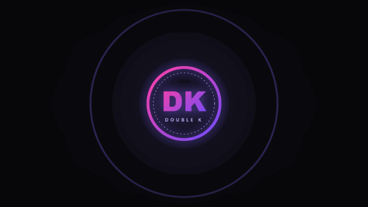
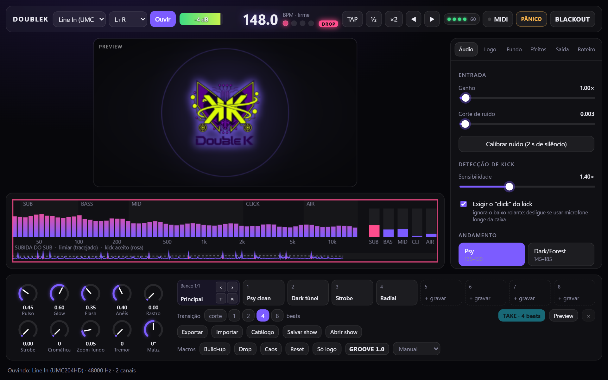
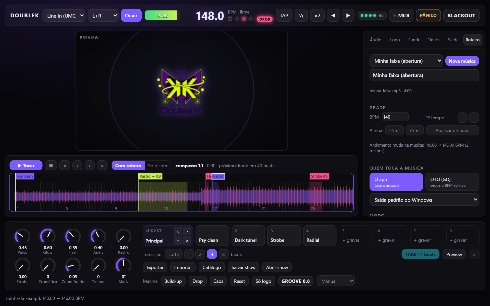
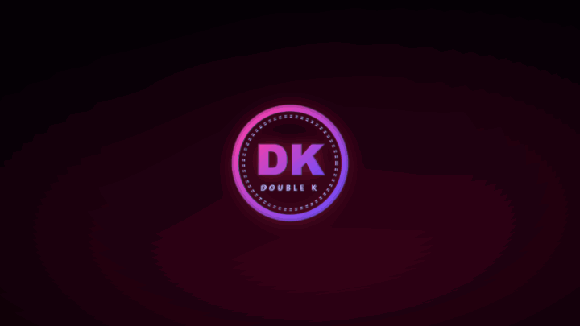
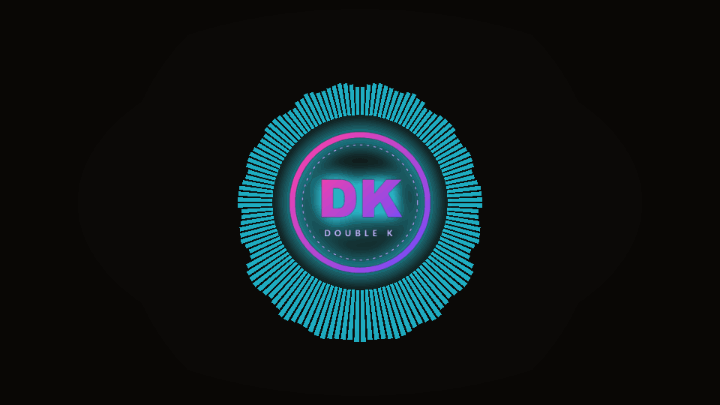
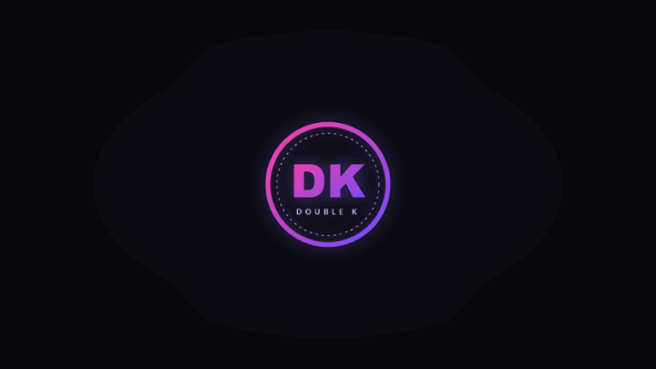

# DoubleK Visuals

App para Windows que escuta o set ao vivo e faz a logo do DJ pulsar no telão, no beat.
Feito para psytrance, dark/forest e hi-tech (135–220 BPM).



**📘 [Tutorial completo, do cabo ao show](docs/TUTORIAL.md)**



## Instalar

Baixe `DoubleK Visuals_<versão>_x64_pt-BR.msi` na página de
[**Releases**](https://github.com/vzf22zss/doublek_sounds/releases/latest) e dê dois cliques. Se
o Windows avisar "O Windows protegeu o computador", clique em **Mais informações → Executar
assim mesmo**. Quando sair versão nova, o app avisa no rodapé e atualiza com um clique (nunca
sozinho, nunca com o telão aberto). Passo a passo: [Tutorial §2](docs/TUTORIAL.md#2-instalar).

## O que ele faz

### No show

- **Kick e BPM confiáveis no psy.** Ele separa o kick do baixo rolante exigindo o grave e o
  "click" ao mesmo tempo. O BPM trava em poucos segundos e se segura nos breakdowns.
- **Pulso no tempo.** Com o BPM travado, o pulso sai do relógio do beat, e um **offset**
  adianta a imagem para compensar o atraso do projetor.
- **Duas janelas.** O controle fica no notebook; o telão abre em tela cheia no datashow.
- **Cenas** com crossfade que começa no próximo beat: 8 por banco, até 4 bancos.
  **Preview/TAKE** prepara a cena sem o público ver e manda no beat.
- **4 macros** (Build-up, Drop, Caos, Reset), **PÂNICO** (acalma tudo e para o roteiro)
  separado do **BLACKOUT**, e limite de **3 flashes/s** ligado por padrão.
- **Intelligent Show:** o app estima o momento da música (breakdown, build-up, groove, drop);
  em **Assistido** mexe nos efeitos sozinho, em **Automático** também troca a cena, seguindo um
  mapa que você ajusta. Qualquer comando seu tem prioridade. Abre sempre em **Manual**.
- **Roteiro por música.** Você sobe a faixa, marca os pontos na timeline (cena, strobe, vídeo,
  knob) e roda com o app tocando o arquivo ou com o DJ nos decks (GO). Com a tecla **R** dá
  para comparar na hora com "só o som".
- **Testar tudo antes do show:** um botão confere em 10 s áudio, BPM, telão, MIDI, disco e
  segurança, e diz o que fazer em cada item vermelho.
- **Saúde do show:** 4 bolinhas (áudio · BPM · MIDI · telão); clique nelas para salvar o
  Diagnóstico ou **Relatar problema** (abre o relato com um resumo pronto; nada sai do
  computador sem você clicar). O telão se recupera sozinho se a placa de vídeo cair.

### Visual

- **Efeitos:** glow, anéis, flash, rastro/túnel, espectro (barras e radial), strobe no tempo,
  aberração, tremor, vinheta, linhas de TV e granulado. Cada um pode reagir ao kick, ao sub, ao
  baixo, aos médios, aos hats, ao beat, ao compasso ou a um LFO, e pode entrar **só no drop**.
- **Psy Engine:** caleidoscópio, túnel fractal, mandala, partículas, padrão orgânico e glitch,
  cada um com seu knob, fonte de modulação e "só no drop". Se o telão engasgar, o app baixa a
  qualidade sozinho. 23 presets de fábrica no **Catálogo**.
- **Camadas:** os módulos do Psy Engine, o rastro, o glitch, o vídeo do fundo e até 2 efeitos
  da comunidade têm ordem, opacidade, modo de mistura e solo; entram nas cenas e aprendem no MIDI.
- **Vídeo em loop no fundo**, reagindo ao beat como a foto, com início/fim do loop, reinício no
  compasso e volta automática para a foto se o vídeo travar.
- **Efeitos da comunidade:** editor de efeitos com pré-visualização e pacotes `.doublekfx`, com
  modo seguro para abrir o telão sem eles ([docs/SHADERS.md](docs/SHADERS.md)).

### Conectar e gravar

- **MIDI learn:** clique num controle da tela e mexa no knob do controlador. Todo comando de
  show tem atalho de teclado e aprende no MIDI.
- **MIDI Clock:** segue o andamento e o 1º tempo (Start e Song Position) do mixer, CDJ ou
  software; se o clock parar, volta a ouvir o som em 2 s ([docs/MIDI-CLOCK.md](docs/MIDI-CLOCK.md)).
- **Celular na mesma rede:** pads, bancos, macros, BLACKOUT, TAP, sliders e PÂNICO pelo
  navegador do celular, sem instalar nada; desligado por padrão e pareado por código
  ([docs/REMOTO.md](docs/REMOTO.md)).
- **OSC:** controle tudo pelo TouchOSC, Pd ou Max ([docs/OSC.md](docs/OSC.md)).
- **Spout:** manda o telão direto para o Resolume, TouchDesigner ou OBS, sem placa de captura.
- **Gravar o telão** (sem som): 16:9 no tamanho do telão, 1080p ou 720p, ou vertical 9:16 em
  1080×1920 para Reels/TikTok, com zoom e posição ajustáveis gravando.
- **Show Pack (`.doublekshow`):** salva e abre o show inteiro (cenas, bancos, roteiros, logo,
  foto, vídeos, MIDI) com backup automático antes de substituir. Presets avulsos em
  `.doublekpreset` para trocar com outros DJs ([docs/PRESETS.md](docs/PRESETS.md)).
- **Afinar com a sua música:** grave a análise de um set (só números, nunca o som) e o app diz
  quantos drops pegou e o que ajustar.

## Requisitos

- Windows 10/11 64 bits. O WebView2 já vem no Windows 11 e nos Windows 10 atualizados; se
  faltar, o instalador baixa (precisa de internet nessa hora).
- Qualquer placa de vídeo com WebGL2; para os 6 módulos do Psy Engine em qualidade alta a
  1080p, uma placa dedicada é recomendada — o app mede o custo e baixa a qualidade sozinho.
- Entrada de áudio: line-in da mesa por interface USB (recomendado) ou microfone.
- Controlador MIDI opcional (qualquer um com knobs/pads).
- Funciona offline. Fora a consulta de versão nova ao abrir, só acessa a rede o que você ligar:
  Relatar problema (abre o navegador), OSC e celular (rede local).



| Dark túnel | Radial | Strobe |
|---|---|---|
|  |  |  |

## Atalhos ao vivo

| Tecla | Ação |
|---|---|
| Espaço | tap tempo |
| ← → | ajuste fino da fase (5 ms) |
| 1–8 | chamar cena (com o Preview ligado, prepara; **T** manda) |
| Shift + 1–8 | preparar a cena no Preview |
| T / Shift+T | TAKE (manda o Preview no próximo beat) / limpar o Preview |
| [ ] · Alt + 1–4 | banco anterior/próximo · abrir o banco 1–4 |
| U D C X | macros Build-up, Drop, Caos, Reset |
| P | PÂNICO (para o roteiro e acalma tudo) |
| B | blackout |
| L | só a logo, sem efeitos |
| F | abrir/fechar o telão |
| G / Shift+G | roteiro: tocar ou GO / parar |
| R | roteiro: comparar com roteiro × só o som |

Shift+clique numa cena grava o visual atual nela. Knobs: arrastar (Shift = fino), roda do
mouse, duplo clique = padrão. Lista completa: [Tutorial §18](docs/TUTORIAL.md#18-atalhos-do-teclado).

## Para desenvolvedores

Tauri 2 + Rust (áudio e análise) + Svelte 5 / WebGL2 (telas). Roadmap e plano de evolução:
[docs/DOUBLEK_VISUALS_PLANO_AGENTICO_ROADMAP.md](docs/DOUBLEK_VISUALS_PLANO_AGENTICO_ROADMAP.md).

```
 cpal (WASAPI) ─► ring buffer ─► análise a cada 256 amostras (~5 ms)
                                 filtros por banda · onset · kick = sub + click
                                 relógio do beat (regressão sobre os kicks; MIDI Clock opcional)
                                        │ Channel ~94 Hz
                       ┌────────────────┴────────────────┐
              janela de controle (Svelte)        janela do telão (WebGL2)
              preview com o mesmo renderer       cena → camadas → pós
```

Todo comando (teclado, MIDI, botões, roteiro, automação, OSC, celular) passa por um dispatcher
único com validação, prioridade e histórico (`src/lib/commands.ts`).

| Pasta | Conteúdo |
|---|---|
| `src-tauri/src/analysis.rs` · `beat.rs` | Filtros, onset, kick, indicadores de energia; relógio do beat (BPM, fase, tap, nudge) |
| `src-tauri/src/audio.rs` · `midi.rs` | Captura com reconexão; reprodução da faixa do roteiro; MIDI (learn, Clock, SPP) |
| `src-tauri/src/track.rs` | Decodifica (symphonia), reamostra (rubato), grade de BPM e forma de onda |
| `src-tauri/src/osc.rs` · `remote.rs` · `spout.rs` | Servidor OSC, servidor do celular (pareamento), saída Spout |
| `src-tauri/src/rec.rs` · `diary.rs` | Gravação do telão em disco; diário de análise e resumo |
| `src/render/` | Renderer WebGL2 (telão e preview), módulos do Psy Engine, camadas e compositor |
| `src/output/` | Janela do telão: renderer, vídeo, gravação (MediaRecorder e WebCodecs) |
| `src/control/` | Interface de controle, cenas, MIDI learn, timeline, pré-show, mapa de automação |
| `src/lib/` | Ajustes e armazenamento versionado, `commands.ts` (dispatcher e atalhos), `show-engine/`, `showpack/`, `shaders/`, `recorder.ts` + `fmp4.ts`, roteiro |

### Rodar

Requer Node 22.18+ (o CI usa 22), Rust (rustup) e Visual Studio Build Tools com C++.

```
npm install
npm run tauri dev
```

### Instalador

```
npm run tauri build
```

Gera `src-tauri/target/release/bundle/msi/DoubleK Visuals_<versão>_x64_pt-BR.msi`.

### Publicar uma versão (atualização automática)

A branch **`prod`** é o que está publicado. Cada push nela roda o
[workflow de release](.github/workflows/release.yml): ele compila, assina e publica a Release
`v<versão>`, com o `.msi`, o `latest.json`, o `SHA256SUMS.txt` e as notas tiradas do
`CHANGELOG.md`. Ao abrir, o app instalado consulta esse arquivo e mostra **"Nova versão … —
atualizar"** no rodapé. Detalhes em [docs/RELEASE.md](docs/RELEASE.md).

```
# na main, com tudo commitado e a seção da versão no CHANGELOG.md
npm version patch            # só altera package.json
git commit -am "v0.3.x"
git push

git checkout prod
git merge --ff-only main
git push                     # publica
git checkout main
```

Se a versão já tiver sido publicada, ou o CHANGELOG não tiver a seção dela, o workflow falha
antes de publicar.

**Chave de assinatura:** o app só aceita atualização assinada com a chave privada (arquivo
`doublek.key`, fora do repositório). Ela fica no GitHub como secret `TAURI_SIGNING_PRIVATE_KEY`,
e `TAURI_SIGNING_PRIVATE_KEY_PASSWORD` fica vazio. **Guarde uma cópia da chave em lugar
seguro.** Se ela for perdida, os apps já instalados não aceitam mais nenhuma atualização e
precisam ser reinstalados à mão.

### Contribuir, segurança e histórico

[CONTRIBUTING.md](CONTRIBUTING.md) (fluxo por tarefa do roadmap e definição de pronto) ·
[SECURITY.md](SECURITY.md) (o que o app guarda e como relatar) · [CHANGELOG.md](CHANGELOG.md).
Licença do repositório ainda em definição (DEC-01 no roadmap).

### Checagens

```
npm run typecheck
npm run check
cd src-tauri && cargo test --release
```

### Afinar a detecção com faixas reais

```
cd src-tauri
cargo run --release --example analyze -- faixa.mp3 135 150
```

Mostra o BPM e os kicks encontrados num arquivo (mp3, wav, flac, m4a, aac ou ogg) e a grade que
o roteiro usaria. Compare com o BPM do Rekordbox.

## Plano B

O app antigo em HTML está em `legacy/logo-pulsante-2.0.html` (abre direto no Chrome/Edge).
Ele também fica guardado na tag git `html-original`.
