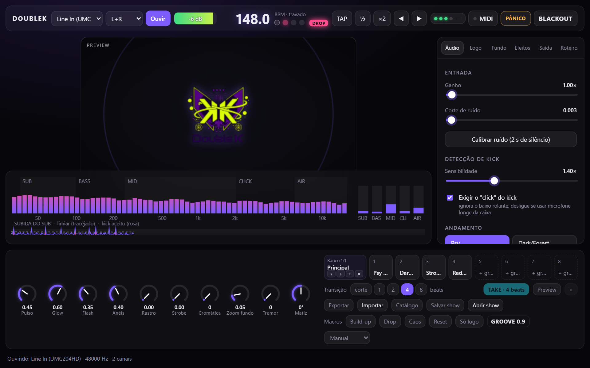
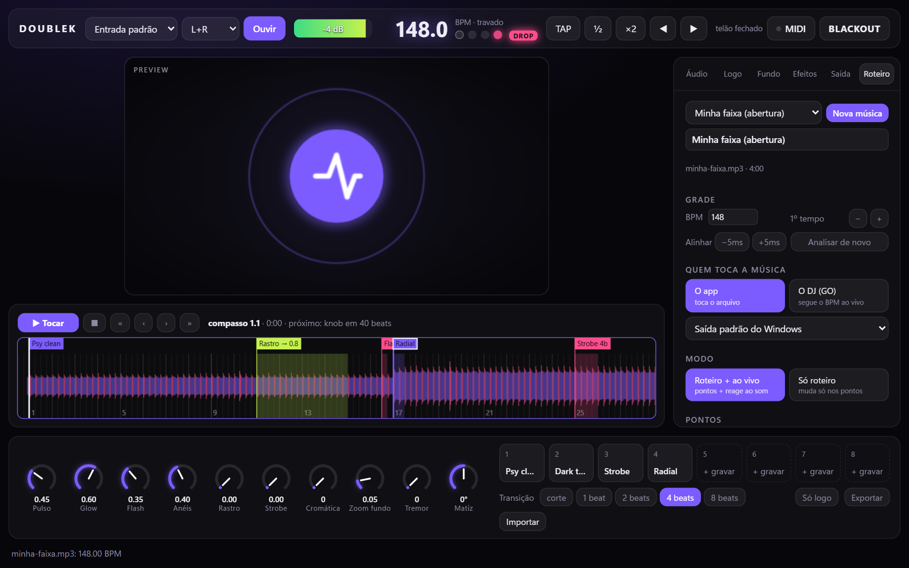

# DoubleK Visuals

App para Windows que escuta o set ao vivo e faz a logo do DJ pulsar no telão, no beat.
Feito para psytrance, dark/forest e hi-tech (135–220 BPM).


**📘 [Tutorial completo, do cabo ao show](docs/TUTORIAL.md)** · 🗺️ [Roadmap e plano de evolução](docs/DOUBLEK_VISUALS_PLANO_AGENTICO_ROADMAP.md)



## O que ele faz

- **Kick e BPM confiáveis no psy.** Ele separa o kick do baixo rolante exigindo o grave e o
  "click" ao mesmo tempo. O BPM trava em poucos segundos e se segura nos breakdowns.
- **Pulso previsto.** Com o BPM travado, o pulso sai do relógio do beat, e um **offset**
  adianta a imagem para compensar o atraso do projetor.
- **Duas janelas.** O controle fica no notebook; o telão abre em tela cheia no datashow.
- **Efeitos em WebGL:** glow, anéis, flash, rastro/túnel, espectro radial, strobe no tempo,
  aberração cromática e tremor. Cada um pode reagir ao kick, ao sub, ao baixo, aos médios,
  aos hats, ao beat, ao compasso ou a um LFO.
- **Efeitos só no drop.** O app percebe quando o grave some (breakdown) e quando volta; cada
  efeito pode entrar só no drop.
- **Vídeo em loop no fundo**, com a mesma reação ao beat da foto.
- **8 cenas** com crossfade que começa no próximo beat. Presets exportáveis em `.json`.
- **Roteiro por música.** Você sobe a faixa, marca os pontos na timeline (cena, strobe, vídeo,
  knob) e roda com o app tocando o arquivo ou com o DJ nos decks (GO). Funciona no modo
  "roteiro + ao vivo" ou "só roteiro"; com a tecla R dá para comparar na hora com "só o som".
- **Psy Engine:** caleidoscópio, túnel fractal, mandala, partículas, padrão orgânico e glitch
  como módulos do renderer, cada um com fonte de modulação, "só no drop", qualidade
  baixa/média/alta e orçamento automático de frametime (rebaixa a qualidade sozinho se o
  telão engasgar). 23 presets de fábrica no **Catálogo**.
- **Operação de show:** até 4 **bancos** de 8 cenas, **Preview/TAKE** (prepare a cena sem o
  público ver e mande no beat), 4 **macros** (Build-up, Drop, Caos, Reset), **PÂNICO**
  separado do **BLACKOUT**, limite de **3 flashes/s** ligado por padrão.
- **Show Pack (`.doublekshow`):** salva e abre o show inteiro (cenas, bancos, roteiros, logo,
  foto, vídeos, MIDI) com backup automático antes de substituir.
- **Saúde e diagnóstico:** 4 bolinhas (áudio · BPM · MIDI · telão) e um JSON de diagnóstico
  sem áudio para relatar problemas; telão sobrevive a perda da placa de vídeo.
- **MIDI learn:** clique num controle da tela e mexa no knob do controlador. Todo comando
  (teclado, MIDI, botões, roteiro) passa por um dispatcher único com histórico.
- **Instalador `.msi`** em português, com atualização automática pelas Releases (quando
  publicadas).

## Requisitos

- Windows 10/11 64 bits com WebView2 (já vem no Windows 11; no 10 o instalador do Edge o traz).
- Qualquer GPU com WebGL2; para os 6 módulos do Psy Engine em qualidade alta a 1080p, uma GPU
  dedicada é recomendada — o app mede o custo e rebaixa a qualidade sozinho se precisar.
- Entrada de áudio: line-in da mesa por interface USB (recomendado) ou microfone.
- Controlador MIDI opcional (qualquer um com knobs/pads).
- Funciona offline; o único acesso externo é a consulta de versão nova ao abrir.



| Dark túnel | Radial | Strobe |
|---|---|---|
|  |  |  |

## Atalhos ao vivo

| Tecla | Ação |
|---|---|
| Espaço | tap tempo |
| ← → | ajuste fino da fase (5 ms) |
| 1–8 | chamar cena (o crossfade começa no próximo beat) |
| Shift+clique na cena | gravar o visual atual nela |
| B | blackout |
| L | só a logo, sem efeitos |
| F | abrir/fechar o telão |
| G / Shift+G | roteiro: tocar ou GO / parar |
| , . / ; ' | roteiro: ±1 beat / ±1 compasso |
| R | roteiro: comparar com roteiro × só o som |

Knobs: arrastar (Shift = fino), roda do mouse, duplo clique = padrão.

## Para desenvolvedores

Tauri 2 + Rust (áudio e análise) + Svelte 5 / WebGL2 (telas).

```
 cpal (WASAPI) ─► ring buffer ─► análise a cada 256 amostras (~5 ms)
                                 filtros por banda · onset · kick = sub + click
                                 relógio do beat (regressão sobre os kicks)
                                        │ Channel ~94 Hz
                       ┌────────────────┴────────────────┐
              janela de controle (Svelte)        janela do telão (WebGL2)
              preview com o mesmo renderer       cena → feedback → pós
```

| Pasta | Conteúdo |
|---|---|
| `src-tauri/src/analysis.rs` | Filtros, onset, detecção de kick (com testes sobre faixas sintéticas) |
| `src-tauri/src/beat.rs` | Relógio do beat: BPM, fase, tap, nudge, ½/×2 |
| `src-tauri/src/audio.rs` · `midi.rs` | Captura com reconexão; reprodução da faixa do roteiro; MIDI em todos os controladores |
| `src-tauri/src/track.rs` | Decodifica (symphonia), reamostra (rubato), grade de BPM da faixa inteira e forma de onda |
| `src/render/renderer.ts` | Renderer WebGL2 (usado pelo telão e pelo preview), vídeo de fundo, "só no drop" |
| `src/control/` | Interface de controle, knobs, cenas, MIDI learn, timeline e motor do roteiro |
| `src/lib/settings.ts` · `roteiro.ts` | Ajustes, cenas, crossfade, validação de presets; modelo e regras do roteiro |

### Rodar

Requer Node 20+, Rust (rustup) e Visual Studio Build Tools com C++.

```
npm install
npm run tauri dev
```

### Instalador

```
npm run tauri build
```

Gera `src-tauri/target/release/bundle/msi/DoubleK Visuals_<versão>_x64_pt-BR.msi`.

### Publicar uma versão (atualização automática)

A branch **`prod`** é o que está publicado. Cada push nela roda o
[workflow de release](.github/workflows/release.yml): ele compila, assina e publica a Release
`v<versão>`, com o `.msi` e o `latest.json`. Ao abrir, o app instalado consulta esse arquivo e
mostra **"Nova versão … — atualizar"** no rodapé. Ele nunca instala sozinho e não instala
com o telão aberto.

```
# na main, com tudo commitado
npm version patch            # 0.2.0 → 0.2.1 (ou minor); só altera package.json
git commit -am "v0.2.1"
git push

git checkout prod
git merge --ff-only main
git push                     # publica
git checkout main
```

Se a versão já tiver sido publicada, o workflow falha e pede para subir a versão.

**Chave de assinatura:** o app só aceita atualização assinada com a chave privada
(`C:\Users\Work\.tauri\doublek.key`, fora do repositório). Ela fica no GitHub como secret
`TAURI_SIGNING_PRIVATE_KEY`, e `TAURI_SIGNING_PRIVATE_KEY_PASSWORD` fica vazio.
**Guarde uma cópia da chave em lugar seguro.** Se ela for perdida, os apps já instalados
não aceitam mais nenhuma atualização e precisam ser reinstalados à mão.

### Contribuir, segurança e histórico

[CONTRIBUTING.md](CONTRIBUTING.md) (fluxo por tarefa do roadmap e definição de pronto) ·
[SECURITY.md](SECURITY.md) (o que o app guarda e como relatar) · [CHANGELOG.md](CHANGELOG.md).
Licença do repositório ainda em definição (DEC-01 no roadmap).

### Checagens

```
npm run typecheck
npm run check
cd src-tauri && cargo test --release
```

### Afinar a detecção com faixas reais

```
cd src-tauri
cargo run --release --example analyze -- faixa.mp3 135 150
```

Mostra o BPM e os kicks encontrados num arquivo (mp3, wav, flac, m4a ou ogg) e a grade que o roteiro usaria. Compare com o BPM do Rekordbox.

## Plano B

O app antigo em HTML está em `legacy/logo-pulsante-2.0.html` (abre direto no Chrome/Edge).
Ele também fica guardado na tag git `html-original`.
