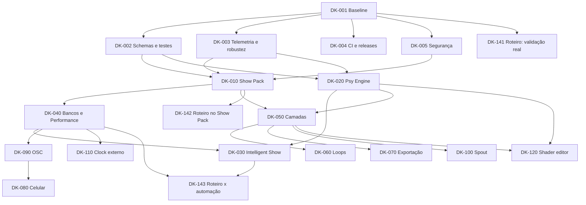

# DoubleK Visuals — Plano mestre de evolução e roadmap executável

> **Documento de execução para agentes de programação**  
> **Produto:** DoubleK Visuals (repositório `vzf22zss/doublek_sounds`)  
> **Repositório:** <https://github.com/vzf22zss/doublek_sounds>  
> **Baseline analisada:** `main` @ `09a7677`, versão **0.3.1**, em 30/10/2026 (ver [`docs/quality/BASELINE.md`](quality/BASELINE.md))  
> **Próxima versão alvo:** **0.4.0** ao fechar o M0; cada marco seguinte sobe o número do meio  
> **Estado do planejamento:** PROPOSTO e alinhado ao código da v0.3.1; nenhuma melhoria deste documento deve ser tratada como implementada sem validação em código e testes.  
> **Responsável pelo acompanhamento:** mantenedor do repositório  
> **Idioma de trabalho:** português (BR); nomes de código e protocolos podem permanecer em inglês.

---

## 0. CONTRATO DE EXECUÇÃO — LEIA ANTES DE ALTERAR O CÓDIGO

Este arquivo é simultaneamente **especificação de produto**, **backlog técnico**, **roteiro de implementação** e **painel de andamento**. O agente deve conseguir trabalhar a partir daqui, sem depender da conversa em que foi criado.

### 0.1. Missão do agente

Evoluir o DoubleK Visuals de um visualizador de logo sincronizado à música para uma plataforma de performance audiovisual ao vivo, voltada inicialmente para psytrance, dark/forest e hi-tech, **sem sacrificar estabilidade, baixa latência, simplicidade de operação ou funcionamento offline**.

### 0.2. Regras obrigatórias

1. **Inspecionar o repositório antes de codificar.** Os caminhos e comportamentos descritos aqui refletem a baseline analisada; o código pode ter evoluído. Conferir `README.md`, `docs/TUTORIAL.md`, `package.json`, `src-tauri/`, `src/` e configuração do Tauri.
2. **Trabalhar uma tarefa de cada vez**, na ordem de prioridade/dependência. Não tentar implementar o roadmap inteiro em um único PR.
3. **Criar branch por tarefa ou incremento** (por exemplo, `feat/dk-010-show-pack`) e produzir commits pequenos. Não fazer push, merge, publicação ou release sem autorização do mantenedor.
4. **Preservar recursos existentes:** análise de kick/BPM, modo manual/TAP, 8 cenas legadas, crossfade quantizado, MIDI Learn, logo/foto, blackout, janela de controle e telão.
5. **Não remover, sobrescrever nem migrar de forma destrutiva** configurações, presets e assets salvos. Implementar migrações e fallback.
6. **Não inventar suporte ou compatibilidade.** Se uma API nativa, codec, driver, protocolo ou SDK não estiver comprovado, abrir um *spike* técnico e registrar resultados antes da implementação.
7. **Executar os testes aplicáveis**, anexar evidências e atualizar as checkboxes e o log deste documento. Se um teste de hardware não puder ser executado, marcar como **NÃO VERIFICADO**, nunca como aprovado.
8. **Priorizar segurança operacional em shows:** falhas em efeitos, assets, vídeo ou rede não podem interromper o motor de áudio nem bloquear o blackout.
9. **Não adicionar dependências, SDKs ou assets sem revisar licença, custo, tamanho e superfície de ataque.** Não usar música, logos ou vídeos de terceiros sem autorização.
10. **Não escolher sozinho a licença do repositório, um modelo comercial ou uma arquitetura nativa irreversível.** Registrar decisão pendente para o mantenedor.
11. **Atualizar a documentação e a observabilidade** junto com o código (configurações, tutoriais, migração, limitação e diagnóstico).
12. **A saída de cada ciclo** deve incluir: ID da tarefa, resumo, arquivos alterados, testes executados/resultados, evidências, riscos, pendências, impacto no roadmap e próximo passo sugerido.

### 0.3. Loop operacional obrigatório

```text
1. Ler o roadmap e identificar a primeira tarefa READY ou IN_PROGRESS.
2. Revalidar a situação no código e verificar se já foi implementada.
3. Se já existe, testar e registrar evidências em vez de duplicar.
4. Se não existe, criar branch e um plano de mudança pequeno.
5. Implementar o menor incremento verificável.
6. Executar checagens de build, tipos, unidade e integração aplicáveis.
7. Validar manualmente os fluxos de show que forem afetados.
8. Atualizar o status e o registro de execução neste arquivo.
9. Produzir um resumo e encerrar o ciclo; solicitar decisão somente se houver bloqueio real.
```

**Condição de parada:** parar quando a tarefa atual estiver concluída e documentada, quando houver bloqueio que dependa do mantenedor ou quando atingir o orçamento de execução da sessão. Não saltar para tarefas desconexas apenas para aumentar o percentual.

### 0.4. Definição de pronto (DoD) — vale para toda tarefa

Uma tarefa só pode ficar **DONE** se satisfizer todos os critérios relevantes:

- [ ] Código compilando e alterações localizadas/legíveis.
- [ ] `npm run typecheck` e `npm run check` executados, sem regressão causada pela tarefa.
- [ ] Testes Rust relevantes executados (`cargo test`, preferencialmente também `cargo test --release`).
- [ ] Testes automatizados novos cobrindo regras novas, limites e erros esperados.
- [ ] Teste manual documentado quando for interação com áudio, controlador MIDI, saída externa ou GPU.
- [ ] Fluxo de abertura/fechamento de telão e **BLACKOUT** preservado.
- [ ] Impacto de CPU/GPU, memória e latência medido quando aplicável.
- [ ] Presets anteriores carregando ou migrados corretamente; falha recuperável se forem inválidos.
- [ ] README/tutorial e mensagens de interface atualizados quando aplicável.
- [ ] Linha correspondente do roadmap, data, commit/PR e evidência atualizados.

> **Nota:** os testes listados são referências da baseline. O agente deve ajustar os comandos ao que existir no repositório no momento da execução.

---

## 1. ESTADO INICIAL E ARQUITETURA EXISTENTE

### 1.1. Funcionalidades já identificadas — não implementar de novo

- Aplicativo Windows com **Tauri 2, Rust, Svelte 5, TypeScript e WebGL2**.
- Captura por `cpal`/WASAPI; thread de análise com ring buffer; separação em bandas.
- Detecção de kick que considera grave e componente de ataque; estimativa de BPM/fase, modo de retenção, TAP, metade/dobro e ajuste fino.
- Visual de logo e imagem de fundo; cores derivadas da foto/logo.
- Glow, anéis, flash, espectro em barras/radial, rastro/túnel, strobe, aberração cromática, tremor, vinheta, scanlines e granulado.
- Fontes de modulação: auto, kick, sub, bass, mid, hats, beat, compasso e LFO.
- Janela de controle, preview e janela fullscreen para monitor externo.
- **8 cenas** com crossfade a partir do próximo beat; importação/exportação de presets JSON.
- MIDI Learn, detecção/reconexão de controladores e atalhos ao vivo.
- Instalador MSI em português, README, tutorial com imagens e testes sintéticos de BPM.

**Acrescentado entre a v0.1.0 e a v0.3.1 (também não reimplementar):**

- **Presença de grave / drop:** `Frame.low` em `analysis.rs` compara o grave (sub+bass, ~250 ms) com o maior grave do último minuto, com histerese (`Params.drop_thr`); teste `drop_breakdown`. Na UI, chip **drop** por efeito (`VISUAL.drop`, `dropFade` em beats), pílula DROP no topo e limiar na aba Áudio. O renderer multiplica cada efeito marcado por um envelope `dropEnv`.
- **Vídeo em loop no fundo:** biblioteca em IndexedDB (`video:<id>`) + lista em `localStorage` (`doublek.videos`); `<video>` reaproveitado por id (`getVideo`), textura só atualizada com quadro novo (`requestVideoFrameCallback`), desfoque por viés de mipmap, velocidade (`videoSpeed`), vídeo dentro das cenas, pré-carga no telão (evento `preload`).
- **Cores automáticas** da logo, da foto e do vídeo (`pickColors` em `assets.ts`, com testes); tinta do texto sobre a cor de destaque (`--accent-ink`).
- **Motor de faixa:** `src-tauri/src/track.rs` decodifica mp3/wav/flac/m4a/ogg (symphonia), reamostra para a saída (rubato), acha a grade de BPM da faixa inteira e a forma de onda (testes `grade_da_faixa_inteira`, `wav_ida_e_volta_com_reamostragem`). `audio::play` toca pela saída e alimenta o mesmo `Analyzer` (`Beat::set_grid`, `Frame.pos`). Comandos `add_track`, `load_track`, `play_track`, `remove_track`, `list_outputs`.
- **Roteiro por música:** pontos em **beats** (cena, efeito com duração, vídeo, rampa de knob) numa timeline com a forma de onda; quem toca pode ser o **app** (cursor = posição do arquivo) ou o **DJ** (GO + relógio ao vivo, correção ±1 beat/compasso); modos *roteiro + ao vivo*, *só roteiro* (`VISUAL.react = false`) e *só o som*, com A/B pela tecla R; exportar/importar JSON; músicas copiadas para `app_data/tracks/`. Lógica pura testada em `src/lib/roteiro.ts`.
- **Atualização automática** (`tauri-plugin-updater`, aviso no rodapé, nunca com o telão aberto) e **release por push na branch `prod`** (`.github/workflows/release.yml`, assinatura do updater); a versão vem do `package.json` (`npm version` não cria tag, ver `.npmrc`).
- Exemplo `cargo run --release --example analyze` aceitando mp3/flac/m4a/ogg e mostrando a grade da faixa.

### 1.2. Mapa do código a revalidar

| Área | Arquivos/caminhos atuais | Uso previsto |
|---|---|---|
| Captura e eventos de áudio | `src-tauri/src/audio.rs`, `analysis.rs`, `beat.rs` | Eventos de energia, sincronização e robustez |
| Faixa do roteiro | `src-tauri/src/track.rs`, `audio::play` | Decodificação, grade da faixa, reprodução + análise |
| Aplicação nativa | `src-tauri/src/main.rs`, `midi.rs`, `tauri.conf.json`, `capabilities/default.json` | Comandos, monitores, MIDI, rede, exportação e integração |
| Tipos de áudio | `src/lib/types.ts` | Contrato Rust ↔ frontend |
| Estados, cenas, presets | `src/lib/settings.ts` | Migração, Show Packs, bancos, macros |
| Roteiro | `src/lib/roteiro.ts` (regras puras), `src/control/roteiro.svelte.ts` (motor), `Timeline.svelte`, `RoteiroPanel.svelte` | Show Pack, automação, dispatcher |
| Arquivos visuais | `src/lib/assets.ts` | Importação, bibliotecas (logo, foto, vídeos) e manifesto de mídia |
| Performance | `src/control/Performance.svelte`, `Knob.svelte`, `Slider.svelte` | Bancos, cena program/preview, macros, export/import |
| Interface | `src/control/App.svelte` (mapa `ACTIONS`, teclado), `src/control/midi.svelte.ts` | Painéis, status, segurança, dispatcher e controle remoto |
| Renderização | `src/render/renderer.ts` | Shaders, camadas, efeitos, vídeo, frame output |
| Telão | `src/output/main.ts` | Render da saída e telemetria de FPS |
| Testes TS | `src/lib/settings.check.ts` (`npm run check`, node + assert) | Base dos testes de DK-002 |
| Entrega | `.github/workflows/release.yml`, `.npmrc`, `tauri.conf.json` (`plugins.updater`) | CI, releases e atualização |
| Documentação | `README.md`, `docs/TUTORIAL.md`, `docs/quality/`, `docs/adr/` | Manual, baseline e decisões |

### 1.3. Lacunas verificadas ou que precisam de validação

1. Em `src/lib/assets.ts`, logo, foto e **vídeos** ficam no **IndexedDB**; roteiros e lista de vídeos no `localStorage`; músicas em `app_data/tracks/`. O exportador JSON de `Performance.svelte` inclui parâmetros e cenas, e o do roteiro só os pontos: **nenhum embute as mídias** (logo, foto, vídeos, músicas) nem o mapeamento MIDI. Restaurar um show em outro computador hoje exige refazer à mão.
2. A modelagem existente de cenas considera comprimento **fixo de 8**. Aumentar a quantidade requer migração, persistência e mudanças na interface.
3. O renderer examinado usa um pipeline **cena → feedback → pós-processamento**, sem compositor geral com múltiplas camadas independentes (o vídeo de fundo é uma textura a mais no passe de cena).
4. Não foram identificadas implementações de edição livre de shaders, gravação de performance, OSC, Spout, Ableton Link, MIDI Clock externo e controle pelo celular. O vídeo de fundo **existe**, mas sem detecção de codec, início/fim, fallback para imagem nem pacote portátil (ver DK-060).
5. O repositório público **não tem licença declarada, Release publicada nem descrição/topics**. Workflows: **release** (push em `prod`) e, desde DK-002, **ci** (push/PR). O secret `TAURI_SIGNING_PRIVATE_KEY` foi cadastrado em 2026-10-30; falta autorizar a 1ª Release (DEC-10).
6. ~~`csp: null`~~ **resolvido em DK-005** (CSP de produção sem inline + `devCsp`), confirmado no app real (produção e dev) em 2026-10-30.
7. Não há testes automatizados de UI nem de render; as capturas da documentação foram feitas com um mock do Tauri no Edge headless, fora do repositório.

### 1.4. Princípios técnicos

- **Áudio não bloqueante**: captura e detecção desacopladas da renderização, do armazenamento e da rede.
- **Desempenho previsível**: limitar trabalho de shader, taxa de comandos e alocações por frame.
- **Determinismo e testabilidade**: detecção/regras de cena reproduzíveis com arquivos/sinais de referência.
- **Operação offline**: nenhuma funcionalidade essencial depende da internet.
- **Degradação graciosa**: efeito falho desabilita o efeito; mídia ausente cai para fallback; MIDI ou rede perdidos não encerram a apresentação.
- **Configuração versionada**: presets e projetos carregáveis de versões anteriores.
- **Observabilidade discreta**: status visível para o operador e logs diagnósticos opcionais, sem interromper a performance.
- **Acessibilidade operacional**: controles grandes, atalhos, contraste e feedback de estado (evitar operação ambígua).

---

## 2. VISÃO, ESCOPO E RESULTADOS ESPERADOS

### 2.1. Posicionamento

**DoubleK Visuals é um motor de visualização e performance musical ao vivo para DJs**, capaz de transformar logo, imagens, geometria, partículas e vídeos em um show sincronizado automaticamente com o áudio, com operação manual e integrações profissionais.

### 2.2. Usuários-alvo

- DJ individual usando notebook + telão/projetor/LED.
- Dupla DJ/VJ, com DJ tocando e VJ operando as cenas.
- Produtor que precisa gerar vídeos promocionais e teasers.
- VJ avançado usando DoubleK como gerador e outro software como compositor.

### 2.3. Resultados de produto

1. Preparar e transportar um show completo entre computadores.
2. Produzir visuais psi mais elaborados sem curva de aprendizado de software complexo.
3. Automatizar reações a mudanças de energia da música, sem perder controle manual.
4. Confiar na execução em apresentações longas e em caso de falhas de periféricos.
5. Exportar vídeo ou integrar a outros programas de VJ quando o usuário desejar.

### 2.4. Fora do escopo da primeira release planejada

- Substituir integralmente Resolume/TouchDesigner/DAWs.
- Edição de vídeo não linear com timeline multitrilha completa.
- Streaming público de mídia, loja de assinaturas ou marketplace online.
- Dependência obrigatória de IA generativa ou APIs pagas.
- Suporte garantido a macOS/Linux sem testes e pipeline próprios.

---

## 3. METAS DE QUALIDADE E MEDIÇÃO

Os valores abaixo são **alvos de engenharia a validar**, não resultados já medidos. Registrar hardware, driver, áudio, cena e resolução em todo benchmark.

| Indicador | Alvo inicial | Como medir |
|---|---|---|
| Render em 1080p | 60 FPS sustentados em máquina de referência compatível | Teste 30 min com cena de stress; registrar FPS mediano e p95/p99 de frametime |
| Degradação | ≥30 FPS no perfil econômico em máquina mínima definida | Testes com renderScale/effects reduzidos |
| Robustez | Sessão longa de 2 horas sem crash ou crescimento descontrolado de memória | Stress test com alternância de cenas e conexão/desconexão de áudio/MIDI |
| Troca de cenas | Sem travar UI, áudio ou blackout | Repetir transições durante 15 min, inclusive com comandos rápidos |
| Persistência | Importação/exportação idempotente e recuperável | Testes com projeto íntegro, incompleto, corrompido e versão anterior |
| Sincronia visual | Offset calibrável, estável no equipamento de referência | Captura de áudio e saída com análise de diferença temporal |
| Erros | Diagnóstico útil e fallback seguro | Testes com GPU reset, dispositivo perdido, arquivo inválido, mídia ausente |

**Critério importante:** não bloquear uma release por meta de hardware ainda não definida; primeiro criar a matriz de máquinas de referência e produzir medições de baseline, depois fixar critérios vinculantes.

---

## 4. BACKLOG FUNCIONAL DETALHADO

### DK-010 — Show Packs portáteis (`.doublekshow`) — P0

**Problema:** presets JSON não incorporam logo, foto, vídeos, roteiros, músicas nem MIDI, que ficam armazenados separadamente, dificultando reprodução em outro PC.

**Dados que existem hoje e precisam entrar no pacote (inventário da v0.3.1):**

| Dado | Onde fica | Chave |
|---|---|---|
| Ajustes de áudio | `localStorage` | `doublek.settings` |
| Visual atual | `localStorage` | `doublek.visual` |
| 8 cenas | `localStorage` | `doublek.scenes` |
| Transição padrão | `localStorage` | `doublek.trans` |
| Mapeamento MIDI | `localStorage` | `doublek.midi` |
| Lista de vídeos (id + nome) | `localStorage` | `doublek.videos` |
| Roteiros (pontos, BPM, âncora, id da música) | `localStorage` | `doublek.roteiros` |
| Logo, foto, vídeos | IndexedDB `doublek` / store `kv` | `logo`, `bg`, `video:<id>` |
| Músicas dos roteiros | disco | `%APPDATA%/com.doublek.visuals/tracks/<id>.<ext>` |

A **música** do roteiro é **opt-in** no pacote (direitos autorais e tamanho; DEC-09); sem ela, o roteiro importado pede "Trocar música".

**Experiência desejada:** “Salvar show” produz um arquivo único; “Abrir show” restaura cenas, mídias, cores, ajustes e mapeamentos opcionais, sem destruir o show atual caso o arquivo esteja inválido.

**Requisitos:**

- Formato `.doublekshow` baseado em ZIP, com `manifest.json`, `visual.json`, `scenes.json`, `roteiros.json`, `assets/` e, se escolhido, `midi.json` (especificado em [`docs/SHOWPACK.md`](SHOWPACK.md), DK-011). `doublek.settings` (dispositivo de áudio, ganho) **não** entra: é da máquina, não do show.
- Manifesto versionado (`schemaVersion`, `appVersion`, `createdAt`, `name`, `assets[]` com caminho, tipo, tamanho e hash SHA-256).
- Importação transacional: validar primeiro, instalar assets e estado apenas quando tudo estiver consistente; rollback em falha.
- Validar caminhos internos (bloquear `../` e caminhos absolutos), tamanhos, quantidade de arquivos, MIME real, dimensões de imagem e consumo descomprimido.
- Detectar referências inexistentes, mídia corrompida e versão futura; erro descritivo sem danificar a sessão em uso.
- Incluir exportação opcional de configuração MIDI; não assumir que nomes de dispositivos são idênticos em outra máquina.
- Preservar importação de JSON legado; fornecer migração sem perda.
- Criar backup automático do show anterior quando importar um novo em modo substituição; oferecer “Importar como novo”.

**Arquivos sugeridos:** `src/lib/settings.ts`, `src/lib/assets.ts`, `src/control/Performance.svelte`, novos `src/lib/showpack/{manifest,import,export,migrate}.ts`; backend Rust apenas se necessário para arquivos grandes/segurança.

**Aceite verificável:** exportar no PC A, importar no PC B/perfil limpo e obter visuais idênticos; recusar ZIP malicioso/corrompido; restaurar preset legado; abrir sem acesso à internet.

**Testes:** roundtrip, migração, assets ausentes, hash errado, ZIP slip, zip bomb, cancelamento e importação de versão desconhecida.

**Dependências:** DK-001, DK-002, DK-003. **Tarefas executáveis:** DK-011, DK-012, DK-013, DK-014.

### DK-020 — Psy Engine: fractais, caleidoscópios e geometria musical — P0

**Experiência desejada:** biblioteca de efeitos voltada a psytrance, com presets prontos que respondam musicalmente de modo distinto a kick, rolling bass, hats e leads.

**Módulos visuais iniciais:**

1. **Kaleidoscope:** simetria N, rotação, espelhamento, zoom, transição entre formas.
2. **Fractal Tunnel:** distância/velocidade do túnel, densidade e paleta; movimento de câmera no beat.
3. **Mandala Geometry:** anéis geométricos e tesselação com expansão por compasso.
4. **Particle Field:** quantidade, direção, turbulência e impulso no kick.
5. **Organic/Forest:** padrões procedurais orgânicos e pulsos de cor, sem usar assets de terceiros.
6. **Hi-tech Glitch:** distorções curtas e precisas, limitadas por controles de fotossensibilidade.

**Arquitetura:** separar shader por módulo, definir interface estável (`init`, `resize`, `render`, `dispose`, `parameters`), expor uniformes musicais padronizados; cache de programas e framebuffer; desligar efeito defeituoso sem derrubar render base.

**Requisitos:** controles de intensidade e fonte de modulação; presets salvos; limite de iterações/partículas; qualidade baixa/média/alta; cores compatíveis com paleta extraída da logo.

**Aceite:** 6 módulos executáveis, pelo menos 2 presets por módulo, modulação individual, previews corretos, uso de GPU medido, fallback em shader não compilável.

**Testes:** compilação GLSL, snapshot visual quando viável, baseline FPS por preset, troca repetida, perda e restauração de contexto WebGL.

**Arquivos:** `src/render/renderer.ts` (refatorar em vez de ampliar monólito), novos `src/render/effects/`, `src/render/gl/`, `src/lib/settings.ts`, UI de Efeitos.

**Dependências:** DK-002, DK-003. **Tarefas:** DK-021, DK-022, DK-023, DK-024.

### DK-030 — Intelligent Show: reconhecimento de energia musical — P0/P1

**Objetivo:** detectar momentos da música e variar a cena de forma coerente, sem prometer compreensão semântica perfeita.

**Estados propostos:** `BREAKDOWN`, `BUILD_UP`, `GROOVE`, `DROP`; estado `UNKNOWN` quando a confiança for baixa. Esses estados são estimativas por sinal e podem falhar dependendo do estilo.

**Ponto de partida existente:** `Frame.low` (presença de grave com histerese, `analysis.rs`) já distingue breakdown de drop e alimenta os efeitos "só no drop". `BREAKDOWN`/`DROP` devem **reaproveitar** esse detector; `BUILD_UP` e `GROOVE` são novos.

**Precedência obrigatória:** quando um **roteiro** estiver rodando, os pontos dele mandam; a automação só preenche o que o roteiro não definiu, e nunca em modo *só roteiro*. Comando manual prevalece sobre os dois.

**Entradas:** RMS, energia por banda, fluxo espectral, histórico de kicks, estabilidade do beat, médias móveis e contraste de energia entre janelas de 4/8/16 compassos.

**Regras:**

- Suavização temporal e **histerese**; mínimo de permanência para evitar alternância nervosa.
- Evento de drop com confirmação temporal e limiar configurável; não fazer vários disparos por um único retorno do kick.
- Escolha de cena/efeito por *mapa de automação* por estado, com limites de intensidade.
- Ações quantizadas por beat/compasso quando o relógio estiver confiável; fallback suave sem BPM travado.
- **Modo Manual / Assistido / Automático**. Qualquer comando manual prevalece imediatamente, com tempo de bloqueio configurável para automações.
- Botão **PANIC/RESET** acessível, separado de BLACKOUT.
- Exibir estado estimado e confiança na interface; nunca afirmar que um drop foi antecipado se só foi detectado depois.

**Aceite:** com fixtures de áudio e transições rotuladas, o sistema reage de forma estável; modo manual não recebe automações; não há mudanças de cena em cascata; todas as regras podem ser desativadas durante o show.

**Testes:** áudio sintético e trechos autorizados/referenciáveis com kick presente, ausência de kick, ruído, breakdown e retorno; falsos positivos, variação de volume e BPM 135–220.

**Arquivos:** `src-tauri/src/analysis.rs`, `src/lib/types.ts`, novo `src/lib/show-engine/`, `src/control/App.svelte`, `Performance.svelte`.

**Dependências:** DK-003, DK-020; para trocar cenas automaticamente, DK-040. **Tarefas:** DK-031, DK-032, DK-033, DK-034.

### DK-040 — Performance Mode: bancos, macros e Program/Preview — P0/P1

**Objetivo:** facilitar a operação de shows longos e a preparação segura de cenas.

**Requisitos:**

- Evoluir 8 cenas fixas para **bancos nomeados**, com 8 pads cada e limite inicial de 32 cenas por show; migração automática do array legado de 8.
- Separar **Program** (ao vivo) de **Preview** (próxima cena, ainda não transmitida). Operação `TAKE` com transição quantizada ou imediata.
- Macros `BUILD UP`, `DROP`, `CHAOS`, `RESET`, com parâmetros editáveis e limites seguros.
- Histórico de ações e comando de desfazer quando não comprometer a saída.
- Preset de dispositivo MIDI por banco; indicadores claros da cena/program atual e da cena preparada.
- Atalhos consistentes e configuráveis; manter 1–8 para o banco atual.
- Ao perder áudio, MIDI ou monitor externo, preservar modo de operação; apresentar status e tentativa de recuperação.
- O dispatcher único **absorve o mapa `ACTIONS` de `App.svelte`** (tap, half, double, nudge±, blackout, logoOnly, go, stop, beat±, bar±, ab), que hoje é a camada comum de teclado e MIDI learn. Os alvos `a:<ação>`, `v:<ajuste>` e `c:<cena>` do MIDI learn viram comandos.
- Definir como **Program/Preview** convive com o roteiro: um ponto de cena do roteiro faz TAKE direto no Program (o roteiro é "pré-ensaiado") ou vai para o Preview? Decisão em DK-143.

**Aceite:** 32 cenas carregadas/renomeadas/exportadas, migração de 8 cenas, Program não muda até TAKE, crossfade sem travar, controladora MIDI pode acionar banco e macros.

**Testes:** migração, stress de alternância, comando TAKE durante transição, blackout durante preview/crossfade, salvamento/restauração de banco.

**Arquivos:** `src/lib/settings.ts`, `src/control/Performance.svelte`, `src/control/App.svelte`, novo `src/lib/performance/`.

**Dependências:** DK-010. **Tarefas:** DK-041, DK-042, DK-043, DK-044.

### DK-050 — Compositor de camadas visuais — P1

**Modelo mínimo de camada:** `id`, `type`, `enabled`, `order`, `opacity`, `blendMode`, `transform`, `source`, `effects`, `modulations`.

**Tipos iniciais:** logo, imagem, shader procedural, partículas e vídeo (quando DK-060 estiver pronto). Modo de composição: normal, additive, screen e multiply, conforme capacidade validada.

**Requisitos:**

- Ordenação por arrastar/soltar, ativação, opacidade e transformação por camada.
- Áudio pode modular parâmetros por camada, sem acoplamento entre objetos.
- Árvore de cena serializável no Show Pack, com migração de cenas antigas para uma camada equivalente.
- Pipeline controlado com framebuffers, gerenciamento de texturas, vida útil e orçamento de memória.
- Configuração de qualidade global e por camada; isolamento de falha.

**Aceite:** ao menos 4 camadas simultâneas, salvar/importar, reordenar sem piscar, sem vazamento de GPU em 100 ciclos criar/remover.

**Arquivos:** novos `src/render/compositor/`, adaptação do `renderer.ts`, `src/lib/settings.ts`, nova UI `src/control/Layers.svelte`.

**Dependências:** DK-010, DK-020. **Tarefas:** DK-051, DK-052, DK-053.

### DK-060 — Biblioteca de loops e fundos em vídeo — P1 — **PARCIAL na v0.3.1**

**Já existe:** biblioteca (adicionar, escolher, remover, arrastar para a janela), loop, velocidade, `cover/contain`, opacidade/desfoque/brilho/matiz, zoom e brilho no beat, "só no drop", vídeo nas cenas, pré-carga no telão, cores do fundo a partir do vídeo. Vídeo é sempre `muted`.

**Falta (escopo restante deste épico):**

- Detectar codec **comprovadamente suportado** pelo WebView2 na versão-alvo (`canPlayType`/spike) e falhar com instrução clara; hoje um arquivo incompatível só não aparece.
- Início/fim do loop e sincronização opcional com o beat.
- Indicador de progresso ao guardar e fallback de imagem quando o vídeo falha.
- Limitar resolução/quantidade simultânea (hoje o telão e o preview decodificam o mesmo vídeo duas vezes); medir CPU/GPU em 720p/1080p.
- Armazenar referências e arquivos no Show Pack com manifestos/hashes, respeitando limites de tamanho (DK-010).

**Aceite:** loop contínuo de mídia compatível sem congelar controles; recuperação de arquivo ausente; CPU/GPU e memória medidas em 720p/1080p.

**Arquivos:** `src/lib/assets.ts`, `src/render/`, UI Fundo, Show Pack.

**Dependências:** DK-010, DK-050. **Tarefas:** DK-061, DK-062, DK-063.

### DK-070 — Gravação e exportação de performances — P1

**Escopo inicial recomendado:** exportar **vídeo visual sem áudio**, com resolução e FPS configuráveis (por exemplo, 1080p/30 e 1080p/60 após benchmark), preservando o render ao vivo. Áudio é etapa posterior e opt-in.

**Descoberta obrigatória:** verificar suporte real de `MediaRecorder`, WebCodecs ou pipeline de encoding nativo no WebView2/Tauri e custo de cópia GPU→CPU. Não assumir que MP4/H.264 está disponível. Planejar fallback suportado.

**Requisitos:**

- Iniciar/parar com indicador explícito; informar resolução, taxa de quadros, duração e tamanho estimado.
- Finalização segura do arquivo; falha em gravação não afeta a saída do telão.
- Avisar quando FPS ou codificação não sustentarem o alvo; opção de exportação offline posteriormente.
- Exportação vertical 9:16 para vídeos promocionais como etapa separada, com enquadramento configurável da logo.
- Se áudio for incluído no futuro, exigir consentimento, caminho de captura autorizado e sincronização A/V medida.

**Aceite:** gravação curta sem corrupção, cancelamento seguro, sem queda substancial no tempo de frame em hardware definido; arquivo reproduzível em player comum conforme codec selecionado.

**Dependências:** DK-003, DK-020; preferencialmente DK-050. **Tarefas:** DK-071, DK-072, DK-073.

### DK-080 — Controle por celular/rede local — P2

**Experiência:** abrir página local para disparar cenas, macros, blackout, TAP e sliders básicos em celular/tablet.

**Requisitos de segurança:**

- Servidor **desligado por padrão** e vinculado a `localhost`; acesso LAN exige ação explícita.
- Pareamento por código/QR com segredo de sessão, autenticação nas conexões e revogação instantânea.
- Limite de taxa e whitelist de ações; não expor sistema de arquivos, execução de comandos ou estado sensível.
- Feedback de conexão e aviso quando alguém estiver controlando o show; comando de desconexão de todos os clientes.
- Se a rede cair, o aplicativo mantém o show e todos os comandos locais.

**Aceite:** operação por celular no Wi-Fi local; cliente não pareado não envia comandos; modo remoto desligado bloqueia acesso; desconexão sem travar output.

**Dependências:** DK-040, DK-003. **Tarefas:** DK-081, DK-082, DK-083.

### DK-090 — Integração OSC — P1/P2

**Objetivo:** integrar TouchOSC, controladores de rede e outros programas de performance.

**Requisitos:**

- Porta UDP/OSC configurável, padrão `127.0.0.1`; LAN exige habilitação explícita e aviso de que OSC/UDP, por si só, não autentica mensagens.
- Endereços versionados: `/doublek/scene/{n}`, `/doublek/bank/{n}`, `/doublek/blackout`, `/doublek/tap`, `/doublek/parameter/{id}` e `/doublek/status` (consultar convenções existentes antes de congelar protocolo).
- Validação de tipo/faixa, tratamento de erros e limitação de frequência.
- Saída opcional para BPM/estado/cena atual e documentação com exemplos de pacotes.
- Mapear OSC para a **mesma camada de comandos** utilizada por MIDI, teclado e remoto, evitando comportamentos divergentes.

**Aceite:** disparos a partir de cliente OSC de teste, comando inválido ignorado e logado sem crash, conflitos de porta tratados e integração MIDI preservada.

**Dependências:** DK-040. **Tarefas:** DK-091, DK-092.

### DK-100 — Saída profissional por Spout (Resolume e afins) — P2

**Atenção arquitetural:** WebGL2 renderizado em WebView2 e texturas compartilhadas nativas do Spout/DirectX não têm interoperabilidade zero-copy garantida. **Obrigatório fazer um spike** comparando captura/cópia, bridge GPU e eventual renderer alternativo. Não prometer “zero-copy” antes de demonstrar.

**Requisitos:**

- Enviar frames como fonte selecionável em receptor compatível.
- Suporte a resolução/FPS negociados, nomes de saída e reinicialização em caso de perda do receptor.
- Medir latência adicionada, VRAM, CPU e estabilidade; documentar requisitos de Windows/GPU/Spout.
- Verificar licença e redistribuição do SDK; fallback de saída em monitor continua disponível.

**Aceite:** receptor reconhece stream por 30 min sem perda prolongada; reinício do receptor não encerra DoubleK; desempenho e limitações publicados.

**Dependências:** DK-003, DK-050 e spike DK-101. **Tarefas:** DK-101, DK-102.

### DK-110 — Sincronização externa: MIDI Clock e Ableton Link — P2

**Requisitos:**

- Interface de origem do relógio: `AUDIO`, `TAP`, `MIDI_CLOCK`, `ABLETON_LINK`.
- Definir política de troca de fonte sem salto abrupto de fase; fallback para relógio local.
- Para MIDI Clock, tratar mensagens de start/stop/continue, jitter e relógio perdido.
- Para Ableton Link, confirmar SDK/biblioteca Rust disponível, arquitetura e licença antes de integrar.
- Expor BPM, fase, confiança/estado e ajustes por fonte; não mascarar diferença entre BPM detectado e imposto externamente.

**Aceite:** alternância de fontes sob teste sem congelamento ou rajadas de eventos; perda de relógio mantém render; documentação de compatibilidade.

**Dependências:** DK-003, DK-040. **Tarefas:** DK-111, DK-112, DK-113.

### DK-120 — Editor e API de shaders da comunidade — P3

**Objetivo:** transformar o Psy Engine em plataforma extensível **após estabilizar o pipeline de renderização**.

**Requisitos:**

- Formato versionado de efeito (`manifest.json`, shader GLSL, metadados, parâmetros, faixas e fontes de modulação).
- Editor com pré-visualização e erros de compilação; botão *reverter para último shader válido*.
- Limitar frequência de compilação e recursos; avisar que GLSL de terceiros pode travar drivers/GPU — não pressupor sandbox completa.
- Modo seguro para iniciar sem extensões; efeitos externos desabilitados após falhas repetidas.
- Distribuição inicial por importação de pacote local; **marketplace/loja não fazem parte desta etapa**.

**Aceite:** importar efeito de exemplo, compilar, parametrizar, persistir, rejeitar manifesto inválido e recuperar após falha.

**Dependências:** DK-020, DK-050, DK-010. **Tarefas:** DK-121, DK-122, DK-123.

### DK-130 — Biblioteca de presets, temas e compartilhamento — P1/P2

**Requisitos:**

- Presets de fábrica por estilo (`Psy Clean`, `Dark Tunnel`, `Forest`, `Hi-Tech`, `Ambient`, `Breakdown`, `Drop` etc.).
- Miniaturas/preview, pesquisa por tags e filtros; duplicar em vez de sobrescrever preset de fábrica.
- Exportar e importar pacotes com nome, versão, autor, licença e dependências de assets.
- Presets comunitários: **primeiro via arquivos e documentação**, hospedagem remota somente em fase posterior.
- Revisar direitos autorais de logos, fotos, loops e pacotes antes de publicar.

**Aceite:** instalação offline de pacote compartilhado, preview consistente e nenhum asset invisível por falta de referência.

**Dependências:** DK-010, DK-020. **Tarefas:** DK-131, DK-132.

### DK-140 — Roteiro: validação e endurecimento — P0/P1

**Contexto:** o roteiro (v0.3.0/0.3.1) foi testado só com um mock do Tauri e áudio simulado. Nunca rodou com música real, saída de som real nem GO com DJ. É recurso em produção sem validação de campo.

**Tarefas:**

- **DK-141 — Validação com áudio real (P0, M0).** Plano passo a passo para o mantenedor: [`docs/quality/DK-141-plano-de-teste.md`](quality/DK-141-plano-de-teste.md). Subir 3 mp3 de psy/dark/hi-tech; conferir BPM e 1º beat contra o Rekordbox; tocar pelo app e medir se os pontos caem no beat (gravar tela + áudio); testar troca de saída de áudio, mensagem "a saída está em … Hz", fim da faixa, seek durante a música e A/B (tecla R); testar GO com uma faixa tocando por outra fonte. Registrar em `docs/quality/` o que passou e o que falhou. Sem hardware → **NÃO VERIFICADO**, não "aprovado".
- **DK-142 — Roteiros e músicas no Show Pack (P1, M1).** Roteiros (`doublek.roteiros`), vídeos referenciados e, opt-in, as músicas de `app_data/tracks/` entram no `.doublekshow` com hash; importar re-vincula ids. Depende de DK-010.
- **DK-143 — Convivência com automação e Program/Preview (P1, M4).** Regra: ponto de roteiro > automação (DK-030); definir se ponto de cena faz TAKE direto ou vai para o Preview (DK-040); modo *só roteiro* desliga automação; override manual com cooldown vale para os dois. Depende de DK-030 e DK-040.

**Melhorias conhecidas (backlog, sem tarefa ainda):** detectar o 1º tempo do compasso (hoje é manual); faixas com tempo variável (grade única); rótulos de pontos sobrepostos na timeline; o `Frame.pos` extrapolado entre frames supõe velocidade 1×.

**Aceite do épico:** DK-141 documentado com evidência real; roteiro portátil; nenhuma automação dispara por cima de um ponto marcado.

---

## 5. BACKLOG TRANSVERSAL — CONFIABILIDADE, ENTREGA E CRESCIMENTO

### DK-001 — Inventário de baseline e decisões arquiteturais — P0

- Registrar versão/commit corrente, árvore do projeto, fluxo de estado, fluxo de áudio e de render, licenças das dependências.
- Executar scripts existentes; criar inventário de falhas e máquinas de teste.
- Criar decisões arquiteturais curtas (`docs/adr/`) para importação de arquivos, renderer e protocolo de comando.
- Salvar primeiro relatório de baseline em `docs/quality/BASELINE.md`.

**Aceite:** baseline reproduzível e diferenças entre documento/código identificadas.

### DK-002 — Contratos, migrações e testes — P0

- Criar schema versionado de estado/projeto e testes automatizados para migrações.
- Garantir que carregamento de configurações antigas não cause perda de dados.
- Introduzir testes automatizados de regras JS/TS, além dos testes Rust existentes.
- Criar fixtures de áudio sintéticas e base para fixtures reais autorizadas (não versionar arquivos protegidos).

**Aceite:** migração validada, roundtrips básicos, testes no CI.

**Feito (2026-10-30):** todas as 7 chaves `doublek.*` passam por `src/lib/store.ts` (`load`/`save` com `SCHEMA` por chave e `MIGRATIONS` numeradas; dado da v0.3.1 = v0). Validadores: `validVisual`, `validScenes`, `validRoteiros` (mantém ids), `validMidiMap`, `validVideos`, `shaped` (ajustes de áudio). Inválido ou de versão futura → padrão, bruto guardado em `<chave>.bak`. Testes em `store.check.ts`; CI em `ci.yml`. Fixtures de áudio **reais** continuam pendentes (DK-008).

### DK-003 — Telemetria local e hardening do show — P0

- Coletar frametime (mediana/p95/p99), FPS, event loop lag, carga estimada, erros de shader, memória aproximada quando disponível.
- Implementar estado de saúde (áudio OK/perdido, BPM lock, MIDI, output, GPU).
- Fail-safe em dispositivos perdidos, recuperação de contexto WebGL e logs exportáveis **sem áudio gravado por padrão**.
- Testes de 2 horas e matriz de equipamentos.

**Aceite:** operador vê degradacão; falha recuperável; logs ajudam a diagnosticar sem expor dados sensíveis.

**Feito (2026-10-30), parte de software:** `telemetry.ts` (`FrameStats`, `percentile` por posto, diário com dedupe e teto de 200), evento `telemetry` do telão (`fps`, `p50/p95/p99`, `drops`, `lost`), evento `output-log`; telão recria o renderer em `webglcontextrestored` e isola erro de shader/render (tela preta + aviso, nunca crash); controle: bolinhas de saúde, `captureErrors()` (erros não tratados viram diário), aviso de p95 limitado a 1/30 s, botão Diagnóstico (versão, ajustes, telemetria, heap JS, monitores, MIDI, roteiro, diário). Rust: status "Saída de áudio perdida". **Pendente com hardware:** sessão de 2 h, matriz de máquinas (DEC-02), GPU reset real.

### DK-004 — CI, releases e governança — P0 — **PARCIAL na v0.3.1**

**Já existe:** `.github/workflows/release.yml` (push em `prod` → compila, assina e publica a Release `v<versão>` com `.msi` e `latest.json`; falha se a versão já existe), atualizador no app (`tauri-plugin-updater`), versão única no `package.json`.

**Falta:**

- ~~Criar workflow de CI em push/PR~~ **feito em DK-002**: `.github/workflows/ci.yml` (`npm ci`, `typecheck`, `check`, build, `cargo test --release`, executor Windows).
- Cadastrar o secret `TAURI_SIGNING_PRIVATE_KEY` e autorizar a **primeira Release** (DEC-10); até lá, o atualizador no app não encontra nada.
- Release notes e **beta instalável**; nunca publicar artefato sem aprovação.
- Adicionar descrição, tópicos, capturas e GIF de demo ao GitHub.
- Escolher licença com mantenedor: repositório público **não equivale a código automaticamente open source**.
- Criar `CONTRIBUTING.md`, `SECURITY.md`, templates de issue e changelog.
- Planejar assinatura do instalador, hash SHA-256 e verificação de distribuição; assinatura depende de certificado real.

**Aceite:** build reproduzível e beta baixável após autorização do mantenedor.

### DK-005 — Segurança de importações, rede e runtime — P0

- Revisar `tauri.conf.json`, CSP, permissões/capabilities e superfície de comandos nativos.
- Validar imagens, ZIP, vídeos e presets; tamanho máximo configurável; tratamento de recursos esgotados.
- Introduzir política de logs, proteção de segredos de pareamento e isolamento de extensões.
- Auditoria de dependências e plano de atualização.

**Aceite:** testes negativos de entradas malformadas e nenhuma operação nativa exposta sem necessidade.

**Feito (2026-10-30):** `tauri.conf.json` ganhou `csp` e `devCsp` (lista acima); o único inline era o `<style>` do telão, movido para `src/output/output.css`. Capabilities continuam no mínimo (`core:default`, `updater:default`, `process:allow-restart`); os 14 comandos nativos são todos usados pela UI e `add_track`/`remove_track`/`load_track` validam id e extensão/tamanho na borda Rust, não só no front. `limits.ts` + `limits.check.ts` (18 asserts) e `track::limites_de_upload_e_id` cobrem os casos negativos (`.exe`, vazio, acima do teto, `../`, `\`, id sem ponto, > 64 chars). Auditoria: `npm audit` 0 em produção; OSV sobre 529 crates → `glib` RUSTSEC-2024-0429 (só Linux, não compilado) e `proc-macro-error` RUSTSEC-2024-0370 (sem manutenção, transitivo) — aceitos, revisar a cada atualização do Tauri. **Fora do escopo ainda:** política de logs e segredos de pareamento (não há rede nem extensões; entram com DK-080/DK-120).

### DK-006 — Segurança visual e experiência em palco — P0

- Modo de efeitos sensíveis a flashes **reduzidos por padrão**, aviso de fotossensibilidade e opção de configuração.
- Aviso e limite configurável para strobe e flashes; avaliar diretrizes de acessibilidade como referência, sem alegar certificação clínica.
- BLACKOUT prioritário e independente do processamento de efeitos; UI com indicação da saída ativa.
- Desligar automação instantaneamente e restaurar cena segura.

**Aceite:** blackout responde mesmo em transição, efeito intenso ou perda de áudio; modo reduzido não produz rajadas descontroladas.

**Feito (2026-10-30):** política adotada = **WCAG 2.3.1 (≤ 3 flashes/s)** como referência, sem alegar certificação. `VISUAL.safeFlash` (padrão `true`, não entra nas cenas): strobe acende 1 em cada `ceil(bpm/60·div/3)` pulsos (`strobeEvery`) e fica ≤ 0,7; flash de tela ≤ 0,5. `safety.check.ts` varre 80–220 BPM × 3 subdivisões e garante a taxa ≤ 3 Hz. BLACKOUT: além do `uBlack` no shader, `body.black` no telão zera a opacidade do canvas por CSS em 80 ms — responde com WebGL perdido ou render travado, e a transição de cena nunca toca em `blackout` (teste em `settings.check.ts`). PÂNICO (`a:panic`, tecla P, MIDI-learnable): `roteiroStop()` + `SAFE_LOOK`; separado do BLACKOUT. UI: seção "Segurança visual" na aba Saída, taxa real de flashes sob o strobe, etiqueta BLACKOUT no preview. **Pendente:** validação com público e medição real no projetor (DK-141/DEC-02).

### DK-007 — Documentação, demonstração e testes com DJs — P1

- README com proposta de valor, instalação, versão, requisitos mínimos e compatibilidade.
- Tutorial de 5 minutos e vídeos/GIFs de casos: logo, cena de drop, controle MIDI, bancos e Show Pack.
- Criar 10 presets redistribuíveis e coletar feedback estruturado de 3–5 DJs (número-alvo, não validação já realizada).
- Template para bug report com OS, GPU, controlador, interface de áudio, logs e passos de reprodução.

**Aceite:** usuário novo consegue instalar, conectar áudio, configurar logo, exibir telão e salvar show com instruções claras.

### DK-008 — Benchmark de detecção e latência — P0

- Testar 135, 140, 148, 175, 200 e 220 BPM, variação de volume, kick sobre rolling bass, breakdown e ruído.
- Medir kick precision/recall e erro de BPM em fixtures rotuladas; latência de captura→evento→imagem após offset.
- Investigar drift de relógio, ½/×2 equivocado e cold start; registrar resultados sem fabricar métricas.
- Definir limites de regressão a partir dos primeiros dados reais.

**Aceite:** relatório reproduzível e casos degradados documentados.

### DK-009 — Correções de detecção apontadas pelo benchmark — P0

Nascida do DK-008 (`docs/quality/DETECCAO.md` §7). Cada correção entra separada, com a linha do bench antes/depois no commit, sem piorar nenhuma outra linha nem quebrar `cargo test`.

- **P3 (maior impacto no show):** ao voltar o drop depois de um breakdown, `Beat::on_kick` refaz o ajuste com só 4 kicks e grava `locked = n >= 6` → a trava cai por 2–3 beats exatamente no drop, o renderer sai de `predicting()` e o limiar da grade some. Corrigir sem perder a capacidade de soltar a trava quando a música muda de verdade.
- **P4:** faixa Auto + cold start ≥ 160 BPM → trava em ½ (175 → 87,5) e se realimenta. Nas faixas do gênero não acontece.
- **P1:** ruído alto (−14 dBFS) mascara o click; recall 0,66–0,87.
- **P2:** sem baixo rolante, oscilação do sub 1 hop antes do kick cruza o limiar abaixado da grade e "rouba" o `rising` do kick real; recall 0,84–0,91 em 135–160.

**Aceite:** bench regenerado em `DETECCAO.md` com as linhas afetadas melhoradas e as demais iguais (±0,01); testes verdes; limites de regressão do §8 do DETECCAO viram asserts quando o mantenedor aprovar.

---

## 6. DECISÕES DE ARQUITETURA RECOMENDADAS

### 6.1. Contrato de comandos comum

Unificar comandos de teclado, MIDI, OSC, celular e automação em um dispatcher, por exemplo:

```ts
// Exemplo de intenção de arquitetura; adaptar à estrutura real.
type ShowCommand =
  | { type: 'SCENE_PREVIEW'; bank: number; index: number }
  | { type: 'SCENE_TAKE'; transitionBeats?: number }
  | { type: 'SCENE_RECALL'; bank: number; index: number }
  | { type: 'SET_PARAMETER'; id: string; value: number }
  | { type: 'BLACKOUT'; enabled: boolean }
  | { type: 'TAP' }
  | { type: 'MACRO'; id: 'BUILD_UP' | 'DROP' | 'CHAOS' | 'RESET' }
  | { type: 'AUTOMATION_MODE'; mode: 'MANUAL' | 'ASSISTED' | 'AUTO' };
```

**Regra:** comandos externos devem passar por autenticação/validação/autorização apropriadas antes de acessar esse dispatcher. A execução do dispatcher nunca deve bloquear a thread de áudio.

### 6.2. Contrato de projeto versionado

```json
{
  "schemaVersion": 1,
  "name": "Meu show",
  "application": "doublek-visuals",
  "createdAt": "2026-10-30T00:00:00Z",
  "visual": {},
  "banks": [],
  "assets": [],
  "midiMappings": {},
  "automation": {"mode": "MANUAL"}
}
```

Este JSON é **um rascunho de contrato**, não um formato congelado. Antes de implementar, aprovar convenções de IDs, schema e upgrade/downgrade. Assets binários ficam no ZIP, não embutidos em base64 por padrão.

### 6.3. Renderizador modular

```text
Audio Engine (Rust) ──► Music Features ──► Show Engine / Dispatcher
                                               │
                   ┌───────────────────────────┴──────────────────┐
                   │                                              │
             Renderer (WebGL2)                               User Controls
                   │                                       MIDI / OSC / UI
           Layer Scene Graph                                     │
                   │                                           Preview
       Shader / Image / Video / Logo                              │
                   │                                         TAKE (beat)
              Compositor                                           │
                   │                                               │
             Feedback / Post ◄──────────────────────────────────────┘
                   │
          Output / Recording / Spout* 

* Spout depende de spike de viabilidade; não presumir compartilhamento GPU simples.
```

### 6.4. Persistência e migração

- `localStorage`/IndexedDB podem continuar como cache de sessão, **não como única forma de compartilhar show**.
- Todas as versões de schema têm função explícita de migração e validação.
- O importador não instala estado parcial. Ideal: copiar para staging, validar, aplicar atomica/compensatoriamente.
- Usar IDs estáveis de assets e cenas para evitar referências frágeis ao reordenar.

### 6.5. Estratégia de integração incremental

- Primeiro um dispatcher local testável; depois OSC; depois rede móvel.
- Primeiro módulos de shader; depois compositor; depois loops de vídeo.
- Primeiro Show Pack; depois banco de presets; por último distribuição online.
- Primeiro benchmark real; depois prometer resolução/codec/Spout a usuários.

---

## 7. ROADMAP DE ENTREGA — CHECKLIST EXECUTÁVEL

**Cadência:** semanas **relativas ao início da implementação**, não datas prometidas. Estimativas precisam ser recalibradas após DK-001 e conforme disponibilidade de desenvolvimento. Os objetivos de 12 semanas representam **núcleo da próxima versão**, não todas as funcionalidades deste documento.

### Marco M0 — Base confiável e beta (semanas 1–2)

- [x] **DK-001** Auditar a baseline, rodar projeto e criar `BASELINE.md`. — 2026-10-30, branch `docs/dk-001-baseline`: [`docs/quality/BASELINE.md`](quality/BASELINE.md), ADRs [0001](adr/0001-persistencia-e-importacao.md), [0002](adr/0002-renderer.md), [0003](adr/0003-protocolo-de-comandos.md). Testes: `cargo test --release` 9/9, `npm run check`, `typecheck`, `build` ok. Hardware: NÃO VERIFICADO (lista em BASELINE §12).
- [x] **DK-002** Introduzir contratos/migrações e testes JS/TS. — 2026-10-30, branch `feat/dk-002-schemas`: `src/lib/store.ts` (envelope `{v, data}` por chave `doublek.*`, migrações v0→v1, validadores, `.bak` para dado inválido/versão futura), `src/lib/store.check.ts` (migração, inválidos, roundtrip), `.github/workflows/ci.yml`. `typecheck` 0 erros · `npm run check` ok · build ok. Nenhum dado existente é perdido: o formato da v0.3.1 é lido como v0 e migrado.
- [x] **DK-003** Criar telemetria local, health indicators e teste longo inicial. — 2026-10-30, branch `feat/dk-003-telemetria`: `src/lib/telemetry.ts` (frametime p50/p95/p99, drops, diário de 200 eventos), telão emite `telemetry` 1×/s e sobrevive a perda/volta do contexto WebGL e a shader que não compila; controle mostra 4 bolinhas de saúde (áudio · BPM · MIDI · telão) e exporta **Diagnóstico** JSON sem áudio; motor avisa saída de áudio perdida. Mock: contexto perdido → bolinha vermelha + log → restaurado e renderer recriado. **Teste de 2 h e matriz de máquinas: NÃO VERIFICADO** (precisam do mantenedor; BASELINE §12).
- [ ] **DK-004** Configurar CI, versionamento, licença pendente e plano de Release.
- [x] **DK-005** Revisar CSP, permissões e regras de arquivo. — 2026-10-30, branch `feat/dk-005-seguranca`: CSP de produção (`default-src 'self'`, `img-src blob: data:`, `media-src blob:`, `connect-src ipc: http://ipc.localhost`, sem inline) + `devCsp`; estilos do telão saíram do HTML para `output.css`; `src/lib/limits.ts` (extensão/tipo/tamanho: imagem 25 MB, vídeo 600 MB, música 300 MB, JSON 2 MB) em todas as entradas de arquivo; Rust `track::check_upload`/`check_id` e teto de 20 min por faixa (antes e durante a decodificação); OSV/RustSec sobre o `Cargo.lock`: 3 avisos, nenhum aplicável ao Windows. Mock com a CSP injetada: nada recusado. **Confirmado no app real** (2026-10-30, WebView2 inspecionado pela porta de depuração): build de produção (`tauri build --no-bundle`) e modo dev (Vite) — IPC, lista de entradas/monitores, telão 1920×1080, telemetria; **nada recusado**. Único ruído era o `favicon.ico` automático (500 no protocolo de assets), silenciado com `<link rel="icon" href="data:,">`.
- [x] **DK-006** Fortalecer blackout e reduzir riscos de strobe. — 2026-10-30, branch `feat/dk-006-seguranca-visual`: `safeFlash` (ligado por padrão, fora das cenas) limita strobe a ≤ 3 flashes/s pulando pulsos (`src/lib/safety.ts`, provado para 80–220 BPM × 1/1, 1/2, 1/4) e o flash de tela a 50%; BLACKOUT também por CSS no telão (independente do WebGL); botão/tecla **PÂNICO (P)** para o roteiro e zera strobe/flash/tremor/aberração/rastro; aviso de fotossensibilidade na aba Saída e taxa real de flashes na aba Efeitos; etiqueta BLACKOUT no preview. Mock: P zera, B apaga o canvas por CSS e volta. **Com público/hardware: NÃO VERIFICADO.**
- [x] **DK-008** Criar suite inicial de áudio e métricas de latência. — 2026-10-30, sessão d7, `feat/dk-008-benchmark` (`684b491`, `5fe7743`, `9a06838`): `src-tauri/src/synth.rs` (faixa sintética determinística, usada pelos testes), `examples/bench.rs` (7 BPM × 6 cenários × faixa do gênero + Auto = 84 linhas: precisão/recall, erro de BPM, tempo até travar, ½/×2), [`docs/quality/DETECCAO.md`](quality/DETECCAO.md) com 4 casos degradados explicados hop a hop e propostas P1–P5. `cargo test --release` 11/11. **Hardware/música real: NÃO VERIFICADO** (latência só analítica: ≈ 14–28 ms kick→quadro por software).
- [ ] **DK-009** Correções de detecção propostas pelo benchmark, com antes/depois — **P3 e P4 DONE** (2026-10-30, sessão d7, `feat/dk-009-deteccao` @ `30cb355`, só `Beat::on_kick` + 2 testes): P3 trava não cai mais ao voltar o drop (16/84 linhas melhoram, 68 idênticas; exige janela limpa, senão nunca re-travava em 148→175) · P4 Auto não trava em ½ (175 Auto cold start: recall 0,51 → 0,96; 83 linhas idênticas). `cargo test --release` 13/13. **Pendentes:** P2 (recall 0,84–0,91 sem baixo rolante) · P1 (ruído alto 0,66–0,87) · **P6 novo:** troca de música sem breakdown leva ~7,3 s para re-travar (comportamento do `main`, não regressão). Onda 2.
- [ ] **DK-141** Validar o roteiro com música real, saída de som e GO (hoje NÃO VERIFICADO).

**Gate M0:** build repetível, áudio/telão/MIDI preservados, checklist de segurança concluído, sem regressões críticas abertas.

### Marco M1 — Shows portáteis (semanas 3–4)

- [x] **DK-011** Definir schema do `.doublekshow` e limites de importação. — 2026-10-30, sessão 22, `feat/dk-011-showpack-schema` @ `fb00d17`: [`docs/SHOWPACK.md`](SHOWPACK.md), `src/lib/showpack/manifest.ts` (`validateManifest`, `safeAssetPath`, limites 50 assets / 2 GiB / tetos de `limits.ts`), `manifest.check.ts` (positivos, zip-slip, versão futura, hash, mime, refId, ordem dos erros). `npm run check` e `typecheck` verdes, conferidos pelo coordenador. Sem ZIP nem UI (DK-012/013/014).
- [x] **DK-012** Implementar exportação com assets, hashes e testes de roundtrip. — 2026-10-30, sessão 22, `feat/dk-012-showpack-export` @ `c32a408`: `zip.ts` (escritor STORE sem dependência, CRC-32, sem ZIP64 — teto 4 GiB, coberto pelos 2 GiB do manifesto), `export.ts` (`buildShowPack`: sha256 via `crypto.subtle`, valida o manifesto **antes** de montar), `collect.ts` (ponte com localStorage/IndexedDB, só navegador), `export.check.ts` (leitor de ZIP no teste, roundtrip, hashes, 10+ casos negativos). `includeTracks` padrão false. Checks e typecheck verdes, conferidos pelo coordenador. UI "Salvar show" = DK-014.
- [x] **DK-013** Implementar importação validada, staging, rollback e migração JSON. — 2026-10-30, sessão 22, `feat/dk-013-showpack-import` @ `1222300`: `readZip` (recusa ZIP64, deflate, senha, CRC errado, nomes perigosos), `inspectShowPack` (manifesto → assets com tamanho e sha256 reais → estado por chave com `validX(migrate(...))` → referências cruzadas; puro, nunca toca em storage), `applyShowPack` (checagem de imagem → backup → assets → chaves, com pilha de inversas e rollback; modos `replace`/`new` com remapeamento de ids), `import.check.ts` (roundtrip, rollback no 2º asset, 20+ recusas). Checks e typecheck verdes, conferidos pelo coordenador. UI, destino do backup e `add_track` com id = DK-014/DK-142.
- [x] **DK-014** UI “Salvar/Abrir Show”, mensagens de erro e tutorial. — 2026-10-30, sessão 22, `feat/dk-014-showpack-ui` @ `05222d5` (base `integ/onda-1`): botões **Salvar show** / **Abrir show** na barra de performance; comandos Rust `save_backup` (pasta `app_data/backups`, nunca sobrescreve, rotação de 5) e `put_track` (id dado, `create_new`); fluxo com `inspect` antes de qualquer escrita, perguntas por `confirm()`, backup automático, `location.reload()` do controle com a mensagem preservada. Mock: 16/16 (salvar, substituir com reload, ZIP lixo sem alterar nada, extensão errada). Checks, typecheck, build e `cargo check` verdes (coordenador). Tutorial escrito pelo coordenador. **App real NÃO VERIFICADO** (disco, rotação, download no WebView2). Onda 2.
- [x] **DK-131** Criar catálogo inicial de presets locais e metadados. — 2026-10-30, sessão 29, `feat/dk-131-presets` @ `204d333`: `src/lib/presets.ts` (11 presets de fábrica em 7 estilos, `presetLook`, `presetsByStyle`, `searchPresets` sem acento), `presets.check.ts` (ids únicos, looks completos e saneáveis, strobe ≤ 0,7 e flash ≤ 0,5 — coerente com DK-006 —, cópia profunda), botão **Catálogo** na barra de performance (select por estilo, "Aplicar agora", "Gravar no pad" com confirmação se ocupado). Checks, typecheck e build verdes, conferidos pelo coordenador. Miniaturas e pacotes compartilháveis = DK-132.
- [ ] **DK-142** Roteiros, vídeos e (opt-in) músicas dentro do Show Pack.

**Gate M1:** abrir Show Pack em perfil limpo com logo, fundo, cenas e ajustes intactos.

### Marco M2 — Psy Engine V1 (semanas 5–6)

- [x] **DK-021** Refatorar interface de shaders, cache e fallback. — 2026-10-30, sessão 29, `feat/dk-021-renderer` @ `bb12f61`: `src/render/` em módulos — `renderer.ts` (orquestrador, API pública intacta + `onEffectError`), `music.ts` (toda a lógica de CPU, TS puro, com `music.check.ts`), `gl/program.ts`, `gl/texture.ts`, `effects/{types,scene,feedback,post}.ts` com os GLSL idênticos; cache de programas; módulo opcional que falha é desligado sozinho (cena e pós são `required`). **Imagem idêntica pixel a pixel** antes/depois em 5 cenas no Edge headless determinístico; isolamento de falha provado. Checks, typecheck e build verdes, conferidos pelo coordenador. Desempenho em GPU real, preview e vídeo: NÃO VERIFICADO. Entra na onda 2 de integração.
- [x] **DK-022** Implementar kaleidoscópio, mandala e fractal tunnel. — 2026-10-30, sessão 29, `feat/dk-022-psy-modulos` @ `1c5ecb9` (base `integ/onda-1`): módulos `effects/{kaleido,tunnel,mandala}.ts` (1 passe cada, laços com teto, FBO só no 1º uso, intensidade 0 = custo zero), chaves novas em `VISUAL` (`kaleido*`, `tunnel*`, `mandala*`, `psyQuality`), `ModTarget`/`DropTarget` ampliados, `PsyEffects.svelte` na aba Efeitos, 6 presets. Ordem: cena → túnel → mandala → caleidoscópio → rastro → pós. Smoke: módulos em 0 = **0 pixels diferentes** vs DK-021; ligados, imagens distintas sem NaN/preto; módulo quebrado cai sozinho. Checks 10/10, typecheck 0, build ok (coordenador). Retoques pedidos: `SAFE_LOOK` zera os 3; `psyQuality` em `NOT_IN_SCENE`. GPU real NÃO VERIFICADO.
- [ ] **DK-023** Implementar partículas, organic/forest e hi-tech glitch.
- [ ] **DK-024** Adicionar UI, qualidade, modulação, presets e benchmark.

**Gate M2:** seis módulos demonstráveis com presets salvos e sem regressão crítica de FPS.

### Marco M3 — Performance e automação V1 (semanas 7–8)

- [ ] **DK-041** Migrar cenas 8→32 e adicionar bancos.
- [ ] **DK-042** Criar dispatcher único e macros seguras.
- [ ] **DK-043** Criar Program/Preview e fluxo TAKE.
- [ ] **DK-044** Integrar bancos/macros ao MIDI/teclado e testar stress.
- [ ] **DK-031** Calcular indicadores temporais de energia musical.
- [ ] **DK-032** Implementar estado musical com histerese e testes.

**Gate M3:** performance manual estável com bancos, preview e diagnóstico musical visível.

### Marco M4 — Show automático seguro (semanas 9–10)

- [ ] **DK-033** Implementar regras de automação por estado e quantização.
- [ ] **DK-034** Criar Manual/Assistido/Auto e override manual com cooldown.
- [ ] **DK-051** Desenhar contrato de camadas, serialização e migração.
- [ ] **DK-052** Implementar compositor mínimo e operações de mistura.
- [ ] **DK-053** Criar painel de camadas e benchmark de 4 layers.
- [ ] **DK-143** Roteiro × automação × Program/Preview: precedência e override.

**Gate M4:** automações desativáveis instantaneamente, efeitos por camada e show recuperável após erro.

### Marco M5 — Integrações e entrega pública controlada (semanas 11–12)

- [ ] **DK-091** Criar servidor OSC local, dispatcher e validação.
- [ ] **DK-092** Criar protocolo/feedback e testes com cliente OSC.
- [ ] **DK-007** Atualizar README, tutorial, demos e feedback beta.
- [ ] **DK-132** Exportar/importar presets comunitários como arquivos locais.
- [ ] Executar regressão completa, testes de 2 horas e benchmark final.
- [ ] Validar política de distribuição e, **com aprovação**, publicar beta/release.

**Gate M5:** versão estável candidata (`0.9.0` se cada marco subir o número do meio a partir de `0.4.0`); melhorias fora do escopo registradas, não implementadas às pressas.

### Pós-M5 — Roadmap ampliado (sem prazo comprometido)

- [ ] **DK-061** Spike: codecs suportados pelo WebView2 e detecção na importação (o vídeo em si já existe).
- [ ] **DK-062** Completar loops: início/fim, sincronia com o beat, fallback de imagem, limite de decodificações simultâneas.
- [ ] **DK-063** Integrar vídeos ao compositor (DK-050); o Show Pack já os leva via DK-142.
- [ ] **DK-071** Spike: opções de gravação/encoding suportadas.
- [ ] **DK-072** Gravar saída visual silenciosa com qualidade configurável.
- [ ] **DK-073** Exportação vertical 9:16 e gravação robusta.
- [ ] **DK-081** Serviço remoto local autenticado e desligado por padrão.
- [ ] **DK-082** UI responsiva de controle para celular + pareamento.
- [ ] **DK-083** Testes de segurança, timeout e perda de rede.
- [ ] **DK-101** Spike Spout ↔ WebGL2/WebView2, latência e licenças.
- [ ] **DK-102** Implementar saída Spout após viabilidade aprovada.
- [ ] **DK-111** Abstrair origem de clock e política de troca.
- [ ] **DK-112** Integrar MIDI Clock externo.
- [ ] **DK-113** Spike + integração Ableton Link, se viável.
- [ ] **DK-121** Definir manifesto e API de shaders.
- [ ] **DK-122** Criar editor, preview, validação e rollback.
- [ ] **DK-123** Criar modo seguro e importação de efeitos externos.

**Gate de cada módulo posterior:** executar critérios próprios + DoD global; não trocar estabilidade por quantidade de recursos.

---

## 8. PAINEL DE ACOMPANHAMENTO DO AGENTE

### 8.1. Estado geral

Atualizar esta seção **ao final de cada tarefa**. Não marcar checkbox sem teste/evidência.

| Campo | Valor inicial |
|---|---|
| Última revisão do planejamento | 2026-10-30 (alinhado à v0.3.1) |
| Commit/branch baseline validado | `main` @ `09a7677` (v0.3.1) — ver `docs/quality/BASELINE.md` |
| Tarefa ativa | **Em paralelo (desde 2026-10-30, coordenador: sessão doublek-sounds-68):** DK-008 → sessão d7 (`feat/dk-008-benchmark`), DK-004 governança → sessão 29 (`docs/dk-004-governanca`), DK-011 → sessão 22 (`feat/dk-011-showpack-schema`); coordenador: plano de teste do DK-141 (`docs/coordenacao-m0`). Regras: cada sessão num `git worktree` próprio, escopo de arquivos disjunto, sem push/merge, só o coordenador edita roadmap/BASELINE/README |
| Marco ativo | M0 (faltam DK-004 restante, DK-008, DK-141) |
| Tarefas do roadmap marcadas | 5 (DK-001, DK-002, DK-003, DK-005, DK-006) |
| Tarefas concluídas | 5 |
| Bloqueios conhecidos | Licença (DEC-01); hardware de referência (DEC-02); secret de assinatura e 1ª release (DEC-10); SDK para Spout/Link/gravação |
| Release alvo | **0.4.0** ao fechar o M0 (decisão do mantenedor, 2026-10-30) |

**Cálculo de progresso:** contar apenas as linhas `- [x]` da seção 7 e dividir pelo número total de tarefas rastreadas da mesma seção. Separar sempre os percentuais **M0–M5** e **Pós-M5**, pois o segundo grupo é um backlog aberto. Opcionalmente manter esses indicadores em GitHub Projects; o Markdown continua sendo a fonte de verdade desta especificação.

### 8.2. Status por épico

| Épico | Prioridade | Estado inicial | Dependências principais | Evidência/PR |
|---|---|---|---|---|
| Baseline, qualidade, segurança | P0 | IN_PROGRESS (DK-001 DONE; DK-004 parcial: release + updater) | Nenhuma | `docs/quality/BASELINE.md`; commits `ecf84ce` (updater/release) |
| Show Pack | P0 | TODO | DK-001/002/003 | — |
| Psy Engine | P0 | TODO | DK-002/003 | — |
| Performance Mode | P0/P1 | TODO | Show Pack | — |
| Intelligent Show | P0/P1 | IN_PROGRESS (parcial: `Frame.low` + efeitos "só no drop") | Indicadores de áudio + Performance | commit `e5bd0cf` |
| Roteiro (DK-140) | P0/P1 | IN_PROGRESS (implementado, NÃO VERIFICADO com áudio real) | DK-141 → DK-010 → DK-030/040 | commits `bebb11f`, `257aeed`, `6afb446` |
| Camadas | P1 | TODO | Renderer modular + Show Pack | — |
| Presets e conteúdo | P1 | TODO | Show Pack + shaders | — |
| OSC | P1/P2 | TODO | Dispatcher | — |
| Loops de vídeo | P1 | IN_PROGRESS (parcial: biblioteca, loop, velocidade, cenas, drop) | Camadas | commit `4174e24` |
| Exportação de vídeo | P1 | TODO | Spike de encoder | — |
| Controle pelo celular | P2 | TODO | Dispatcher + segurança | — |
| Spout | P2 | TODO | Spike de GPU/interop | — |
| MIDI Clock/Link | P2 | TODO | Clock abstrato | — |
| Shader editor | P3 | TODO | Psy Engine + camadas | — |

**Estados permitidos:** `TODO`, `READY`, `IN_PROGRESS`, `BLOCKED`, `DONE`, `DEFERRED`. Em caso de `BLOCKED`, registrar a decisão necessária e o responsável. A descrição “DONE” é inválida sem evidência.

### 8.3. Registro de execução (adicionar uma linha por ciclo)

| Data | ID | Estado | Branch/commit/PR | Testes/evidência | Pendência/próximo passo |
|---|---|---|---|---|---|
| 2026-10-30 | PLANO | PROPOSTO | — | Análise do código/documentação existente; implementação não iniciada | Começar DK-001 |
| 2026-10-30 | PLANO | ALINHADO | `docs/dk-001-baseline` @ `e011daf` | Roadmap corrigido para a v0.3.1 (drop, vídeo, roteiro, updater/release já existem); DK-140 criado; DEC-09/10/11 | DK-001 |
| 2026-10-30 | DK-001 | DONE | `docs/dk-001-baseline` (commit seguinte) | `cargo test --release` 9/9 · `npm run check` 43 asserts · typecheck 0 erros · build ok · `npm audit` 0 em prod · licenças: 527 crates, sem GPL; 6 com `AND` permissivo · BASELINE.md + 3 ADRs | **DK-141** (validar roteiro com áudio real, exige o mantenedor) e **DK-002** (schemas/migrações) em paralelo; DEC-10 destrava a 1ª release |
| 2026-10-30 | DK-002 | DONE | `feat/dk-002-schemas` | `store.ts` + `store.check.ts` (migração v0→v1, inválidos → padrão + `.bak`, versão futura, roundtrip de cenas/roteiros, ids mantidos) · `npm run check` ok · typecheck 0 erros · build ok · Rust inalterado (9/9 hoje) · `ci.yml` criado | **DK-003** (telemetria/saúde/fail-safe) para o agente; **DK-141** com o mantenedor; CI **verde** no 1º push para `main` (run 41108914633) |
| 2026-10-30 | DK-003 | DONE (software) | `feat/dk-003-telemetria` | `telemetry.check.ts` ok · typecheck 0 · build ok · `cargo test` 9/9 · mock Edge headless: header cabe em 1280, telemetria chega, `WEBGL_lose_context` → bolinha vermelha + "contexto perdido" no diário → `restoreContext` → renderer recriado; Diagnóstico JSON com 12 seções | **DK-005** (CSP, limites de arquivo em `add_track`, capabilities); teste de 2 h e matriz de máquinas com o mantenedor (NÃO VERIFICADO) |
| 2026-10-30 | DK-005 | DONE (software) | `feat/dk-005-seguranca` | `limits.check.ts` 18 asserts · `cargo test` 10/10 (novo `limites_de_upload_e_id`) · typecheck 0 · build ok · OSV 529 crates: 2 avisos não aplicáveis · mock com CSP injetada nas duas janelas: nada recusado, vídeo blob: e logo data: ok, `.exe` recusado com mensagem | App real rodado com autorização (prod + dev, via `WEBVIEW2_ADDITIONAL_BROWSER_ARGUMENTS=--remote-debugging-port` + Puppeteer): IPC, telão e telemetria ok, nada recusado; de quebra, a migração v0→v1 do DK-002 rodou sobre os dados reais da v0.3.1 instalada. Próximo: **DK-006** ou **DK-008** |
| 2026-10-30 | DK-006 | DONE (software) | `feat/dk-006-seguranca-visual` | `safety.check.ts` (≤ 3 Hz em 80–220 BPM × 1/1,1/2,1/4) · typecheck 0 · build ok · mock: P zera strobe/flash/tremor e reporta; B → `body.black`, canvas opacity 0, etiqueta no preview; header cabe em 1280 | **DK-008** (benchmark de detecção com fixtures); DEC-07 resolvida (3 Hz, revisável) |
| 2026-10-30 | COORD | IN_PROGRESS | `docs/coordenacao-m0` | Três sessões em paralelo com briefs completos: DK-008 (d7), DK-004 governança (29), DK-011 (22); worktrees separados, escopos disjuntos, relatório §11 de volta ao coordenador | Integrar as três branches na `main` com autorização; atualizar este painel com as evidências de cada uma |
| 2026-10-30 | DK-004 (docs) | PARCIAL → documentos DONE | `docs/dk-004-governanca` @ `731d370` (sessão 29) | CONTRIBUTING, SECURITY (placeholders `[PREENCHER]` para canal de relato), templates de issue/PR, CHANGELOG 0.1.0→0.3.1 + Não lançado; só Markdown, revisado pelo coordenador. Faltam: licença (DEC-01), 1ª Release (DEC-10), assinatura do instalador | Mantenedor preenche SECURITY e decide DEC-01; merge; templates só valem na default branch |
| 2026-10-30 | DK-011 | DONE (contrato) | `feat/dk-011-showpack-schema` @ `fb00d17` (sessão 22) | `manifest.check.ts` + todos os checks ok e typecheck 0, rodados pelo coordenador no worktree; spec `docs/SHOWPACK.md`; decisões de schema registradas em DEC-03 | **DK-012** (exportar ZIP, mesma sessão, em cima desta branch); DK-013 precisa de `store.migrate(key, envelope)` para aplicar sobre texto do ZIP |
| 2026-10-30 | DK-012 | DONE (biblioteca) | `feat/dk-012-showpack-export` @ `c32a408` (sessão 22) | `export.check.ts` + todos os checks ok e typecheck 0, rodados pelo coordenador; sem dependência nova; `collect.ts`/`downloadShowPack` NÃO VERIFICADOS no app (sem GUI) | **DK-013** (importação com staging/rollback, mesma sessão, com `store.migrate` de `feat/store-migrate`); depois DK-014 (UI) |
| 2026-10-30 | DK-131 | DONE (software) | `feat/dk-131-presets` @ `204d333` (sessão 29) | `presets.check.ts` + checks ok, typecheck 0, build ok, rodados pelo coordenador; UI do Catálogo fotografada no mock em 1280 px | **DK-021** (renderer modular, mesma sessão); DK-132 depois do Show Pack |
| 2026-10-30 | DK-008 | DONE (software) | `feat/dk-008-benchmark` @ `9a06838` (sessão d7) | `cargo test --release` 11/11 e bench rodados pelo coordenador no worktree; 84 linhas, 4 casos degradados com mecanismo; latência analítica 14–28 ms; música real NÃO VERIFICADO | **DK-009** P3 e P4 (mesma sessão, antes/depois pelo bench); P1/P2 depois; fixtures reais dependem de DEC-01/mp3 do mantenedor |
| 2026-10-30 | DK-013 | DONE (biblioteca) | `feat/dk-013-showpack-import` @ `1222300` (sessão 22) | `import.check.ts` + todos os checks ok e typecheck 0, rodados pelo coordenador; decisões a confirmar: modo `new` substitui visual/cenas (posições únicas), `replace` não apaga músicas antigas (DK-142), versão futura recusa o pacote | **DK-014** UI Salvar/Abrir show (mesma sessão, a partir de `integ/onda-1`) |
| 2026-10-30 | INTEG | PRONTA | `integ/onda-1` (worktree wt-integ) | 7 branches + DK-013 mergeadas; único conflito: linha "check" do package.json (união); check 9/9, typecheck 0, build, `cargo test` 11/11 | Autorização do mantenedor para `main` ← fast-forward + push; depois remover worktrees concluídos |
| 2026-10-30 | RELEASE local | 0.3.2 instalada | `integ/onda-1` @ `7582b07` (v0.3.2) | MSI assinado gerado da integração e instalado no PC do mantenedor a pedido; `main` ainda em 443a8a4 até autorização | Push/merge da onda 1 |
| 2026-10-30 | DK-021 | DONE (software) | `feat/dk-021-renderer` @ `bb12f61` (sessão 29) | diff pixel a pixel = 0 em 5 cenas; `music.check.ts` + checks ok, typecheck 0, build ok (coordenador); GPU real NÃO VERIFICADO | **DK-022** (1º módulo novo) na mesma sessão; onda 2 de integração |
| 2026-10-30 | DK-009 P3+P4 | DONE (software) | `feat/dk-009-deteccao` @ `30cb355` (sessão d7) | bench: nenhuma linha piorou; `cargo test --release` 13/13 (coordenador); trade-offs em DETECCAO §7; música real NÃO VERIFICADO | P2 → P1 → P6 na mesma sessão; onda 2 |
| 2026-10-30 | DK-014 | DONE (software) | `feat/dk-014-showpack-ui` @ `05222d5` (sessão 22) | mock 16/16; checks 9/9, typecheck 0, build, `cargo check` ok (coordenador); `put_track` usa header `x-id` (corpo Raw não aceita args); app real NÃO VERIFICADO | **Gate M1** depende de validação no app real (mantenedor) + DEC-03/DEC-09; DK-142 espera DEC-09; sessão 22 → **DK-041** (bancos de cenas) |
| 2026-10-30 | DK-022 | DONE (software) | `feat/dk-022-psy-modulos` @ `1c5ecb9` (sessão 29) | diff 0 com módulos em 0; smoke (a)(b)(c); checks 10/10, typecheck 0, build (coordenador); custo por módulo documentado (1 passe, 1–8 iterações/pixel) | retoques SAFE_LOOK + NOT_IN_SCENE na mesma branch; depois **DK-023** (partículas, orgânico, glitch) |

### 8.4. Bloqueios e decisões pendentes

| ID | Decisão | Dono | Status | Critério para destravar |
|---|---|---|---|---|
| DEC-01 | Licença do repositório e contribuições | Mantenedor | PENDENTE | Escolher licença e política de contribuição |
| DEC-02 | Mínimo hardware/Windows/GPU suportados | Mantenedor + agente | PENDENTE | Definir máquina de referência e medir baseline |
| DEC-03 | Tamanho/limites do Show Pack | Agente + mantenedor | PROPOSTA (DK-011) | Em `docs/SHOWPACK.md`: 50 assets, 2 GiB descomprimidos (soma do manifesto, checada antes de extrair), por asset os tetos de `limits.ts`; `settings` fora do pacote; música só com `includeTracks` (DEC-09). Mantenedor confirma ou ajusta |
| DEC-04 | Codec/container padrão de gravação | Agente + mantenedor | PENDENTE | Spike com compatibilidade WebView2/Windows |
| DEC-05 | Viabilidade técnica/licença do Spout | Agente + mantenedor | PENDENTE | POC, benchmark e revisão de distribuição |
| DEC-06 | SDK/licença Ableton Link | Agente + mantenedor | PENDENTE | POC mínima com compatibilidade demonstrada |
| DEC-07 | Limites de flashes e padrões de segurança | Mantenedor + agente | **RESOLVIDA 2026-10-30** (DK-006) | Política: ≤ 3 flashes/s (WCAG 2.3.1) ligado por padrão, desligável pelo operador com aviso; flash de tela ≤ 50%; PÂNICO separado do BLACKOUT. Mantenedor pode endurecer (ex.: travar o limite) |
| DEC-08 | Modelo de distribuição (open source, freeware, comercial) | Mantenedor | PENDENTE | Decisão explícita antes de publicar |
| DEC-09 | Música do roteiro dentro do Show Pack (direitos autorais, tamanho, opt-in) | Mantenedor + agente | PENDENTE | Política escrita antes de DK-142 |
| DEC-10 | Cadastrar `TAURI_SIGNING_PRIVATE_KEY` no GitHub e autorizar a 1ª Release (push em `prod`) | Mantenedor | PARCIAL (secret cadastrado 2026-10-30) | Secret cadastrado; a chave privada em `%USERPROFILE%\.tauri\doublek.key` tem cópia segura |
| DEC-11 | Numeração de versões | Mantenedor | **RESOLVIDA 2026-10-30** | Segue de 0.3.x: M0 = 0.4.0, cada marco sobe o número do meio |

---

## 9. ORDEM DE EXECUÇÃO E DEPENDÊNCIAS



**Observação:** `DK-006` (segurança visual), `DK-007` (documentação) e `DK-008` (áudio/latência) acompanham transversalmente o roadmap; devem abrir defeitos bloqueantes caso encontrem regressão.

---

## 10. PLANO DE TESTES DE REGRESSÃO

### 10.1. Áudio e sincronização

- [ ] Detecção/travamento de BPM em 135, 140, 148, 175, 200 e 220.
- [ ] Baixo rolante não dispara múltiplos kicks indevidos.
- [ ] Breakdowns não provocam fase errática nem troca inesperada de cena.
- [ ] TAP, ½, ×2, nudge e offset continuam funcionando.
- [ ] Dispositivo de áudio desconectado/reconectado não trava UI/output.
- [ ] Input sem sinal, saturado/CLIP e ruído recebem feedback adequado.

### 10.2. Cena, configuração e interface

- [ ] Preset da versão anterior carrega sem perda.
- [ ] Importação malformada não substitui o estado atual.
- [ ] Crossfade de 0, 1, 2, 4 e 8 beats funciona.
- [ ] BLACKOUT interrompe a saída imediatamente, independentemente da cena.
- [ ] Preview e Program não divergem indevidamente.
- [ ] Os controladores MIDI conectam, desconectam e reaprendem.
- [ ] Atalhos continuam funcionando após alternância de abas/bancos.

### 10.3. Render, dispositivo e segurança

- [ ] Trocar de monitor/resolução repetidamente.
- [ ] Usar tela única e dois monitores.
- [ ] Reduzir qualidade sem reiniciar o show.
- [ ] Falha de compilação shader mantém imagem de fallback.
- [ ] Mídia ausente/corrompida não provoca crash.
- [ ] Testar limites de FPS, VRAM e RAM sob sessão longa.
- [ ] Strobe/modo reduzido e avisos estão disponíveis.
- [ ] Comandos remotos desativados não ficam escutando na rede.

### 10.4. Instalação e distribuição

- [ ] Instalação MSI limpa em máquina/perfil sem ambiente de desenvolvimento.
- [ ] Inicialização offline e sem permissões administrativas indevidas após instalação.
- [ ] Importação de Show Pack de outro perfil/PC.
- [ ] Desinstalação preserva ou remove dados conforme política documentada.
- [ ] Installer, hashes e release notes correspondem ao binário publicado.

---

## 11. MODELO DE RELATÓRIO DO AGENTE (PREENCHER A CADA CICLO)

```markdown
### Relatório de implementação — YYYY-MM-DD
- **Tarefa:** DK-XXX — Título
- **Status anterior → atual:** TODO → DONE / IN_PROGRESS / BLOCKED
- **Branch/commit/PR:** ...
- **Alterações:** ...
- **Arquivos alterados:** ...
- **Testes automatizados:** comando, resultado, logs relevantes
- **Teste manual/hardware:** máquina, dispositivo, passos, resultado ou NÃO VERIFICADO
- **Métricas antes/depois:** FPS, p95 frametime, memória, latência (quando relevante)
- **Compatibilidade/migração:** ...
- **Riscos e decisões pendentes:** ...
- **Critérios de aceite satisfeitos:** ...
- **Checklist/documentação atualizados:** sim/não
- **Próxima tarefa recomendada:** DK-YYY
```

### Prompt de partida para qualquer agente de código

> Abra o repositório `https://github.com/vzf22zss/doublek_sounds`. Leia integralmente `DOUBLEK_VISUALS_PLANO_AGENTICO_ROADMAP.md` e siga a seção **0. Contrato de execução**. Faça inicialmente a tarefa `DK-001`, verifique o estado atual do código (não presuma que o documento está atualizado), rode os testes existentes, registre baseline e proponha alterações pequenas. Não tente executar todas as tarefas de uma vez. Não altere licença, publique releases nem faça push/merge sem autorização. Ao finalizar, atualize o roadmap e gere o relatório da seção 11. Em sessões futuras, continue pela primeira tarefa `READY` não concluída, respeitando dependências e critérios de aceite.

---

## 12. CRITÉRIOS DE ACEITE DE RELEASE

Uma release candidata só pode ser proposta quando:

1. Marcos incluídos no escopo foram aprovados, e todos os bloqueios críticos estão resolvidos ou explicitamente retirados do escopo.
2. O aplicativo abre, capta áudio, detecta beats, renderiza telão e responde a BLACKOUT em instalação limpa.
3. Presets legados e Show Packs passam nos testes de compatibilidade; falhas de importação são recuperáveis.
4. Novos shaders não fazem o renderer travar; há fallback e modo seguro.
5. Testes automáticos e regressão manual têm evidência rastreável.
6. Documentação, limitações conhecidas, changelog, atribuições e licenças estão atualizados.
7. Release/installers foram autorizados pelo mantenedor e publicados com notas claras.

## 13. REGRA FINAL DE PRIORIZAÇÃO

Se houver conflito entre **mais um efeito** e **confiabilidade de um show ao vivo**, priorizar confiabilidade. Se houver conflito entre **automatizar tudo** e **manter o controle do DJ/VJ**, priorizar controle. Se a integração exigir reescrever todo o aplicativo, primeiro executar uma prova de conceito mensurável e registrar a decisão.

**A ação inicial recomendada é DK-001 — inventariar, testar e estabelecer a baseline técnica real.**
