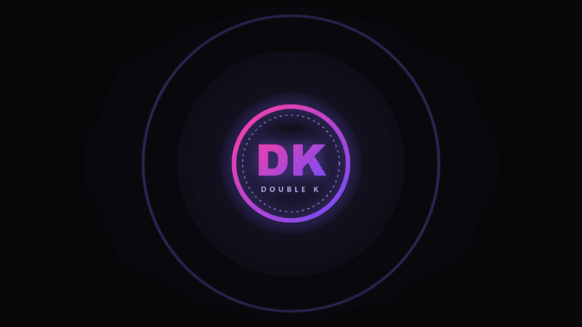
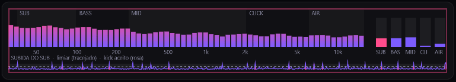
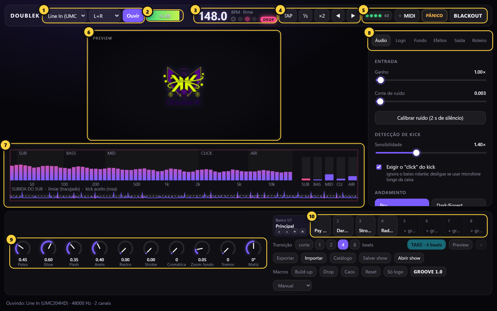
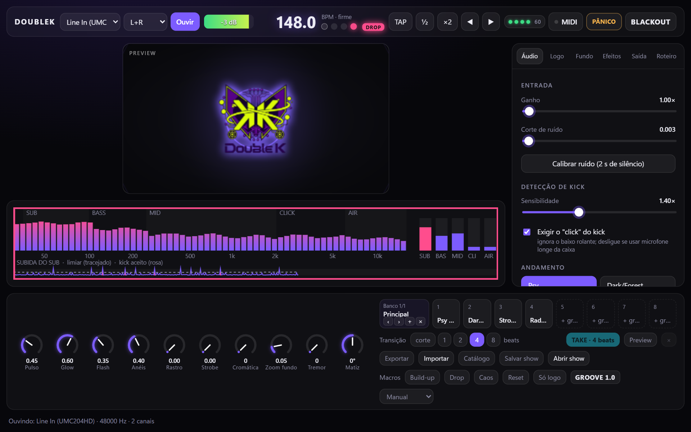
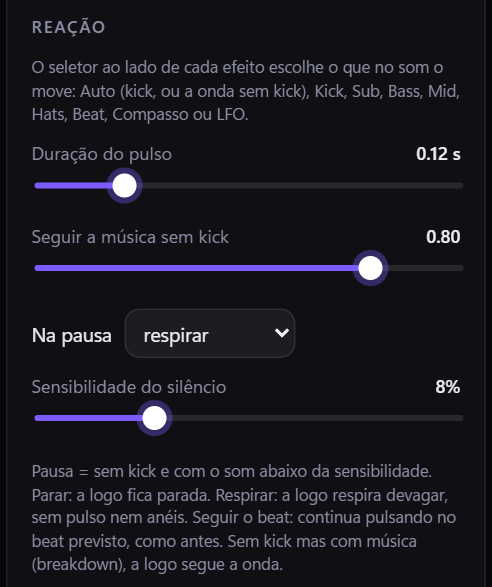
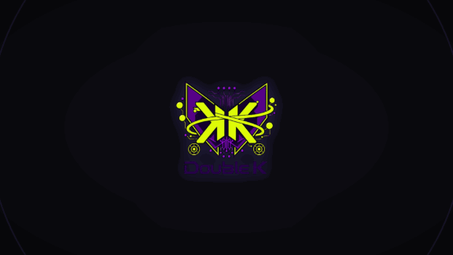
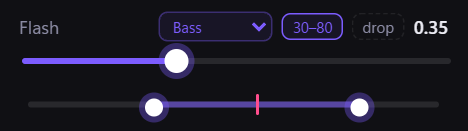

# DoubleK Visuals — Guia para iniciantes

Este guia é para quem **nunca usou** um programa de visual ao vivo. Ele explica as ideias por
trás do app (o que é kick, BPM, cena, telão…) e leva você do zero ao primeiro show em uns
15 minutos. Quando quiser os detalhes de cada botão, vá para o
**[Guia completo](TUTORIAL.md)**.

## Sumário

1. [O que o app faz](#1-o-que-o-app-faz)
2. [Do que você precisa](#2-do-que-você-precisa)
3. [Conceitos: a música](#3-conceitos-a-música)
4. [Conceitos: o app](#4-conceitos-o-app)
5. [Seu primeiro show em 15 minutos](#5-seu-primeiro-show-em-15-minutos)
6. [Os 4 botões de emergência](#6-os-4-botões-de-emergência)
7. [Deixar a logo "orgânica"](#7-deixar-a-logo-orgânica)
8. [Problemas mais comuns](#8-problemas-mais-comuns)
9. [Próximos passos](#9-próximos-passos)

---

## 1. O que o app faz

O DoubleK Visuals **escuta a música** que sai da sua mesa e faz a **sua logo pulsar** no
telão (datashow, TV, painel de LED) junto com o kick, com efeitos que reagem ao grave, aos
médios e ao chimbal.

Você não precisa programar nada: o app acha o andamento sozinho. O seu trabalho é escolher o
visual (cores, efeitos, cenas) e, no show, trocar de cena nos momentos certos — ou deixar o
app fazer isso por você.

---

## 2. Do que você precisa

| Item | Para quê | Obrigatório? |
|---|---|---|
| Notebook com Windows 10 ou 11 (64 bits) | Rodar o app | Sim |
| Datashow, TV ou LED com entrada HDMI | O telão que o público vê | Sim (para o show) |
| Interface de áudio USB (ex.: Behringer UMC) | Levar o som da mesa para o notebook, limpo | Recomendado |
| Cabo da saída **REC** ou **BOOTH** da mesa até a interface | O sinal da música | Recomendado |
| Sua logo em PNG com fundo transparente | O que vai pulsar no telão | Recomendado |
| Controladora MIDI | Trocar cenas e mexer nos efeitos com botões físicos | Opcional |

Sem interface, dá para usar o **microfone** do notebook perto da caixa. Funciona, mas o kick
fica mais difícil de detectar no meio do barulho da pista.

Para instalar, baixe o arquivo `.msi` mais novo na página **Releases** do projeto no GitHub e
dê dois cliques (detalhes no [Guia completo, seção 2](TUTORIAL.md#2-instalar)).

---

## 3. Conceitos: a música

Você não precisa saber teoria musical. Basta entender estas palavras, porque o app usa todas
elas na tela.

| Palavra | O que é | Onde aparece no app |
|---|---|---|
| **Kick** | O bumbo: a batida grave e seca que marca o tempo ("tum, tum, tum"). É o que faz a logo pulsar. | Analisador (cada kick aceito vira um traço rosa) |
| **Baixo rolante** | No psytrance, o baixo que toca entre os kicks ("tum-ta-ta-ta"). Fica no mesmo grave do kick, então o app precisa separar os dois. | Opção *Exigir o "click" do kick* |
| **Click** | O estalo agudo no começo do kick. O baixo rolante não tem; é assim que o app distingue um do outro. | Aba Áudio |
| **BPM** | Batidas por minuto: a velocidade da música. Psytrance fica perto de 140–150; dark/forest, 145–185; hi-tech, 175–220. | Número grande no topo |
| **Beat** | Cada batida do tempo (cada "tum"). | As bolinhas no topo andam a cada beat |
| **Compasso** | Um grupo de 4 beats ("1, 2, 3, 4"). A música costuma mudar no começo de um compasso. | As 4 bolinhas no topo |
| **Fase** | Em que ponto do beat você está agora, do começo ao fim. Ajustar a fase é "puxar" ou "empurrar" o pulso uns milissegundos. | Botões ◀ ▶ |
| **Drop** | O momento em que o grave entra com tudo, depois de uma preparação. É o ápice da pista. | Pílula **DROP** acende |
| **Breakdown** | O trecho mais calmo, normalmente sem kick e sem grave, antes do drop. | Pílula DROP apagada |
| **Silêncio / pausa** | A música parou de verdade (ou ficou só um chiado). | Opção **Na pausa** |
| **Sub, Bass, Mid, Hats** | As "faixas" do som: grave profundo, baixo, médios (synths e vozes) e agudos (chimbal). Cada efeito pode reagir a uma delas. | Seletor roxo ao lado dos efeitos |

---

## 4. Conceitos: o app

| Palavra | O que é |
|---|---|
| **Janela de controle** | Fica no notebook. É onde você mexe. O público não vê. |
| **Telão** | A janela em tela cheia no datashow, só com a logo e os efeitos. Abre com **Projetar** (tecla **F**). |
| **Preview** | A miniatura do telão dentro da janela de controle, para você ver o que o público vê sem virar o pescoço. |
| **BPM firme** | O app entendeu o andamento e passa a **prever** o próximo beat. A partir daí o pulso fica no tempo mesmo se um kick passar despercebido. |
| **Offset** | O atraso do projetor (30 a 80 ms é comum). O app adianta o pulso para compensar, e a imagem "cola" no som. |
| **Fonte de movimento** | O que na música faz um efeito se mexer: o kick, o sub, os médios, o chimbal, o beat… Cada efeito tem a sua (o seletor roxo). |
| **Régua (faixa)** | Para cada efeito, o nível mínimo e máximo da fonte em que ele age. Abaixo do mínimo, parado; acima do máximo, no máximo. |
| **Só no drop** | Um efeito marcado assim some no breakdown e volta quando o grave entra. |
| **Cena** | Uma "foto" de todo o visual (cores, efeitos, fundo). Você monta antes e chama no show com um clique ou uma tecla (**1** a **8**). |
| **Banco** | Um grupo de 8 cenas. São até 4 bancos (ex.: um por tipo de festa). |
| **Crossfade / transição** | A passagem suave de uma cena para outra, em 1, 2, 4 ou 8 beats, sempre começando no beat. |
| **Preview / TAKE** | Modo de preparar uma cena **sem o público ver** e mandar para o telão no próximo beat com **TAKE** (tecla **T**). |
| **Macros** | Atalhos de momento: **Build-up**, **Drop**, **Caos** e **Reset** mexem em vários efeitos de uma vez. |
| **Intelligent Show** | A automação: o app lê se a música está crescendo, no drop ou no breakdown e troca as cenas sozinho (modos Manual, Assistido e Automático). |
| **Roteiro** | Efeitos e cenas marcados em pontos exatos de **uma música específica**, como uma coreografia. |
| **MIDI learn** | Ligar um botão ou knob da sua controladora a um controle do app: clique no controle, mexa no botão, pronto. |
| **Show (`.doublekshow`)** | Um arquivo só com tudo o que você montou (cenas, logo, vídeos, roteiros, MIDI), para levar a outro notebook. |

---

## 5. Seu primeiro show em 15 minutos

### Passo 1 — Ligar os cabos (2 min)

1. Da mesa, puxe a saída **REC OUT** ou **BOOTH OUT** para a entrada da interface de áudio.
2. Ligue a interface e o datashow no notebook.
3. Aperte **Windows + P** e escolha **Estender**. O datashow vira uma segunda tela.

### Passo 2 — Fazer o app ouvir (3 min)

1. Abra o **DoubleK Visuals**.
2. No topo, escolha a **entrada** (a sua interface) e clique em **Ouvir**.
3. Toque uma música. O **medidor** deve mexer.
4. Na aba **Áudio**, ajuste o **Ganho** até o medidor ficar forte nos trechos altos, **sem**
   acender o **CLIP** vermelho.
5. Em **Andamento**, escolha o estilo: **Psy**, **Dark/Forest**, **Hi-tech** ou **Auto**.
6. Espere alguns segundos: o BPM aparece e o estado muda para **firme**.

> Se o topo avisar *"A música parece estar a X BPM, fora da faixa…"*, clique no aviso: o app
> troca para **Auto** e o BPM firma.

### Passo 3 — Colocar a sua logo (2 min)

1. Aba **Logo** → **Escolher logo**. Um PNG com fundo transparente é o ideal.
2. Se a logo tiver fundo branco, marque **Remover fundo branco da logo**.
3. Clique em **Cores da logo**: o app pega as cores dela e ajusta o brilho e o fundo para
   combinar.

### Passo 4 — Projetar (2 min)

1. Aba **Saída** → escolha o monitor do datashow.
2. Clique em **Projetar** (ou aperte **F**). O telão abre em tela cheia.
3. Olhe para o telão e escute o kick. Se o pulso vier **depois** do som, deixe o
   **Offset visual** mais negativo (−50, −60…) até os dois "colarem".

### Passo 5 — Montar 3 cenas (5 min)

1. Ajuste um visual calmo (pouco efeito) e clique num pad vazio de cena (**+ gravar**).
   Dê duplo clique para chamar de "Calma".
2. Suba alguns efeitos (aba **Efeitos**: flash, anéis, rastro) e grave outra: "Pesada".
3. Faça uma terceira bem forte, com túnel ou caleidoscópio (seção Psy Engine): "Drop".
4. No show, chame com as teclas **1**, **2** e **3**. A troca entra no beat, com crossfade.

### Passo 6 — Conferir tudo (1 min)

Com a música tocando e o telão aberto: aba **Saída** → **Testar tudo**. Em 10 segundos o app
mostra em verde, amarelo ou vermelho o áudio, o BPM, o telão, o MIDI e o resto. Resolva os
vermelhos antes de abrir a pista.

Pronto: você tem um show.

---

## 6. Os 4 botões de emergência

Decore estas teclas antes de tocar:

| Tecla | Botão | Quando usar |
|---|---|---|
| **B** | **BLACKOUT** | Apagar o telão na hora (troca de DJ, problema na tela). Aperte de novo para voltar. |
| **P** | **PÂNICO** | Algo forte demais na tela: para o roteiro e zera strobe, tremor e os efeitos agressivos, deixando só a logo pulsando calma. |
| **L** | **Só logo** | Momento calmo: tira todos os efeitos e deixa só a logo. |
| **Espaço** | **TAP** | O BPM se perdeu: bata no tempo 4 vezes ou mais. |

---

## 7. Deixar a logo "orgânica"

A ideia é a logo parecer que **emite o som**: respira no breakdown, explode no drop e para no
silêncio. Três ajustes fazem isso:

**1. Na pausa** (aba **Logo**, em Reação). O que a logo faz quando a música silencia:

- **respirar** (padrão): sem pulso nem anéis, a logo respira devagar;
- **parar**: fica parada;
- **seguir o beat**: continua pulsando no tempo, como se a música não tivesse parado.

A **Sensibilidade do silêncio** diz o que conta como silêncio. Se uma introdução baixa já é
tratada como silêncio, diminua; se o chiado da pausa ainda mexe a logo, aumente.

**2. A fonte de cada efeito.** No seletor roxo, escolha o que move cada efeito. Exemplos:
o **brilho** pelo **Bass** (a aura vibra com o baixo rolante), a **aberração** pelos **Hats**
(o glitch acompanha o chimbal), o **pulso** pelo **Sub** (a logo cresce com o grave profundo).

**3. A régua.** Ao lado da fonte, o botão **faixa** abre uma régua com **mínimo** e **máximo**
e uma marca que mostra, ao vivo, onde a música está. O efeito fica parado abaixo do mínimo,
cresce entre os dois e chega a 100% no máximo. Exemplo: **Pulso** com **Bass** em 30–80 faz a
logo só respirar com o grave fraco e bater cheia quando o grave passa de 80%. Com **Kick**, a
régua é o volume do kick: em 50–100 os kicks fracos não mexem a logo e os fortes batem cheio.

Tudo isso entra nas cenas: dá para ter uma cena "orgânica" para o breakdown e outra
"explosiva" para o drop.

---

## 8. Problemas mais comuns

| Problema | O que fazer |
|---|---|
| O medidor não mexe | Confira a entrada escolhida e clique em **Ouvir** de novo. Confira se a saída REC/BOOTH da mesa tem volume. No Windows: Configurações → Privacidade → **Microfone** → permitir apps da área de trabalho. |
| O BPM não firma | Escolha a faixa certa de andamento (ou **Auto**), ou clique no aviso *fora da faixa*. Em último caso, **TAP**. |
| O BPM está na metade ou no dobro | Botões **½** ou **×2** no topo. |
| A logo pulsa fora do tempo | Acerte o **Offset visual** olhando para o telão (passo 4). |
| A logo pulsa no silêncio | **Na pausa** em **respirar** ou **parar** e suba a **Sensibilidade do silêncio**. |
| O app pega o baixo rolante como kick | Na aba Áudio, diminua a **Sensibilidade** e deixe **Exigir o "click" do kick** ligado. |
| O telão engasga | Aba Saída → abaixe a **Resolução de render** (ex.: 75%). |

A lista completa está no [Guia completo, seção 20](TUTORIAL.md#20-problemas-e-soluções).
Se nada resolver, clique nas **bolinhas de saúde** no topo → **Relatar problema**.

---

## 9. Próximos passos

Quando o básico estiver confortável, o [Guia completo](TUTORIAL.md) mostra:

- **Efeitos e Psy Engine** (túnel, mandala, caleidoscópio, partículas) e **camadas**;
- **Vídeo em loop** no fundo;
- **Preview e TAKE**, **bancos** e **macros** para operar como VJ;
- **Intelligent Show**: o app troca as cenas sozinho conforme a música;
- **Roteiro**: efeitos marcados numa música específica;
- **Controladora MIDI**, **MIDI Clock** do CDJ/Traktor, **celular** e **OSC**;
- **Gravar o telão** (inclusive em vertical, para stories) e **Spout** para o Resolume;
- **Salvar show** para levar tudo a outro notebook.
