# Tutorial — DoubleK Visuals

Guia completo, do zero até o show: instalar, ligar os cabos, regular o som, montar o visual,
projetar no telão e operar ao vivo (inclusive com controlador MIDI).

> As imagens deste guia foram feitas com uma logo de exemplo ("DK") e um som simulado a 148 BPM.
> No seu notebook, a tela é a mesma, só que com a sua logo e a sua música.


---

## Sumário

1. [Como funciona, em 30 segundos](#1-como-funciona-em-30-segundos)
2. [Instalar](#2-instalar)
3. [Ligar os cabos](#3-ligar-os-cabos)
4. [Conhecendo a tela](#4-conhecendo-a-tela)
5. [Primeiro uso: fazer o app ouvir o som](#5-primeiro-uso-fazer-o-app-ouvir-o-som)
6. [Regular a detecção do kick](#6-regular-a-detecção-do-kick)
7. [BPM e andamento](#7-bpm-e-andamento)
8. [Colocar a sua logo](#8-colocar-a-sua-logo)
9. [Fundo](#9-fundo)
10. [Efeitos](#10-efeitos)
11. [O que no som move cada efeito](#11-o-que-no-som-move-cada-efeito)
12. [Efeitos só no drop (quando o grave entra)](#12-efeitos-só-no-drop-quando-o-grave-entra)
13. [Projetar no telão](#13-projetar-no-telão)
14. [Acertar o atraso do projetor (offset)](#14-acertar-o-atraso-do-projetor-offset)
15. [Cenas: trocar o visual no meio do set](#15-cenas-trocar-o-visual-no-meio-do-set)
16. [Roteiro: efeitos marcados numa música](#16-roteiro-efeitos-marcados-numa-música)
17. [Controlador MIDI](#17-controlador-midi)
18. [Atalhos do teclado](#18-atalhos-do-teclado)
19. [Checklist do dia do show](#19-checklist-do-dia-do-show)
20. [Problemas e soluções](#20-problemas-e-soluções)
21. [Plano B](#21-plano-b)

---

## 1. Como funciona, em 30 segundos

```
 Mesa (Rec/Booth out) ──► Interface USB ──► Notebook ──► Datashow
                                             │
                                    DoubleK Visuals
                         ┌───────────────────┴───────────────────┐
                  Janela de CONTROLE                       Janela do TELÃO
                  (fica no notebook,                    (tela cheia no datashow,
                   você mexe aqui)                       só a logo e os efeitos)
```

- O app **escuta** o som que sai da mesa e acha o **kick** (o bumbo) e o **BPM**.
- Com o BPM travado, ele **prevê** onde vai cair o próximo beat. Por isso o pulso pode
  sair até um pouco *antes* do som, para compensar o atraso do projetor.
- São **duas janelas**. Você opera na do notebook e o público só vê a do telão.

---

## 2. Instalar

1. Pegue o arquivo **`DoubleK Visuals_0.1.0_x64_pt-BR.msi`**.
2. Dê dois cliques nele e siga o instalador (Avançar → Instalar → Concluir).
3. Se aparecer **"O Windows protegeu o computador"**, clique em **Mais informações** →
   **Executar assim mesmo**. O aviso aparece porque o instalador não tem assinatura digital
   paga; não é vírus.
4. O app aparece no menu Iniciar como **DoubleK Visuals**.

Precisa de Windows 10 ou 11 (64 bits). Não precisa instalar mais nada.

### Atualizações

Quando sai uma versão nova, aparece no rodapé da janela, ao abrir o app, o botão
**"Nova versão X — atualizar"**. Um clique baixa, instala e reabre o app, com as suas
configurações, cenas, logo e MIDI preservados.

- O app **nunca atualiza sozinho**. Você escolhe a hora.
- Com o **telão aberto**, o botão fica bloqueado, para ninguém derrubar a projeção no meio
  do set. Atualize antes do show, em casa.
- Sem internet, nada acontece: o app funciona normalmente.

---

## 3. Ligar os cabos

### Opção A — Line-in pela interface de áudio (recomendado)

1. Da mesa, puxe a saída **REC OUT** ou **BOOTH OUT** para a entrada de uma
   **interface de áudio USB** (ex.: Behringer UMC, Focusrite, a placa da própria controladora).
2. Ligue a interface no notebook.
3. Deixe o volume dessa saída **fixo** durante o set. Se você mexer no volume do booth,
   o app recebe mais ou menos sinal.

Por que é a melhor opção: o sinal chega limpo, sem o barulho da pista, e o kick fica muito
mais fácil de detectar.

### Opção B — Microfone

Funciona no improviso: pode ser o microfone do notebook ou um microfone USB perto da caixa.

- Na aba **Áudio**, **desligue** "Exigir o click do kick" (seção 6), porque o microfone
  longe da caixa perde os agudos do kick.
- Use **Calibrar ruído** antes de começar (seção 5).

### O datashow

1. Ligue o datashow no HDMI do notebook.
2. Aperte **Windows + P** e escolha **Estender**. Assim o datashow vira uma "segunda tela"
   e o notebook continua mostrando o controle.

---

## 4. Conhecendo a tela


| # | O quê | Para que serve |
|---|---|---|
| 1 | **Entrada de áudio** + **Ouvir** | Escolhe de onde vem o som (interface, mic) e o canal. *Ouvir* liga a escuta. |
| 2 | **Medidor** | Nível do sinal. Verde é bom; **CLIP** vermelho quer dizer que está alto demais. |
| 3 | **BPM** + bolinhas | O andamento detectado e o estado (*procurando / ajustando / travado / segurando*). As 4 bolinhas andam no compasso; a pílula **DROP** acende quando há grave (seção 12). |
| 4 | **TAP ½ ×2 ◀ ▶** | Ajuste manual do andamento (seção 7). |
| 5 | **MIDI**, **PÂNICO** e **BLACKOUT** | Liga o modo de mapear o controlador (seção 17); PÂNICO para o roteiro e zera os efeitos agressivos; BLACKOUT apaga o telão na hora. Ao lado ficam as **4 bolinhas de saúde** (áudio · BPM · MIDI · telão) e o fps do telão; clicar nelas salva um **diagnóstico**. |
| 6 | **Preview** | O mesmo visual que está no telão, em tamanho pequeno. |
| 7 | **Analisador** | Mostra o que o app está ouvindo e cada kick que ele aceitou (seção 6). |
| 8 | **Abas de ajuste** | Áudio, Logo, Fundo, Efeitos, Saída e **Roteiro** (seção 16). |
| 9 | **Knobs de performance** | Os 10 efeitos mais usados ao vivo, sempre à mão. |
| 10 | **Cenas e barra de performance** | 8 pads por banco (até 4 bancos), transição, **TAKE**/Preview, **Macros**, Catálogo de presets, Exportar/Importar e **Salvar/Abrir show** (seção 15). |

**As 4 bolinhas de saúde** (passe o mouse para ver o nome de cada uma):

| Bolinha | Verde | Laranja | Vermelha |
|---|---|---|---|
| **Áudio** | som chegando | nada chega há mais de 1,5 s | o app avisou que a entrada ou a saída caiu |
| **BPM** | travado | achou, mas ainda ajustando | — |
| **MIDI** | controlador conectado | — | — |
| **Telão** | aberto e fluido | aberto, mas engasgando (p95 acima de 25 ms) | perdeu a placa de vídeo (ele se recupera sozinho quando ela volta) |

O número ao lado é o fps do telão. **Clicar nas bolinhas salva um diagnóstico**: um arquivo `.json`
com versão, ajustes, estatísticas do telão e os últimos 200 eventos, **sem nenhum áudio**. É o que
mandar quando algo der errado.


**Como mexer nos controles:**

- **Sliders:** arraste. **Duplo clique** volta ao valor padrão.
- **Knobs:** arraste para cima ou para baixo, ou use a roda do mouse.
  Segure **Shift** para ajuste fino. **Duplo clique** volta ao padrão.
- **Tudo é salvo sozinho.** Fechou e abriu o app, está tudo como você deixou.

---

## 5. Primeiro uso: fazer o app ouvir o som


1. No topo, escolha a **entrada** (ex.: *Line In (UMC204HD)*) e o canal (**L+R** serve para
   quase tudo).
2. Clique em **Ouvir**. Embaixo aparece "Ouvindo: …".
3. Solte uma música. O **medidor** (2) deve mexer.
4. Ajuste o **Ganho** até o medidor ficar entre **−12 dB e −3 dB** nos trechos fortes,
   **sem** chegar no CLIP.
5. Com a música **parada**, clique em **Calibrar ruído (2 s de silêncio)**. O app mede o
   chiado da linha e define o **Corte de ruído**. Abaixo desse nível, ele ignora o som.

> O app lembra a entrada escolhida. Da próxima vez, ele já começa a ouvir sozinho.
> Se a interface for desplugada, ele tenta reconectar a cada segundo.

---

## 6. Regular a detecção do kick

O analisador é onde você vê se o app está "entendendo" a música:


- **Em cima:** o espectro, do grave (esquerda) ao agudo (direita), dividido em SUB, BASS,
  MID, CLICK e AIR.
- **À direita:** um medidor por banda. O **SUB fica rosa** a cada kick aceito.
- **Embaixo:** a linha da "subida do sub" contra o **limiar tracejado**. Cada **traço rosa**
  é um kick que o app aceitou.

**O certo é:** um traço rosa por beat, certinho, sem traços no meio.

| O que você vê | O que fazer |
|---|---|
| Faltam kicks (beats sem traço rosa) | Aumente a **Sensibilidade**. |
| Traços a mais, entre os kicks (o app está pegando o baixo rolante) | Diminua a **Sensibilidade** e confira se **Exigir o "click" do kick** está ligado. |
| Nada detecta, nem com sensibilidade alta, usando microfone | **Desligue** "Exigir o click" e suba o **Ganho**. |

**Por que existe o "click":** no psytrance, o baixo rolante (K-B-B-B) bate na mesma região
grave do kick. A diferença é que o kick tem um estalo agudo (o "click") e o baixo não.
Exigindo os dois juntos, o app ignora o baixo.

---

## 7. BPM e andamento

Na aba **Áudio**, em **Andamento**, escolha a faixa do estilo que você vai tocar:

| Faixa | BPM | Quando usar |
|---|---|---|
| **Psy** | 135–150 | Psytrance, full-on, progressive |
| **Dark/Forest** | 145–185 | Dark, forest, night |
| **Hi-tech** | 175–220 | Hi-tech, psycore |
| **Auto** | 80–220 | Set misturado. Pode confundir metade e dobro. |

Escolher a faixa certa evita o erro clássico de o app achar 74 em vez de 148.

**Estados do BPM** (ao lado do número):

- **procurando**: ainda não achou o andamento.
- **ajustando**: achou, mas os kicks ainda estão irregulares.
- **travado**: firme. O número fica branco e brilha. A partir daqui, o pulso é **previsto**.
- **segurando (sem kick)**: veio um breakdown sem kick. O app segura o andamento por até
  30 segundos, para o visual não morrer no meio da música.

**Botões manuais** (no topo):

| Botão | Tecla | O que faz |
|---|---|---|
| **TAP** | Espaço | Bata no tempo (4 ou mais toques) para dar o andamento na mão. |
| **½** | — | O app achou o dobro? Divide por 2. |
| **×2** | — | O app achou a metade? Multiplica por 2. |
| **◀** | ← | Puxa a fase do beat 5 ms para trás (adianta o pulso). |
| **▶** | → | Empurra a fase 5 ms para frente (atrasa o pulso). |

**Travar BPM:** com a opção ligada, o número não muda mais. Só a fase continua acompanhando
os kicks. Use quando o BPM estiver certo e você não quiser que ele oscile.

---

## 8. Colocar a sua logo


1. Aba **Logo** → **Escolher logo**. Escolha um PNG com fundo transparente (o ideal) ou um
   JPG/PNG com fundo branco.
2. Se o fundo for branco, marque **Remover fundo branco da logo** e ajuste a
   **Tolerância do branco** até sumir o fundo sem comer a logo.
3. **Cor do brilho:** a cor do glow em volta da logo. Ela também vira a cor de destaque da
   janela de controle.
4. **Cores da logo** (o jeito rápido): o app analisa a logo e acerta tudo de uma vez. A cor
   mais viva vai para o brilho, as ondas, o flash e o espectro. A segunda cor vira o
   **degradê do fundo**. Exemplo: numa logo lima e roxa, ficam ondas lima sobre um fundo
   roxo. Depois dá para ajustar qualquer cor na mão.

| Ajuste | O que faz |
|---|---|
| **Tamanho** | Tamanho da logo no telão (% da altura da tela). |
| **Pulso** | Quanto a logo cresce a cada kick. |
| **Brilho (glow)** | A aura de luz em volta da logo. |
| **Aberração cromática** | Separa o vermelho e o azul nas bordas: efeito "glitch" no beat. |
| **Duração do pulso** | Quanto tempo o pulso leva para voltar. Curto = seco; longo = macio. |
| **Seguir a música sem kick** | Nos trechos sem kick, a logo continua respirando com a música. |

> A logo fica salva dentro do app. Pode apagar ou mover o arquivo original depois.

---

## 9. Fundo


- **Cor 1 / Cor 2 / Degradê:** um fundo liso ou em degradê, com ângulo ajustável.
- **Foto de fundo:** escolha uma imagem, ou **arraste a imagem para cima da janela**.
  *Preencher* corta para cobrir a tela toda; *Caber inteira* mostra a foto inteira.
- **Cores do fundo (automático):** ao escolher a foto ou o vídeo, o app tira dele a cor mais
  viva para o **brilho** (glow, anéis, flash e espectro) e as **Cor 1 / Cor 2** do fundo. Mudou
  as cores na mão e quer voltar às do fundo? Clique em **Cores do fundo**.
- **Opacidade, Desfoque e Brilho da foto/vídeo:** para a foto não brigar com a logo.
  Escurecer e desfocar um pouco costuma ficar ótimo.
- **Girar matiz:** as cores do fundo giram sem parar (graus por segundo).
- **Zoom do fundo / Brilho do fundo:** o fundo "respira" junto com o beat.

### Vídeo em loop

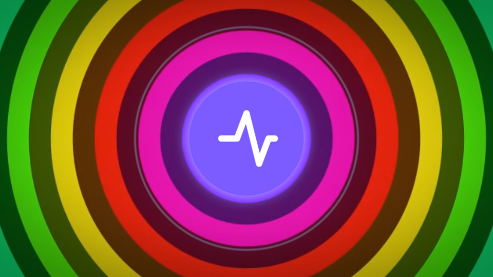

1. Em **Vídeo em loop**, clique em **Adicionar vídeo** (mp4, webm ou mov), ou **arraste o vídeo
   para cima da janela**. O app testa o arquivo antes de guardar: se este Windows não consegue
   tocar (por exemplo HEVC/H.265, comum em vídeo de iPhone), ele recusa e diz para converter
   para **MP4 H.264** ou **WebM VP9**. Aceito, o vídeo fica guardado na sua biblioteca.
2. Clique no nome de um vídeo para usá-lo, ou em **Sem vídeo** para voltar à foto ou cor.
   O **×** tira o vídeo da biblioteca.
3. **Velocidade do vídeo:** de 0,25× (câmera lenta) a 2×.
4. **Início e fim do loop:** com o vídeo na tela, escolha de que segundo a que segundo ele
   repete (fim 0 = até o final). Bom para aproveitar só o trecho bonito de um clipe.
5. **Reiniciar no compasso:** quando esse vídeo entra (por cena ou roteiro), ele volta ao
   começo no próximo 1º tempo da música, em vez de entrar no meio.

Se um vídeo der erro ou travar no meio do show, o telão volta sozinho para a foto ou a cor de
fundo e avisa no Diagnóstico, sem tela preta. Para o notebook não sofrer, o app deixa no máximo
um vídeo tocando e um preparado (o próximo do roteiro); os outros ficam parados.

O vídeo usa os mesmos ajustes da foto (opacidade, desfoque, brilho, matiz, zoom e brilho no
beat). Ele também pode ficar **só no drop** (seção 12). As **cenas** guardam qual vídeo está
tocando, então trocar de cena pode trocar o vídeo.

> Para o notebook não sofrer, prefira vídeos em **1080p ou menos**. Loops curtos (10 a 30 s)
> feitos para VJ funcionam muito bem.

---

## 10. Efeitos


| Efeito | O que faz |
|---|---|
| **Flash** | A tela clareia a cada kick. |
| **Anéis a cada kick** | Ondas de anel saindo da logo. |
| **Espectro em barras** | Barras do espectro na base da tela. |
| **Espectro radial na logo** | As barras em círculo em volta da logo (veja a cena "Radial"). |
| **Rastro** | Cada quadro deixa um rastro. Junto com o zoom, vira um **túnel**. |
| **Zoom do rastro / Giro do rastro** | Para onde o rastro anda: para dentro, para fora, girando. |
| **Strobe** + 1/1, 1/2, 1/4 | Pisca no tempo: a cada beat, a cada meio beat ou a cada quarto de beat. |
| **Vinheta** | Escurece os cantos. |
| **Linhas de TV / Granulado** | Textura de tela antiga e de filme. |
| **Tremor** | A imagem treme no kick. |

### Psy Engine

Abaixo dos efeitos clássicos, a aba Efeitos tem a seção **Psy Engine**: seis módulos que
desenham por cima ou por baixo da logo, cada um com o próprio knob (0 = desligado, custo zero),
fonte de modulação e chip **drop**.

| Módulo | O que faz | O que a fonte de modulação move |
|---|---|---|
| **Caleidoscópio** | Dobra o quadro inteiro em N fatias simétricas (3–12), com giro e zoom. A logo entra na dobra. | Empurrão no giro |
| **Túnel fractal** | Túnel procedural por baixo da logo, com velocidade e densidade. | Velocidade |
| **Mandala** | Anéis e pétalas geométricas em volta da logo, abrindo no compasso. | Brilho |
| **Partículas** | Campo de partículas com direção e turbulência. | Velocidade e brilho |
| **Orgânico** | Padrão orgânico/floresta por baixo da logo, cores do fundo, matiz pelo knob **Matiz**. | Acende a cor da logo nos picos |
| **Glitch** | Fatias deslocadas, blocos e separação RGB em rajadas curtas (≤ 120 ms). | **Disparo** da rajada |

- **Qualidade** (baixa/média/alta) é ajuste da máquina, não da cena. Com **Ajuste automático**
  ligado, se o telão engasgar (p95 acima do **Teto do quadro**, 22 ms por padrão) por 3 s, o
  app desce um degrau sozinho e, em baixa, desliga o módulo mais caro; volta devagar quando
  sobra folga. A linha de status avisa.
- Abaixo de cada knob aparece o **custo medido** (ms de GPU, ou de CPU quando a placa não
  informa).
- **Psy Engine: ligado/desligado** é um interruptor que pausa os seis módulos sem mexer nos
  valores das cenas. **PÂNICO** e **Reset** zeram os módulos.
- O glitch respeita o limite de flashes: com ele ligado, no máximo 3 rajadas por segundo.

Exemplos de cenas que já vêm prontas:

| Dark túnel | Radial | Strobe |
|---|---|---|
|  |  |  |

> ⚠️ **Strobe:** cuidado com a intensidade. Luz piscando rápido pode causar mal-estar e, em
> pessoas sensíveis, crises de epilepsia fotossensível. Por padrão o app **limita a 3 flashes
> por segundo** (aba Saída → Segurança visual): a 148 BPM, o strobe 1/4 daria quase 10 por
> segundo e passa a acender 1 em cada 4 pulsos. A aba Efeitos mostra a taxa real. Desligue o
> limite só se souber o que está fazendo, e avise o público na entrada.

---

### Camadas

Cada módulo do Psy Engine, o rastro e o glitch são **camadas**: na aba Efeitos, a seção
**Camadas** lista as sete na ordem em que são desenhadas (a de baixo da lista fica por cima).
Em cada linha dá para ligar e desligar, escolher o **modo de mistura** e a **opacidade**, e
mover com ▲▼. Os modos: **Normal** (a camada cobre o que está embaixo, custo zero), **Somar**
(clareia: bom para partículas e mandala sobre o túnel), **Tela** (clareia mais suave) e
**Multiplicar** (escurece: o túnel a 60 % em Multiplicar vira uma textura escura sobre a logo).
Qualquer modo diferente de Normal, ou opacidade abaixo de 100 %, gasta um passe a mais de GPU
por camada; a aba Efeitos mostra o custo. Fundo, foto, vídeo, logo e pós (vinheta, strobe,
blackout) não são camadas: ficam sempre no lugar de sempre. As camadas fazem parte da cena:
salvar um pad guarda ordem, modos e opacidades, e chamar a cena troca tudo de uma vez no meio
do crossfade. **S** deixa só aquela camada desenhando (solo) sem mexer no liga/desliga das
outras, com um aviso em laranja enquanto estiver ativo. Para reordenar, arraste pelo nome ou
use ▲▼. No MIDI learn, a opacidade e o liga/desliga de cada camada aprendem como qualquer
knob ou botão.

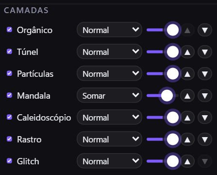

### Efeitos da comunidade (shaders)

Quem programa shaders pode criar efeitos novos. Na aba **Efeitos**, abra **Efeitos da
comunidade (FX)**: **Importar** traz um arquivo `.doublekfx`, **Novo** abre um modelo para
escrever o seu, **Exportar** gera o arquivo para compartilhar. O editor mostra uma
pré-visualização sobre a sua logo, reagindo ao som de verdade, e aponta o erro com a linha; se
algo quebrar, **Reverter para o último válido** volta ao código que funcionava. Cada efeito
pode ter até 8 controles deslizantes. Por enquanto os efeitos aparecem só na pré-visualização
do editor; levar para o telão vem na próxima versão.

> ⚠ Código de shader de outra pessoa pode travar a placa de vídeo. Importe só de quem você
> confia. Um efeito que derruba a pré-visualização fica marcado como **suspeito** e, depois de
> 3 falhas, é desligado até você reativar. O formato está em [docs/SHADERS.md](SHADERS.md).

---

## 11. O que no som move cada efeito

Ao lado de vários ajustes há um seletor pequeno, em roxo. Ele escolhe **qual parte da música
move aquele efeito**:

| Fonte | Reage a |
|---|---|
| **Auto** | Ao kick. Quando não tem kick, à onda da música. (Padrão.) |
| **Kick** | Só ao kick. |
| **Sub** | Ao grave profundo (35–100 Hz). |
| **Bass** | Ao baixo (100–250 Hz), ou seja, ao baixo rolante do psy. |
| **Mid** | Aos médios: synths e leads. |
| **Hats** | Aos agudos: chimbal e percussão. |
| **Beat** | A uma onda regular, uma por beat (mesmo sem kick). |
| **Compasso** | A uma onda lenta, uma a cada 4 beats. |
| **LFO** | A uma onda lenta e contínua, que não depende da música. |

Ideias: **Glow → Bass** (a aura vibra com o baixo rolante), **Aberração → Hats**
(o glitch acompanha o chimbal), **Zoom do fundo → Compasso** (o fundo respira devagar).

---

## 12. Efeitos só no drop (quando o grave entra)

No psytrance, o breakdown tira o kick e o baixo; quando o grave volta, é o **drop**. O app
percebe isso sozinho, e cada efeito pode ficar **só no drop**: no breakdown fica só a logo,
limpa, e no drop os efeitos entram.

| Breakdown (sem grave) | Drop (grave de volta) |
|---|---|
| 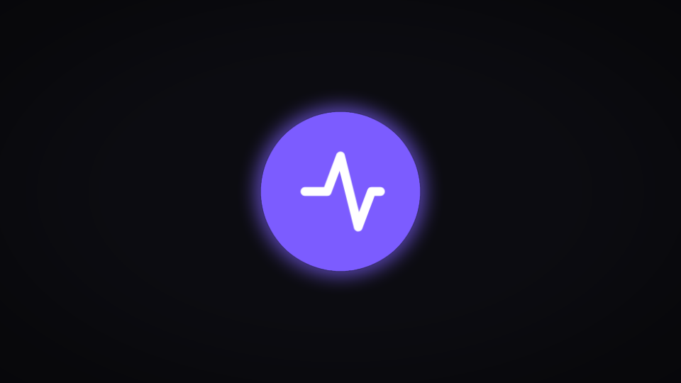 | 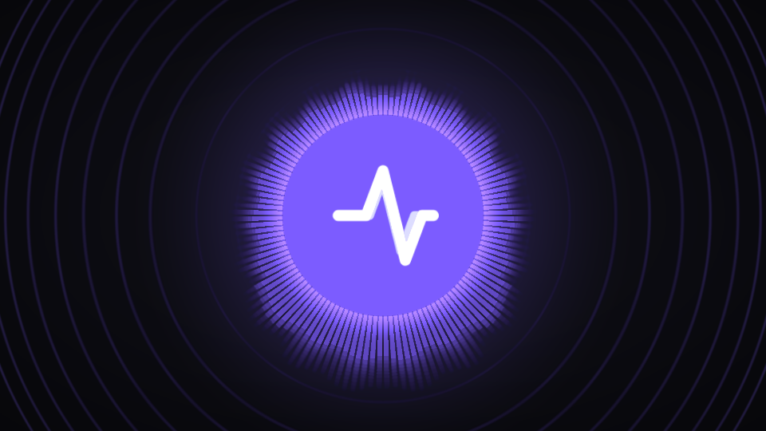 |

**Como usar:**

1. Nos sliders de efeito (Flash, Anéis, Espectros, Rastro, Strobe, Aberração, Tremor, Zoom e
   Brilho do fundo, Opacidade da foto/vídeo) há um chip **drop**.
2. Clique nele para ligar (fica rosa). Aquele efeito passa a sumir no breakdown e entrar no drop.
3. No topo, ao lado das bolinhas do compasso, a pílula **DROP** acende quando o app ouve grave.

**Regulagem** (aba **Áudio**, seção *Drop*):

- **Limiar do grave:** se a pílula DROP apaga com o grave tocando, **baixe**. Se ela acende
  no breakdown, **suba**.
- **Entrada/saída do drop:** quantos beats o efeito leva para aparecer e sumir. Com 1 beat o
  drop "explode"; com 4 a 8 beats ele entra suave.

> O app compara o grave de agora com o grave do último minuto. Por isso funciona igual numa
> pista alta ou baixa, e não confunde uma faixa mais "magra" com um breakdown.

---

## 13. Projetar no telão


1. Confira se o datashow está em **Estender** (Windows + P).
2. Aba **Saída** → escolha o monitor do datashow na lista.
3. Clique em **Projetar** (ou aperte **F**).
   A janela abre em tela cheia no datashow, sem bordas e sem cursor.
4. No topo do controle aparece **TELÃO 60 fps**. Se cair muito abaixo de 60, abaixe a
   **Resolução de render** (ex.: 75%).
5. Para fechar: **Fechar telão**, **F** no controle, ou **Esc** com o mouse no telão.

> Enquanto o telão está aberto, o Windows não apaga a tela nem entra em descanso.
> Mesmo assim, deixe o notebook **na tomada** e no modo de energia **Melhor desempenho**.

### Segurança visual e os dois botões de emergência

- **Limitar flashes a 3 por segundo** (aba Saída) vem **ligado**. Com ele, o strobe pula pulsos
  para nunca passar de 3 por segundo e o flash de tela fica em no máximo 50%. É a referência
  da WCAG 2.3.1 para fotossensibilidade. Não é laudo médico: avise na entrada quando usar strobe.
- **BLACKOUT (B):** apaga o telão na hora, por cima de qualquer efeito, transição ou roteiro.
  Funciona até se a placa de vídeo travar, porque não depende do desenho.
- **PÂNICO (P):** não apaga; **para o roteiro** e zera na hora strobe, flash, tremor, aberração,
  rastro, granulado e linhas de TV. Fica só a logo pulsando calma. Use quando algo sair do
  controle mas você não quer o telão preto.

---

### Gravar o telão

Na aba **Saída**, seção **Gravação**, o app grava exatamente o que o telão está mostrando (sem
som), para postar depois. Escolha a qualidade (**Leve**, **Média** ou **Alta**) e 30 ou 60 quadros
por segundo e clique em **Gravar** (precisa do telão aberto). Enquanto grava, a seção mostra
`● REC` com o tempo e o tamanho, e uma bolinha vermelha pisca no rodapé. **Parar** fecha o
arquivo; **Abrir pasta das gravações** mostra onde ficou (um `.mp4` com data e hora no nome, que
abre em qualquer player). Se a gravação pesar no telão, o app avisa para baixar para 30 fps ou
Leve; se algo der errado (disco cheio, telão fechado), a gravação para com uma mensagem e **o
telão continua normal**. A gravação para sozinha em 4 GB ou se o disco ficar com menos de 1 GB
livre. Apague as gravações antigas de vez em quando: o app não apaga nada sozinho.

**Vertical (9:16) para Reels/TikTok:** em **Formato**, escolha **Vertical**. Um retângulo ciano
aparece por cima do PREVIEW mostrando o pedaço do telão que vai ser gravado; ajuste o **Zoom do
recorte** e a **Posição horizontal** (dá para mexer gravando). O arquivo sai em 1080×1920
(720×1280 na qualidade Leve) com `V9x16` no nome. O vertical pesa mais no notebook: prefira
Leve ou 30 fps.

## 14. Acertar o atraso do projetor (offset)

Todo projetor atrasa a imagem (30 a 80 ms é comum). Se nada for feito, o pulso parece
chegar "depois" do kick. Como o app prevê o beat, dá para **adiantar** o pulso.

1. Toque uma faixa com kick bem marcado e espere o BPM ficar **travado**.
2. Olhe para o **telão** (não para o preview) e escute o kick.
3. Na aba **Saída**, mexa no **Offset visual**:
   - O pulso vem **depois** do kick → deixe **mais negativo** (−50, −60…).
   - O pulso vem **antes** do kick → deixe **menos negativo** (−30, −20…).
4. Achou o ponto em que os dois "colam"? Pronto. Esse valor vale para esse projetor.

Para o ajuste fino durante o set, use **◀ ▶** (ou as setas do teclado). Cada toque desloca
5 ms.

> **Pulsar pelo relógio do beat** precisa estar ligado para o offset funcionar. Desligado,
> o pulso segue o kick detectado na hora: não dá para adiantar, mas também não depende do BPM.

---

## 15. Cenas: trocar o visual no meio do set


Uma **cena** é uma "foto" de todo o visual: cores, efeitos e fundo. São 8 posições.

| Ação | Como |
|---|---|
| **Chamar** uma cena | Clique no pad, ou as teclas **1** a **8**. |
| **Gravar** o visual atual | Clique num pad vazio (**+ gravar**), ou **Shift + clique** num pad cheio (grava por cima). |
| **Renomear** | Duplo clique no pad. |
| **Transição** | *corte* (na hora) ou 1/2/4/8 beats de crossfade. |

O crossfade **começa no próximo beat** e dura o número de beats escolhido. Assim, a troca de
visual entra na música, não fora dela. A barrinha rosa embaixo do pad mostra o progresso.

**Só logo (L):** desliga todos os efeitos e deixa só a logo pulsando. Bom para os momentos
calmos.

**BLACKOUT (B):** apaga o telão com um fade curto. Aperte de novo para voltar.

**Exportar / Importar:** salva o visual e as 8 cenas num arquivo `.json`. Serve para fazer
backup, levar para outro notebook ou ter um arquivo para cada tipo de festa.

> O que **não** entra na cena: offset, resolução, recorte da logo, blackout e só logo.
> São ajustes do lugar e da operação, não do visual.

### Bancos de cenas

Além dos 8 pads, você pode ter até **4 bancos** de 8 cenas (32 no total). O seletor fica à
esquerda dos pads: **‹ ›** troca de banco, **+** cria um banco vazio, **×** apaga o banco
atual (pergunta antes se ele tem cenas). Duplo clique no nome do banco para renomear. Teclas
**[** e **]** trocam de banco; com o MIDI learn ligado, clique em ‹ ou › e mexa num botão do
controlador para trocar de banco pelo MIDI. Os pads 1–8, as teclas 1–8, os botões MIDI já
aprendidos e os pontos de cena do roteiro agem sempre no **banco que está aberto**. Quem já
tinha cenas encontra todas no banco 1, "Principal". Ao apagar um banco, os pontos de roteiro e
o mapa de automação que apontavam para os bancos seguintes são renumerados sozinhos; os que
apontavam para o banco apagado passam a usar o banco aberto (roteiro) ou "nenhuma" (automação),
e a confirmação avisa quantos são.

### Catálogo e presets compartilhados

O botão **Catálogo** lista os 23 presets de fábrica por estilo: **Aplicar agora** muda o visual,
**Gravar no pad** guarda num pad. Para trocar presets com outros DJs, **Exportar preset** salva o
visual atual num arquivo `.doublekpreset` (pequeno, só os ajustes: sem logo, foto nem vídeo) e
**Importar preset** traz um arquivo desses para a seção **Importados** do Catálogo (até 100;
**Apagar** remove um importado). Arquivos que não são preset, ou de uma versão mais nova do app,
são recusados com o motivo. O formato está em [docs/PRESETS.md](PRESETS.md).

### Preview e TAKE

O canvas grande da janela de controle é o **PREVIEW**: só você vê. O telão é o **Program**. Para
preparar uma cena sem o público ver, aperte **Shift + 1..8** (ou ligue o botão **Preview** e toque
o pad, ou o pad do controlador MIDI): o pad ganha um contorno ciano tracejado e o canvas mostra a
cena, com a etiqueta "PREVIEW: nome — T para TAKE". Quando estiver pronto, aperte **T** (ou o
botão **TAKE**): a cena vai para o telão no próximo beat, com a transição escolhida ("TAKE · 4
beats"; em "corte", na hora). **Shift+T** ou **×** desfaz o preparo. Pode trocar de banco com a
cena preparada: o TAKE volta ao banco dela. Regravar a cena preparada atualiza o preview.
**PÂNICO** limpa o preview; **BLACKOUT** não. Os pontos de cena do roteiro vão direto para o
telão, sem passar pelo preview. No MIDI learn, TAKE, Preview e × podem ser aprendidos como
qualquer botão.

### Macros

Na barra de performance, a linha **Macros** tem 4 botões que mexem em vários efeitos de uma vez,
no tempo da música: **Build-up** sobe rastro, anéis e zoom do fundo aos poucos por 16 beats
(para a subida antes do drop); **Drop** dá flash + strobe por 2 beats com anéis no máximo e
depois volta ao que estava (com o limite de flashes ligado, o strobe e o flash respeitam o
teto); **Caos** sorteia aberração, tremor e giro do rastro a cada beat por 4 beats e volta;
**Reset** zera strobe, flash, tremor, aberração e rastro sem parar o roteiro (o **PÂNICO** para
o roteiro também). Cada macro pode ser aprendida no MIDI learn como qualquer botão. Chamar uma
cena, o PÂNICO ou outra macro interrompe a que estiver rodando.

### Intelligent Show: o app lê o momento da música

Na linha das macros, depois de "Só logo", um chip mostra o **estado estimado da música** e a
confiança: **BREAK** (sem grave), **BUILD** (energia subindo, grave ainda fora), **GROOVE**
(grave presente e estável), **DROP** (o grave acabou de voltar depois de um breakdown) ou **—**
quando o app não tem certeza (começo, silêncio, sem BPM). É uma estimativa pelo sinal: o drop
aparece no chip **depois** que ele acontece, nunca antes, e um breakdown mais curto que dois
compassos não conta como breakdown. Se aparecer **GRADE?**, o app ouve grave mas nenhum kick cai
no tempo que ele tinha travado (típico depois de trocar de faixa com uma pausa): a automação fica
parada até os kicks voltarem a bater; um **TAP** (Espaço) no tempo novo resolve na hora. Clicar no
chip (ou a tecla **A**) alterna o modo.

Ao lado, o seletor **Manual / Assistido / Automático** decide o que o app faz com isso:

- **Manual** (padrão ao abrir): só mostra o chip. Nada muda sozinho.
- **Assistido:** no breakdown as rampas baixam rastro, anéis e zoom aos poucos; no build-up
  sobem por 16 beats; no drop dispara a macro **Drop** (respeitando o limite de flashes).
  Nunca troca cena, banco nem vídeo.
- **Automático:** tudo do Assistido e, se houver cena marcada para o drop ou para o groove no
  mapa de automação, chama essa cena (abrindo o banco dela) no compasso.

**Mapa de automação:** no topo da aba **Efeitos**, abra **Mapa de automação**. Ali dá para
desligar cada regra (breakdown, build-up, drop, groove), escolher até onde as rampas levam
rastro, anéis, zoom do fundo e aberração em cada momento (duplo clique volta ao padrão) e
escolher a cena do drop e a do groove (banco e pad, ou "nenhuma"). Mexer no mapa não pausa a
automação. O mapa fica salvo neste computador e ainda não vai junto no Show Pack.

Regras que valem sempre: **qualquer comando seu** (pad, knob, tecla, MIDI) pausa a automação por
8 segundos (o Diagnóstico mostra quanto falta); com um **roteiro tocando**, o roteiro manda e a
automação não troca cena, banco nem vídeo; no modo **só roteiro** a automação fica desligada;
**Reset** e **PÂNICO** desfazem o que a automação estava fazendo. As ações entram no próximo
beat (drop) ou compasso (entradas de estado) quando o BPM está travado; sem trava, na hora.
Para começar, deixe em **Assistido** durante um set inteiro e veja se as rampas acompanham o
seu gosto antes de passar para Automático.

### Salvar e abrir um show (`.doublekshow`)

Um **show** é um arquivo só com tudo o que você montou: visual, as 8 cenas, transição,
roteiros, logo, foto de fundo, vídeos da biblioteca e, se quiser, o mapeamento MIDI. Serve
para levar o show do seu PC para o notebook da festa, ou para guardar uma cópia.

**Salvar:** na barra de performance, clique em **Salvar show**, dê um nome e escolha se quer
incluir o MIDI. O arquivo `.doublekshow` vai para a pasta de downloads. As **músicas dos
roteiros não vão no arquivo** (direitos autorais e tamanho): no outro computador, o roteiro
abre e pede **Trocar música**. Os ajustes de áudio (entrada, ganho, ruído) também não vão,
porque são da máquina.

**Abrir:** clique em **Abrir show** e escolha o arquivo. O app confere tudo antes de mexer em
qualquer coisa: se o arquivo estiver corrompido, incompleto ou for de uma versão mais nova do
DoubleK, ele avisa na linha de baixo e o seu show atual continua intacto. Depois pergunta:

- **Substituir o show atual** (OK): troca tudo pelo do arquivo.
- **Importar como novo** (Cancelar e depois OK): soma os vídeos e roteiros do arquivo aos
  seus; o visual, a transição e as 8 cenas vêm do arquivo. Pergunta se troca a logo e a foto.
- Se o arquivo tiver MIDI, pergunta se aplica. O controlador de outra máquina pode estar
  mapeado diferente.

Antes de aplicar, o app **sempre salva um backup** do show atual em
`%APPDATA%\com.doublek.visuals\backups` (ficam os 5 mais recentes). Para voltar atrás, use
**Abrir show** com o backup. Depois de abrir, a janela de controle recarrega sozinha e a
linha de baixo mostra o resultado e onde ficou o backup.

---

## 16. Roteiro: efeitos marcados numa música

Para as músicas que você conhece de cor (a abertura do set, a faixa autoral), dá para
**marcar na música** o que acontece em cada ponto: troca de cena no drop, um strobe de 4
beats no build, outro vídeo no breakdown, o rastro subindo devagar até o clímax.


### Criar um roteiro

1. Abra a aba **Roteiro** e clique em **Nova música**. Escolha o arquivo (mp3, wav, flac, m4a
   ou ogg). Ele fica **guardado dentro do app**.
2. O app analisa a música, acha o **BPM** e o **1º beat** e desenha a música na timeline (no
   lugar do analisador). Em **rosa** aparece o grave, então dá para ver onde estão os drops e
   os breakdowns.
3. Confira a grade. As linhas são os beats, e as numeradas são os compassos.
   - Se o "1" do compasso não cai no tempo forte, use **1º tempo − / +**.
   - Se as linhas estão um pouco antes ou depois dos kicks, use **−5ms / +5ms**.
   - Se o BPM saiu errado, digite o BPM certo, ou confira a faixa de andamento na aba Áudio e
     clique em **Analisar de novo**.

### Marcar os pontos

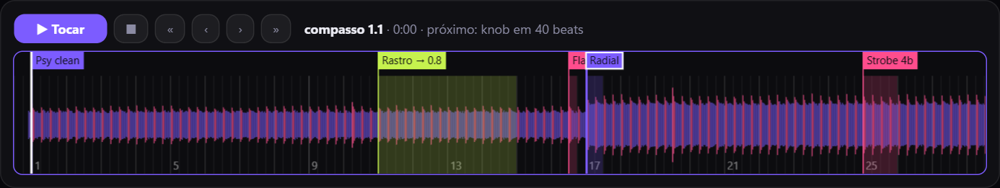

| Na timeline | Faz |
|---|---|
| **Duplo clique** | Cria um ponto no beat (com **Shift**, no compasso). |
| **Clique** num ponto | Seleciona o ponto, que você edita na aba Roteiro. |
| **Arrastar** um ponto | Muda o ponto de lugar (com **Shift**, de compasso em compasso). |
| **Clique** no fundo | Leva o cursor (linha branca) até ali. |
| **Arrastar** o fundo / **roda** | Rola / dá zoom. |
| **Delete** | Apaga o ponto selecionado. |

Cada ponto é de um tipo (a cor na timeline mostra qual):

| Tipo | O que faz |
|---|---|
| **Cena** (roxo) | Chama uma das 8 cenas, com crossfade de N beats. |
| **Efeito** (rosa) | **Strobe** (1/1, 1/2 ou 1/4) por N beats, **Flash** (um clarão no beat), **Blackout** ou **Só logo** por N beats. Depois volta ao que estava. |
| **Vídeo** (azul) | Troca o vídeo de fundo, de forma instantânea (o telão já deixa carregado). |
| **Knob** (verde) | Leva um ajuste (rastro, glow, zoom, matiz…) até um valor em N beats, como uma automação. |

Os pontos ficam marcados **em beats**, não em segundos. Por isso o mesmo roteiro funciona
mesmo se o DJ mexer no pitch.

### Rodar: quem toca a música?

**O app toca** (*O app*). Bom para abertura, intro gravada ou apresentação.

1. Escolha a **saída de áudio** (por exemplo, a que vai para a mesa).
2. Posicione o cursor e clique em **▶ Tocar** (ou **G**). O app toca o arquivo e os pontos
   disparam exatamente no tempo.
3. Clicar na timeline durante a música pula para aquele ponto. O visual já assume a cena e o
   vídeo daquele trecho.

**O DJ toca nos decks** (*O DJ (GO)*). O app não sabe onde a música está, então você avisa
com o **GO**:

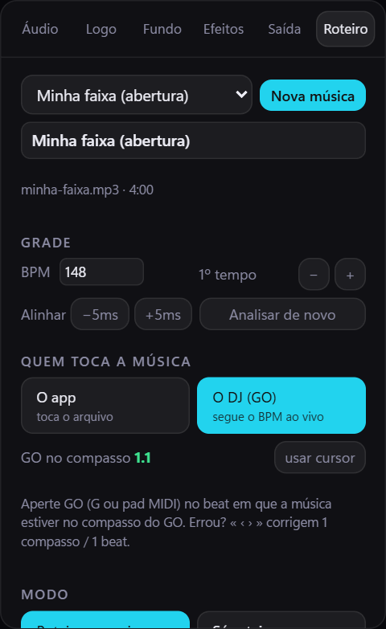

1. Escolha o **compasso do GO**, por exemplo o 1º compasso ou o primeiro drop. Coloque o
   cursor lá e clique em **usar cursor**.
2. Com a música tocando e o **BPM travado**, aperte **GO** (**G** ou um pad MIDI) **no beat**
   em que a música chega naquele compasso.
3. Daí em diante, o roteiro anda junto com o BPM ao vivo, mesmo com o pitch mexido.
4. Errou o GO? **‹ ›** corrigem 1 beat e **« »** corrigem 1 compasso (teclas **, .** e **; '**).

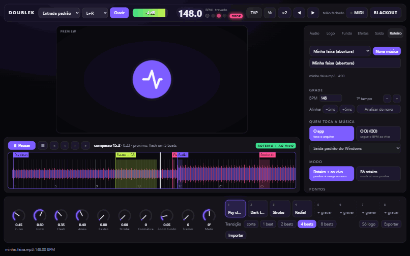

### Modo

- **Roteiro + ao vivo:** os pontos disparam e o visual continua reagindo ao som (pulso,
  anéis, espectro). Os knobs, as cenas e o MIDI também continuam funcionando.
- **Só roteiro:** o visual muda **apenas nos pontos marcados** e não reage ao som. Bom para
  um show "coreografado", que fica igual toda vez.
- **Só o som:** a música toca, mas os pontos **não** disparam: o visual só reage ao áudio,
  do jeito que ficaria ao vivo sem roteiro.

### Comparar na hora: com roteiro × só o som

Toque a música pelo app e aperte **R** (ou o botão **Com roteiro / Só o som** na barra da
timeline) **com a música tocando**. O telão troca na hora entre o visual do roteiro e o visual
só reagindo ao som, no mesmo trecho da música. Assim dá para decidir se um ponto vale a pena
ou se o som sozinho já resolve.

| Com roteiro (no drop entra a cena "Radial") | Só o som (mesmo trecho, sem os pontos) |
|---|---|
| 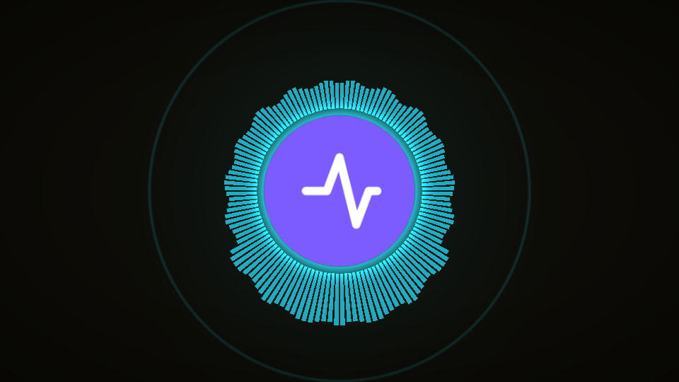 | 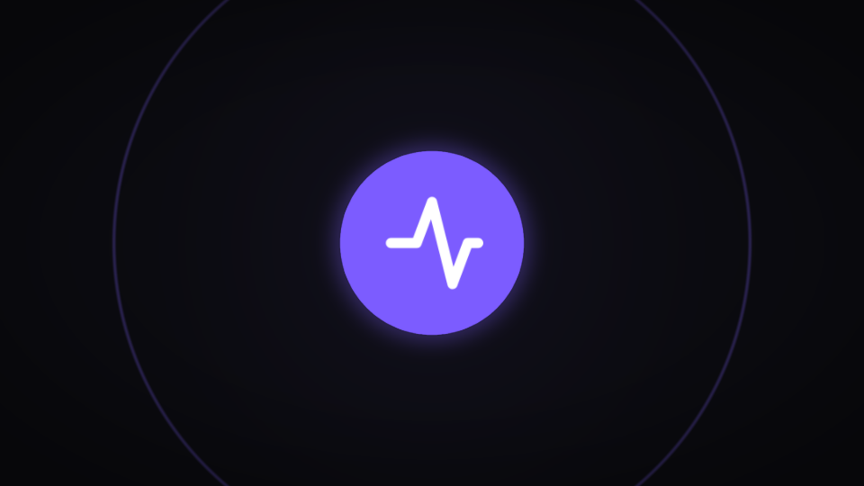 |

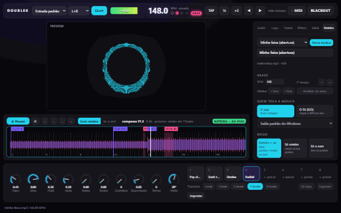

Voltar para o roteiro aplica na hora a cena e o vídeo daquele trecho. O modo também pode ser
trocado na aba Roteiro, a qualquer momento.

**Exportar / Importar** salvam o roteiro em `.json`, sem a música. Para levar a outro
computador, importe o roteiro e use **Trocar música** para apontar o arquivo de novo.

**Ponto de cena de outro banco:** ao editar um ponto de cena, escolha "Banco aberto na hora"
(o pad do banco que estiver aberto quando o ponto passar, como sempre foi) ou um banco fixo.
Com banco fixo, o app abre esse banco na hora do ponto e chama a cena; na timeline o ponto
aparece como "B2·nome". **Reset** desfaz na hora os efeitos do roteiro que estiverem rodando
(strobe, blackout, só logo) e para as rampas de knob, mas o roteiro continua; **PÂNICO** faz o
mesmo e para o roteiro. Tudo o que o roteiro faz fica registrado no Diagnóstico.

---

## 17. Controlador MIDI

Qualquer controlador MIDI USB funciona (Korg nanoKONTROL, Akai LPD8/MPD, Novation Launch
Control, Arturia BeatStep…).

### Mapear (MIDI learn)

1. Ligue o controlador no USB. Pode ser com o app aberto: ele aparece em até 2 segundos.
2. Clique em **MIDI** no topo. Os controles que podem ser mapeados ficam com contorno
   tracejado.
3. **Clique no controle da tela** que você quer comandar. Ele fica piscando em rosa
   ("armado").
4. **Mexa no knob ou aperte o pad** do controlador. Aparece um selo, como **CC16** ou **N41**,
   no controle da tela.
5. Repita para os outros controles. No fim, clique em **Concluir** (ou **Esc**).


**O que dá para mapear:**

- os 10 knobs de performance e os sliders das abas Logo, Fundo, Efeitos e Saída;
- as 8 cenas;
- TAP, ½, ×2, ◀, ▶, BLACKOUT e Só logo.

**Como cada tipo de controle responde:**

- **Knob/fader do controlador** em um ajuste contínuo: o curso todo (0 a 127) vira a faixa
  toda do ajuste.
- **Pad/botão** numa ação ou cena: dispara ao apertar. Funciona tanto com controlador que
  manda *nota* quanto com o que manda *CC 127/0*.

**Trocar ou apagar:** com o modo MIDI ligado, clique no controle e mexa em outro knob
(substitui o anterior), ou clique em **Apagar mapeamento**.

O LED ao lado de "MIDI" pisca toda vez que chega uma mensagem do controlador. É o jeito
rápido de saber se ele está conectado.

### Atenção: controladora de DJ

No Windows, **só um programa por vez** consegue abrir um aparelho MIDI. Se a sua
controladora de DJ já está no Rekordbox ou no Serato, ela aparece como **"(ocupado)"** no
DoubleK. Para o visual, use um **controlador separado** (um pequeno e barato já resolve).

> Se o knob do controlador estiver numa posição diferente do knob da tela, o valor **pula**
> para a posição do controlador no primeiro movimento. Antes de começar, deixe os knobs na
> posição dos da tela.

### MIDI Clock: o BPM vindo do equipamento do DJ

Se o mixer, a CDJ ou o software do DJ (Traktor, Rekordbox, Ableton) manda **MIDI Clock** para
uma porta que o DoubleK está usando, o app passa a seguir o andamento do equipamento em vez de
adivinhar pelo som, e a bolinha de BPM mostra **MIDI CLK**. Quando o equipamento manda
**Start**, o 1º tempo também vem dele. Se o clock parar de chegar, depois de 2 segundos o app
volta a ouvir o som sozinho, já no andamento certo. A porta precisa estar livre (veja a nota
acima sobre "(ocupado)"); um cabo MIDI ou interface USB-MIDI separado resolve. Detalhes e roteiro
de teste em [docs/MIDI-CLOCK.md](MIDI-CLOCK.md).

---

### Controlar pela rede (OSC)

Programas como TouchOSC, Pure Data, Max ou qualquer coisa que fale **OSC** podem mandar
comandos para o app. Na aba **Saída**, seção **OSC (rede)**: escolha a porta (padrão 9000) e
clique em **Ligar OSC**. Por padrão o app só escuta o próprio computador (`127.0.0.1`); para um
tablet na mesma rede, marque **Abrir para a rede local** antes de ligar e leia o aviso: **não
há senha** — quem estiver no mesmo Wi-Fi controla o show. Use só em rede sua, e desligue
quando não precisar. O Windows pode perguntar sobre o firewall na primeira vez.

Os endereços seguem `/doublek/v1/...` e cobrem tudo o que o teclado e o MIDI fazem: cenas
(`/doublek/v1/scene/3`), bancos, macros, blackout, "só logo", PÂNICO, TAP, nudge, qualquer
knob (`/doublek/v1/parameter/trail 0.5`) e o roteiro (go, stop). A lista completa, com tipos e
faixas, está em [docs/OSC.md](OSC.md). Com o servidor ligado, a seção mostra **recebidas ·
descartadas · recusadas** (descartadas = acima de 200 por segundo; recusadas = endereço ou
valor inválido, que também aparecem no diário do Diagnóstico). Comando por OSC não pausa a
automação do Intelligent Show (é tratado como outro programa, não como a sua mão); PÂNICO e
BLACKOUT por OSC têm a mesma prioridade de sempre.

### Celular na mesma rede

Dá para comandar o show pelo celular, sem instalar nada: na aba **Saída**, seção **Celular
(rede)**, marque **Abrir para a rede local**, clique em **Ligar** e depois em **Mostrar código**.
No celular (no mesmo Wi-Fi), abra o endereço que aparece (`http://IP-do-notebook:8008`) e digite
os 6 dígitos. O código vale 2 minutos e uma vez só; depois de 5 tentativas erradas o pareamento
trava por 1 minuto.

| 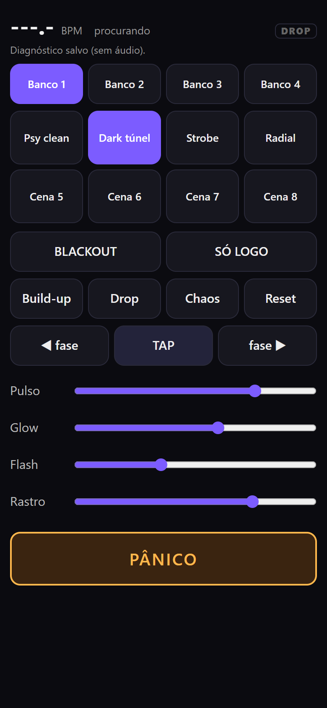 | 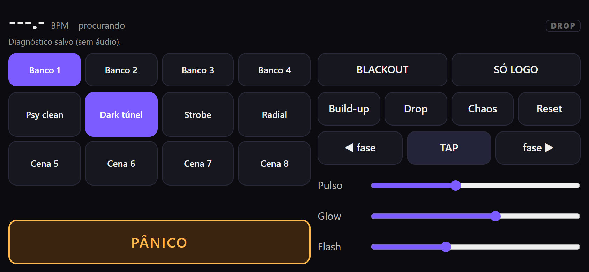 |
|---|---|

A tela do celular mostra o BPM, o estado da música e o DROP, e tem: os bancos e os 8 pads com os
nomes das cenas (o pad aceso é a cena no telão), **BLACKOUT** e **SÓ LOGO**, as 4 macros, **TAP**
e ajuste de fase (◀ ▶), quatro sliders (pulso, glow, flash, rastro) e o **PÂNICO**, grande e
separado. Se o celular perder o app (Wi-Fi caiu, app fechado), aparece uma faixa "sem conexão" e
os botões ficam desligados até voltar; o show no notebook continua normal.

**Desconectar todos** derruba os celulares na hora, e fechar o app também. Enquanto alguém
comanda pelo celular, um aviso laranja aparece no rodapé. A rede local não é criptografada: use
só em Wi-Fi seu. O Windows pode perguntar sobre o firewall na primeira vez. Detalhes de
segurança em [docs/REMOTO.md](REMOTO.md).

## 18. Atalhos do teclado

| Tecla | Ação |
|---|---|
| **Espaço** | TAP (bater o tempo) |
| **← / →** | Adiantar / atrasar a fase 5 ms (segurar repete) |
| **1 … 8** | Chamar cena (no modo Preview: preparar) |
| **Shift + 1 … 8** | Preparar a cena no Preview, sem o telão ver |
| **T** / **Shift + T** | TAKE (manda o Preview para o telão no próximo beat) / limpar o Preview |
| **V** | Ligar/desligar o modo Preview dos pads |
| **[ / ]** | Banco anterior / próximo |
| **Alt + 1 … 4** | Abrir o banco 1 a 4 |
| **U / D / C / X** | Macros Build-up / Drop / Caos / Reset |
| **A** | Automação: Manual → Assistido → Automático |
| **B** | Blackout (apaga o telão) |
| **P** | Pânico (para o roteiro e zera os efeitos agressivos) |
| **L** | Só logo |
| **F** | Abrir/fechar o telão |
| **G** | Roteiro: tocar / pausar (o app toca) ou **GO** (o DJ toca) |
| **Shift + G** | Roteiro: parar |
| **, / .** | Roteiro: −1 / +1 beat |
| **; / '** | Roteiro: −1 / +1 compasso |
| **R** | Roteiro: compara com roteiro × só o som (com a música tocando) |
| **Esc** | Sair do modo MIDI (no controle) · fechar o telão (no telão) |

Os atalhos só valem sem **Ctrl** (ou Cmd): Ctrl+C, Ctrl+R e afins continuam com o Windows. Segurar
uma tecla não repete o comando (segurar **D** dá um Drop só); só as setas de fase repetem. Todo
comando desta tabela também tem um id para o **MIDI learn**: clique no botão correspondente com o
modo MIDI ligado (para abrir um banco pelo MIDI, abra o banco e clique em "Banco N/M"; para o
modo de automação, clique no chip de estado).

---

## 19. Checklist do dia do show

**Em casa (uma vez):**

- [ ] Logo carregada e conferida no preview.
- [ ] 3 ou 4 cenas montadas (ex.: calma, pesada, túnel, strobe) e nomeadas.
- [ ] Controlador MIDI mapeado.
- [ ] Roteiros conferidos (tocar pelo app e ver os pontos caírem no tempo).
- [ ] **Exportar** um backup do preset para um pendrive ou para a nuvem.

**Na festa (antes de abrir a pista):**

- [ ] Notebook **na tomada**, modo **Melhor desempenho**, notificações desligadas
      (Assistente de foco / Não perturbe).
- [ ] Datashow em **Estender** (Windows + P).
- [ ] Cabo do REC/BOOTH na interface → **Ouvir** → **Ganho** no ponto → **Calibrar ruído**
      com a mesa em silêncio.
- [ ] Faixa de BPM certa (Psy / Dark / Hi-tech).
- [ ] **Projetar** → conferir **60 fps**.
- [ ] Acertar o **Offset visual** olhando para o telão.
- [ ] Ter na cabeça: **B** = blackout, **L** = só logo, **Espaço** = tap.

---

## 20. Problemas e soluções

| Problema | Solução |
|---|---|
| O medidor não mexe | Confira a entrada escolhida e clique em **Ouvir** de novo. Confira se o REC/BOOTH da mesa tem volume. No Windows: Configurações → Privacidade → **Microfone** → permitir apps da área de trabalho. |
| Medidor no **CLIP** | Abaixe o **Ganho** (ou o volume do booth). |
| BPM na metade ou no dobro | Escolha a faixa certa de andamento ou use **½ / ×2**. |
| BPM pulando | Ligue **Travar BPM** quando ele estiver certo, ou dê **TAP**. |
| O pulso sai atrasado em relação ao som | **Offset visual** mais negativo (seção 14). |
| A logo pulsa com o baixo, não com o kick | Ligue **Exigir o "click" do kick** e baixe um pouco a **Sensibilidade**. |
| Logo quase parada num breakdown longo | Depois de 30 s sem kick, o app solta o BPM e a logo passa a seguir a onda da música. Suba **Seguir a música sem kick** para ela mexer mais. O BPM volta sozinho quando o kick volta. |
| Telão travando, fps baixo | Abaixe a **Resolução de render**. Feche outros programas. Deixe o notebook na tomada. |
| O telão abriu no monitor errado | Feche (**F**), escolha o outro monitor na aba **Saída** e projete de novo. |
| Efeito "só no drop" não aparece com o grave tocando | A pílula **DROP** está apagada: baixe o **Limiar do grave** (aba Áudio). |
| Roteiro no modo DJ escorregando | O BPM ao vivo não estava travado no GO. Espere travar (ou dê TAP), e corrija com **‹ ›** / **« »**. |
| Roteiro: pontos adiantados ou atrasados em relação à música | Alinhe a grade com **−5ms / +5ms**; se for um beat inteiro, **1º tempo − / +**. |
| "A saída está em … Hz" ao tocar o roteiro | A saída de áudio mudou: escolha a saída de novo na aba Roteiro (a música é preparada de novo). |
| Telão ficou preto e a bolinha do telão está vermelha | A placa de vídeo "sumiu" por um instante (driver, monitor trocado). O app recria o telão sozinho quando ela volta; se não voltar em alguns segundos, **F** duas vezes (fecha e reabre). |
| Quer relatar um problema | Clique nas **4 bolinhas** no topo: salva um `.json` de diagnóstico sem áudio. Mande esse arquivo junto com o que aconteceu. |
| "Não aceitei …: tipo não aceito / grande demais" | Limites do app: **imagem** até 25 MB (png, jpg, webp, gif, bmp, svg); **vídeo** até 600 MB (mp4, webm, mov); **música** até 300 MB e 20 min (mp3, wav, flac, m4a, aac, ogg); **preset ou roteiro** até 2 MB. Converta ou corte o arquivo. |
| Controlador aparece como "(ocupado)" | Outro programa está com ele (Rekordbox, Serato…). Use outro controlador ou feche o programa. |
| O controlador não aparece | Desplugue e plugue de novo. O app reconecta em até 2 s. |

---

## 21. Plano B

Se algo der errado no notebook do show, o app antigo em HTML continua funcionando: o arquivo
`legacy/logo-pulsante-2.0.html` abre direto no Chrome ou Edge, sem instalar nada. Vale
deixar uma cópia num pendrive.
