# Tutorial — DoubleK Visuals

Guia completo, do zero até o show: instalar, ligar os cabos, regular o som, montar o visual,
projetar no telão e operar ao vivo (inclusive com controlador MIDI).

> As imagens deste guia foram feitas com uma logo de exemplo ("DK") e um som simulado a 148 BPM.
> No seu notebook, a tela é a mesma, só que com a sua logo e a sua música.

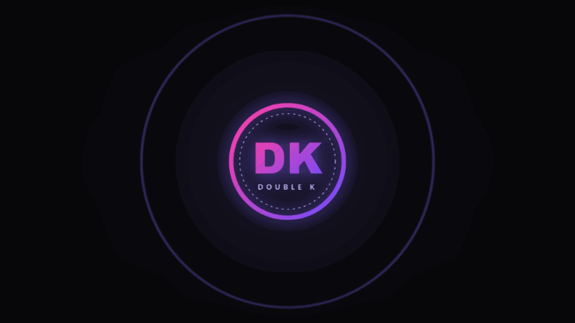

---

## Sumário

1. [Como funciona, em 30 segundos](#1-como-funciona-em-30-segundos)
2. [Instalar](#2-instalar)
3. [Ligar os cabos](#3-ligar-os-cabos)
4. [Conhecendo a tela](#4-conhecendo-a-tela)
5. [Primeiro uso: fazer o app ouvir o som](#5-primeiro-uso-fazer-o-app-ouvir-o-som)
6. [Regular a detecção do kick](#6-regular-a-detecção-do-kick)
7. [BPM e andamento](#7-bpm-e-andamento)
8. [Colocar a sua logo](#8-colocar-a-sua-logo)
9. [Fundo](#9-fundo)
10. [Efeitos](#10-efeitos)
11. [O que no som move cada efeito](#11-o-que-no-som-move-cada-efeito)
12. [Projetar no telão](#12-projetar-no-telão)
13. [Acertar o atraso do projetor (offset)](#13-acertar-o-atraso-do-projetor-offset)
14. [Cenas: trocar o visual no meio do set](#14-cenas-trocar-o-visual-no-meio-do-set)
15. [Controlador MIDI](#15-controlador-midi)
16. [Atalhos do teclado](#16-atalhos-do-teclado)
17. [Checklist do dia do show](#17-checklist-do-dia-do-show)
18. [Problemas e soluções](#18-problemas-e-soluções)
19. [Plano B](#19-plano-b)

---

## 1. Como funciona, em 30 segundos

```
 Mesa (Rec/Booth out) ──► Interface USB ──► Notebook ──► Datashow
                                             │
                                    DoubleK Visuals
                         ┌───────────────────┴───────────────────┐
                  Janela de CONTROLE                       Janela do TELÃO
                  (fica no notebook,                    (tela cheia no datashow,
                   você mexe aqui)                       só a logo e os efeitos)
```

- O app **escuta** o som que sai da mesa e acha o **kick** (o bumbo) e o **BPM**.
- Com o BPM travado, ele **prevê** onde vai cair o próximo beat. Por isso o pulso pode
  sair até um pouco *antes* do som, para compensar o atraso do projetor.
- São **duas janelas**. Você opera na do notebook e o público só vê a do telão.

---

## 2. Instalar

1. Pegue o arquivo **`DoubleK Visuals_0.1.0_x64_pt-BR.msi`**.
2. Dê dois cliques nele e siga o instalador (Avançar → Instalar → Concluir).
3. Se aparecer **"O Windows protegeu o computador"**, clique em **Mais informações** →
   **Executar assim mesmo**. O aviso aparece porque o instalador não tem assinatura digital
   paga; não é vírus.
4. O app aparece no menu Iniciar como **DoubleK Visuals**.

Precisa de Windows 10 ou 11 (64 bits). Não precisa instalar mais nada.

---

## 3. Ligar os cabos

### Opção A — Line-in pela interface de áudio (recomendado)

1. Da mesa, puxe a saída **REC OUT** ou **BOOTH OUT** para a entrada de uma
   **interface de áudio USB** (ex.: Behringer UMC, Focusrite, a placa da própria controladora).
2. Ligue a interface no notebook.
3. Deixe o volume dessa saída **fixo** durante o set. Se você mexer no volume do booth,
   o app recebe mais ou menos sinal.

Por que é a melhor opção: o sinal chega limpo, sem o barulho da pista, e o kick fica muito
mais fácil de detectar.

### Opção B — Microfone

Funciona no improviso: pode ser o microfone do notebook ou um microfone USB perto da caixa.

- Na aba **Áudio**, **desligue** "Exigir o click do kick" (seção 6), porque o microfone
  longe da caixa perde os agudos do kick.
- Use **Calibrar ruído** antes de começar (seção 5).

### O datashow

1. Ligue o datashow no HDMI do notebook.
2. Aperte **Windows + P** e escolha **Estender**. Assim o datashow vira uma "segunda tela"
   e o notebook continua mostrando o controle.

---

## 4. Conhecendo a tela

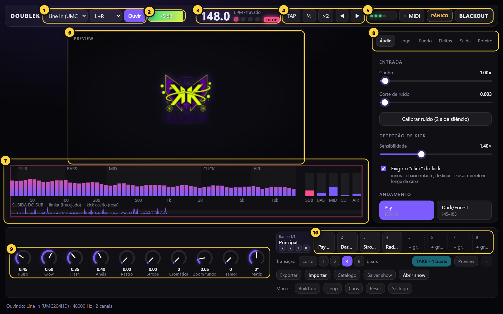

| # | O quê | Para que serve |
|---|---|---|
| 1 | **Entrada de áudio** + **Ouvir** | Escolhe de onde vem o som (interface, mic) e o canal. *Ouvir* liga a escuta. |
| 2 | **Medidor** | Nível do sinal. Verde é bom; **CLIP** vermelho quer dizer que está alto demais. |
| 3 | **BPM** + bolinhas | O andamento detectado e o estado (*procurando / ajustando / travado / segurando*). As 4 bolinhas andam no compasso. |
| 4 | **TAP ½ ×2 ◀ ▶** | Ajuste manual do andamento (seção 7). |
| 5 | **MIDI** e **BLACKOUT** | Liga o modo de mapear o controlador (seção 15) e apaga o telão na hora. Ao lado aparece o fps do telão. |
| 6 | **Preview** | O mesmo visual que está no telão, em tamanho pequeno. |
| 7 | **Analisador** | Mostra o que o app está ouvindo e cada kick que ele aceitou (seção 6). |
| 8 | **Abas de ajuste** | Áudio, Logo, Fundo, Efeitos e Saída. |
| 9 | **Knobs de performance** | Os 10 efeitos mais usados ao vivo, sempre à mão. |
| 10 | **Cenas** | 8 visuais prontos para trocar com crossfade no beat (seção 14). |

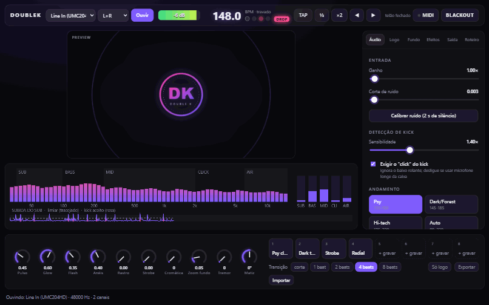

**Como mexer nos controles:**

- **Sliders:** arraste. **Duplo clique** volta ao valor padrão.
- **Knobs:** arraste para cima ou para baixo, ou use a roda do mouse.
  Segure **Shift** para ajuste fino. **Duplo clique** volta ao padrão.
- **Tudo é salvo sozinho.** Fechou e abriu o app, está tudo como você deixou.

---

## 5. Primeiro uso: fazer o app ouvir o som

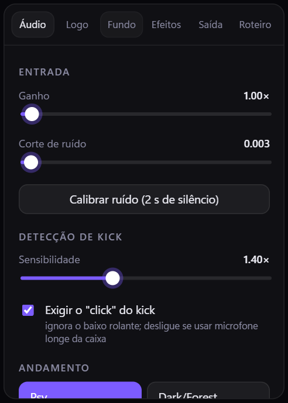

1. No topo, escolha a **entrada** (ex.: *Line In (UMC204HD)*) e o canal (**L+R** serve para
   quase tudo).
2. Clique em **Ouvir**. Embaixo aparece "Ouvindo: …".
3. Solte uma música. O **medidor** (2) deve mexer.
4. Ajuste o **Ganho** até o medidor ficar entre **−12 dB e −3 dB** nos trechos fortes,
   **sem** chegar no CLIP.
5. Com a música **parada**, clique em **Calibrar ruído (2 s de silêncio)**. O app mede o
   chiado da linha e define o **Corte de ruído**. Abaixo desse nível, ele ignora o som.

> O app lembra a entrada escolhida. Da próxima vez, ele já começa a ouvir sozinho.
> Se a interface for desplugada, ele tenta reconectar a cada segundo.

---

## 6. Regular a detecção do kick

O analisador é onde você vê se o app está "entendendo" a música:

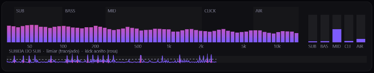

- **Em cima:** o espectro, do grave (esquerda) ao agudo (direita), dividido em SUB, BASS,
  MID, CLICK e AIR.
- **À direita:** um medidor por banda. O **SUB fica rosa** a cada kick aceito.
- **Embaixo:** a linha da "subida do sub" contra o **limiar tracejado**. Cada **traço rosa**
  é um kick que o app aceitou.

**O certo é:** um traço rosa por beat, certinho, sem traços no meio.

| O que você vê | O que fazer |
|---|---|
| Faltam kicks (beats sem traço rosa) | Aumente a **Sensibilidade**. |
| Traços a mais, entre os kicks (o app está pegando o baixo rolante) | Diminua a **Sensibilidade** e confira se **Exigir o "click" do kick** está ligado. |
| Nada detecta, nem com sensibilidade alta, usando microfone | **Desligue** "Exigir o click" e suba o **Ganho**. |

**Por que existe o "click":** no psytrance, o baixo rolante (K-B-B-B) bate na mesma região
grave do kick. A diferença é que o kick tem um estalo agudo (o "click") e o baixo não.
Exigindo os dois juntos, o app ignora o baixo.

---

## 7. BPM e andamento

Na aba **Áudio**, em **Andamento**, escolha a faixa do estilo que você vai tocar:

| Faixa | BPM | Quando usar |
|---|---|---|
| **Psy** | 135–150 | Psytrance, full-on, progressive |
| **Dark/Forest** | 145–185 | Dark, forest, night |
| **Hi-tech** | 175–220 | Hi-tech, psycore |
| **Auto** | 80–220 | Set misturado. Pode confundir metade e dobro. |

Escolher a faixa certa evita o erro clássico de o app achar 74 em vez de 148.

**Estados do BPM** (ao lado do número):

- **procurando**: ainda não achou o andamento.
- **ajustando**: achou, mas os kicks ainda estão irregulares.
- **travado**: firme. O número fica branco e brilha. A partir daqui, o pulso é **previsto**.
- **segurando (sem kick)**: veio um breakdown sem kick. O app segura o andamento por até
  30 segundos, para o visual não morrer no meio da música.

**Botões manuais** (no topo):

| Botão | Tecla | O que faz |
|---|---|---|
| **TAP** | Espaço | Bata no tempo (4 ou mais toques) para dar o andamento na mão. |
| **½** | — | O app achou o dobro? Divide por 2. |
| **×2** | — | O app achou a metade? Multiplica por 2. |
| **◀** | ← | Puxa a fase do beat 5 ms para trás (adianta o pulso). |
| **▶** | → | Empurra a fase 5 ms para frente (atrasa o pulso). |

**Travar BPM:** com a opção ligada, o número não muda mais. Só a fase continua acompanhando
os kicks. Use quando o BPM estiver certo e você não quiser que ele oscile.

---

## 8. Colocar a sua logo

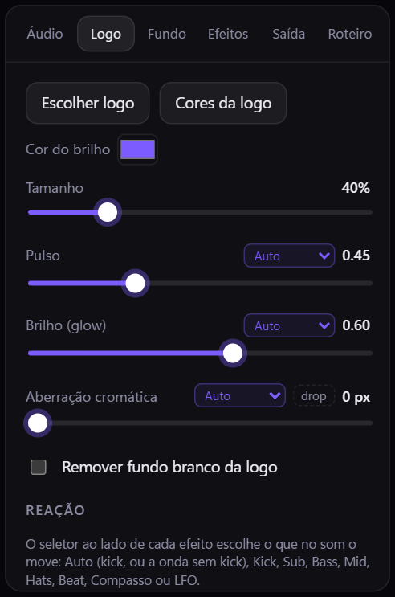

1. Aba **Logo** → **Escolher logo**. Escolha um PNG com fundo transparente (o ideal) ou um
   JPG/PNG com fundo branco.
2. Se o fundo for branco, marque **Remover fundo branco da logo** e ajuste a
   **Tolerância do branco** até sumir o fundo sem comer a logo.
3. **Cor do brilho:** a cor do glow em volta da logo. Ela também vira a cor de destaque da
   janela de controle.

| Ajuste | O que faz |
|---|---|
| **Tamanho** | Tamanho da logo no telão (% da altura da tela). |
| **Pulso** | Quanto a logo cresce a cada kick. |
| **Brilho (glow)** | A aura de luz em volta da logo. |
| **Aberração cromática** | Separa o vermelho e o azul nas bordas: efeito "glitch" no beat. |
| **Duração do pulso** | Quanto tempo o pulso leva para voltar. Curto = seco; longo = macio. |
| **Seguir a música sem kick** | Nos trechos sem kick, a logo continua respirando com a música. |

> A logo fica salva dentro do app. Pode apagar ou mover o arquivo original depois.

---

## 9. Fundo

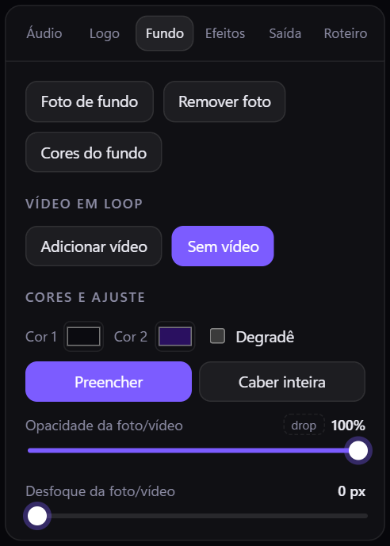

- **Cor 1 / Cor 2 / Degradê:** um fundo liso ou em degradê, com ângulo ajustável.
- **Foto de fundo:** escolha uma imagem, ou **arraste a imagem para cima da janela**.
  *Preencher* corta para cobrir a tela toda; *Caber inteira* mostra a foto inteira.
- **Cores da foto (automático):** ao escolher a foto, o app tira dela a cor mais viva para o
  **brilho** (glow, anéis, flash e espectro) e as **Cor 1 / Cor 2** do fundo. Mudou as cores
  na mão e quer voltar às da foto? Clique em **Cores da foto**.
- **Opacidade, Desfoque e Brilho da foto:** para a foto não brigar com a logo.
  Escurecer e desfocar um pouco costuma ficar ótimo.
- **Girar matiz:** as cores do fundo giram sem parar (graus por segundo).
- **Zoom do fundo / Brilho do fundo:** o fundo "respira" junto com o beat.

---

## 10. Efeitos

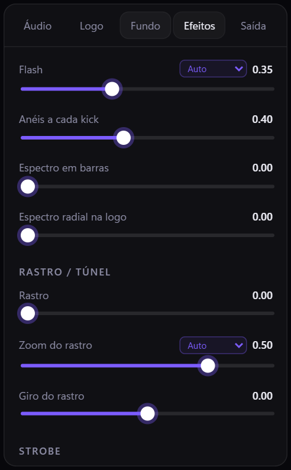

| Efeito | O que faz |
|---|---|
| **Flash** | A tela clareia a cada kick. |
| **Anéis a cada kick** | Ondas de anel saindo da logo. |
| **Espectro em barras** | Barras do espectro na base da tela. |
| **Espectro radial na logo** | As barras em círculo em volta da logo (veja a cena "Radial"). |
| **Rastro** | Cada quadro deixa um rastro. Junto com o zoom, vira um **túnel**. |
| **Zoom do rastro / Giro do rastro** | Para onde o rastro anda: para dentro, para fora, girando. |
| **Strobe** + 1/1, 1/2, 1/4 | Pisca no tempo: a cada beat, a cada meio beat ou a cada quarto de beat. |
| **Vinheta** | Escurece os cantos. |
| **Linhas de TV / Granulado** | Textura de tela antiga e de filme. |
| **Tremor** | A imagem treme no kick. |

Exemplos de cenas que já vêm prontas:

| Dark túnel | Radial | Strobe |
|---|---|---|
| 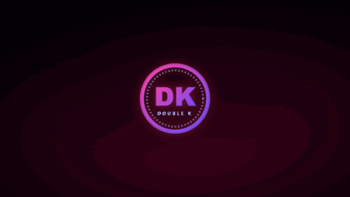 | 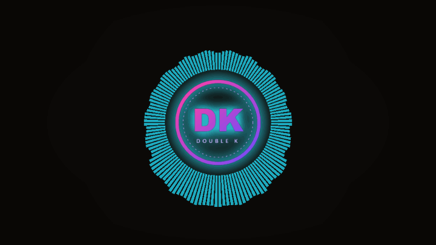 | 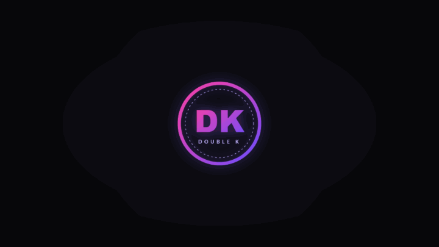 |

> ⚠️ **Strobe:** cuidado com a intensidade. Luz piscando rápido pode causar mal-estar e, em
> pessoas sensíveis, crises de epilepsia fotossensível.

---

## 11. O que no som move cada efeito

Ao lado de vários ajustes há um seletor pequeno, em roxo. Ele escolhe **qual parte da música
move aquele efeito**:

| Fonte | Reage a |
|---|---|
| **Auto** | Ao kick. Quando não tem kick, à onda da música. (Padrão.) |
| **Kick** | Só ao kick. |
| **Sub** | Ao grave profundo (35–100 Hz). |
| **Bass** | Ao baixo (100–250 Hz), ou seja, ao baixo rolante do psy. |
| **Mid** | Aos médios: synths e leads. |
| **Hats** | Aos agudos: chimbal e percussão. |
| **Beat** | A uma onda regular, uma por beat (mesmo sem kick). |
| **Compasso** | A uma onda lenta, uma a cada 4 beats. |
| **LFO** | A uma onda lenta e contínua, que não depende da música. |

Ideias: **Glow → Bass** (a aura vibra com o baixo rolante), **Aberração → Hats**
(o glitch acompanha o chimbal), **Zoom do fundo → Compasso** (o fundo respira devagar).

---

## 12. Projetar no telão

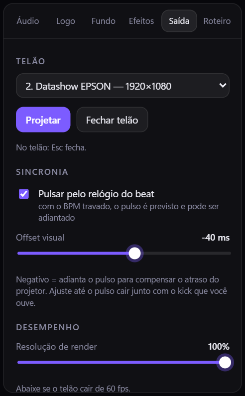

1. Confira se o datashow está em **Estender** (Windows + P).
2. Aba **Saída** → escolha o monitor do datashow na lista.
3. Clique em **Projetar** (ou aperte **F**).
   A janela abre em tela cheia no datashow, sem bordas e sem cursor.
4. No topo do controle aparece **TELÃO 60 fps**. Se cair muito abaixo de 60, abaixe a
   **Resolução de render** (ex.: 75%).
5. Para fechar: **Fechar telão**, **F** no controle, ou **Esc** com o mouse no telão.

> Enquanto o telão está aberto, o Windows não apaga a tela nem entra em descanso.
> Mesmo assim, deixe o notebook **na tomada** e no modo de energia **Melhor desempenho**.

---

## 13. Acertar o atraso do projetor (offset)

Todo projetor atrasa a imagem (30 a 80 ms é comum). Se nada for feito, o pulso parece
chegar "depois" do kick. Como o app prevê o beat, dá para **adiantar** o pulso.

1. Toque uma faixa com kick bem marcado e espere o BPM ficar **travado**.
2. Olhe para o **telão** (não para o preview) e escute o kick.
3. Na aba **Saída**, mexa no **Offset visual**:
   - O pulso vem **depois** do kick → deixe **mais negativo** (−50, −60…).
   - O pulso vem **antes** do kick → deixe **menos negativo** (−30, −20…).
4. Achou o ponto em que os dois "colam"? Pronto. Esse valor vale para esse projetor.

Para o ajuste fino durante o set, use **◀ ▶** (ou as setas do teclado). Cada toque desloca
5 ms.

> **Pulsar pelo relógio do beat** precisa estar ligado para o offset funcionar. Desligado,
> o pulso segue o kick detectado na hora: não dá para adiantar, mas também não depende do BPM.

---

## 14. Cenas: trocar o visual no meio do set

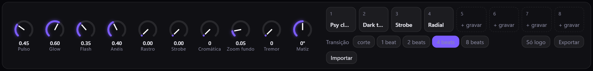

Uma **cena** é uma "foto" de todo o visual: cores, efeitos e fundo. São 8 posições.

| Ação | Como |
|---|---|
| **Chamar** uma cena | Clique no pad, ou as teclas **1** a **8**. |
| **Gravar** o visual atual | Clique num pad vazio (**+ gravar**), ou **Shift + clique** num pad cheio (grava por cima). |
| **Renomear** | Duplo clique no pad. |
| **Transição** | *corte* (na hora) ou 1/2/4/8 beats de crossfade. |

O crossfade **começa no próximo beat** e dura o número de beats escolhido. Assim, a troca de
visual entra na música, não fora dela. A barrinha rosa embaixo do pad mostra o progresso.

**Só logo (L):** desliga todos os efeitos e deixa só a logo pulsando. Bom para os momentos
calmos.

**BLACKOUT (B):** apaga o telão com um fade curto. Aperte de novo para voltar.

**Exportar / Importar:** salva o visual e as 8 cenas num arquivo `.json`. Serve para fazer
backup, levar para outro notebook ou ter um arquivo para cada tipo de festa.

> O que **não** entra na cena: offset, resolução, recorte da logo, blackout e só logo.
> São ajustes do lugar e da operação, não do visual.

---

## 15. Controlador MIDI

Qualquer controlador MIDI USB funciona (Korg nanoKONTROL, Akai LPD8/MPD, Novation Launch
Control, Arturia BeatStep…).

### Mapear (MIDI learn)

1. Ligue o controlador no USB. Pode ser com o app aberto: ele aparece em até 2 segundos.
2. Clique em **MIDI** no topo. Os controles que podem ser mapeados ficam com contorno
   tracejado.
3. **Clique no controle da tela** que você quer comandar. Ele fica piscando em rosa
   ("armado").
4. **Mexa no knob ou aperte o pad** do controlador. Aparece um selo, como **CC16** ou **N41**,
   no controle da tela.
5. Repita para os outros controles. No fim, clique em **Concluir** (ou **Esc**).

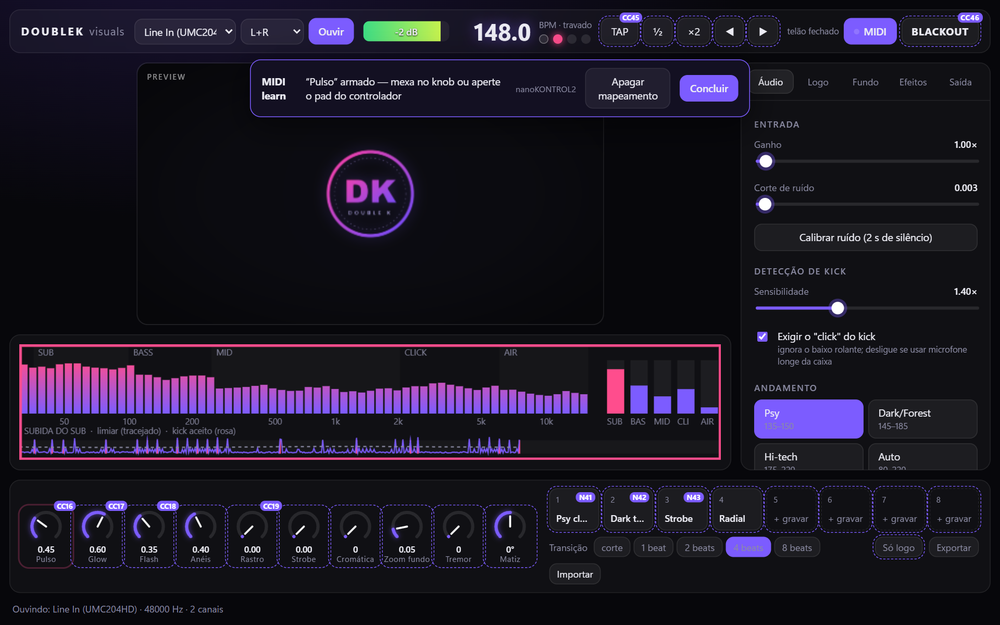

**O que dá para mapear:**

- os 10 knobs de performance e os sliders das abas Logo, Fundo, Efeitos e Saída;
- as 8 cenas;
- TAP, ½, ×2, ◀, ▶, BLACKOUT e Só logo.

**Como cada tipo de controle responde:**

- **Knob/fader do controlador** em um ajuste contínuo: o curso todo (0 a 127) vira a faixa
  toda do ajuste.
- **Pad/botão** numa ação ou cena: dispara ao apertar. Funciona tanto com controlador que
  manda *nota* quanto com o que manda *CC 127/0*.

**Trocar ou apagar:** com o modo MIDI ligado, clique no controle e mexa em outro knob
(substitui o anterior), ou clique em **Apagar mapeamento**.

O LED ao lado de "MIDI" pisca toda vez que chega uma mensagem do controlador. É o jeito
rápido de saber se ele está conectado.

### Atenção: controladora de DJ

No Windows, **só um programa por vez** consegue abrir um aparelho MIDI. Se a sua
controladora de DJ já está no Rekordbox ou no Serato, ela aparece como **"(ocupado)"** no
DoubleK. Para o visual, use um **controlador separado** (um pequeno e barato já resolve).

> Se o knob do controlador estiver numa posição diferente do knob da tela, o valor **pula**
> para a posição do controlador no primeiro movimento. Antes de começar, deixe os knobs na
> posição dos da tela.

---

## 16. Atalhos do teclado

| Tecla | Ação |
|---|---|
| **Espaço** | TAP (bater o tempo) |
| **← / →** | Adiantar / atrasar a fase 5 ms |
| **1 … 8** | Chamar cena |
| **B** | Blackout |
| **L** | Só logo |
| **F** | Abrir/fechar o telão |
| **Esc** | Sair do modo MIDI (no controle) · fechar o telão (no telão) |

---

## 17. Checklist do dia do show

**Em casa (uma vez):**

- [ ] Logo carregada e conferida no preview.
- [ ] 3 ou 4 cenas montadas (ex.: calma, pesada, túnel, strobe) e nomeadas.
- [ ] Controlador MIDI mapeado.
- [ ] **Exportar** um backup do preset para um pendrive ou para a nuvem.

**Na festa (antes de abrir a pista):**

- [ ] Notebook **na tomada**, modo **Melhor desempenho**, notificações desligadas
      (Assistente de foco / Não perturbe).
- [ ] Datashow em **Estender** (Windows + P).
- [ ] Cabo do REC/BOOTH na interface → **Ouvir** → **Ganho** no ponto → **Calibrar ruído**
      com a mesa em silêncio.
- [ ] Faixa de BPM certa (Psy / Dark / Hi-tech).
- [ ] **Projetar** → conferir **60 fps**.
- [ ] Acertar o **Offset visual** olhando para o telão.
- [ ] Ter na cabeça: **B** = blackout, **L** = só logo, **Espaço** = tap.

---

## 18. Problemas e soluções

| Problema | Solução |
|---|---|
| O medidor não mexe | Confira a entrada escolhida e clique em **Ouvir** de novo. Confira se o REC/BOOTH da mesa tem volume. No Windows: Configurações → Privacidade → **Microfone** → permitir apps da área de trabalho. |
| Medidor no **CLIP** | Abaixe o **Ganho** (ou o volume do booth). |
| BPM na metade ou no dobro | Escolha a faixa certa de andamento ou use **½ / ×2**. |
| BPM pulando | Ligue **Travar BPM** quando ele estiver certo, ou dê **TAP**. |
| O pulso sai atrasado em relação ao som | **Offset visual** mais negativo (seção 13). |
| A logo pulsa com o baixo, não com o kick | Ligue **Exigir o "click" do kick** e baixe um pouco a **Sensibilidade**. |
| Logo quase parada num breakdown longo | Depois de 30 s sem kick, o app solta o BPM e a logo passa a seguir a onda da música. Suba **Seguir a música sem kick** para ela mexer mais. O BPM volta sozinho quando o kick volta. |
| Telão travando, fps baixo | Abaixe a **Resolução de render**. Feche outros programas. Deixe o notebook na tomada. |
| O telão abriu no monitor errado | Feche (**F**), escolha o outro monitor na aba **Saída** e projete de novo. |
| Controlador aparece como "(ocupado)" | Outro programa está com ele (Rekordbox, Serato…). Use outro controlador ou feche o programa. |
| O controlador não aparece | Desplugue e plugue de novo. O app reconecta em até 2 s. |

---

## 19. Plano B

Se algo der errado no notebook do show, o app antigo em HTML continua funcionando: o arquivo
`legacy/logo-pulsante-2.0.html` abre direto no Chrome ou Edge, sem instalar nada. Vale
deixar uma cópia num pendrive.
